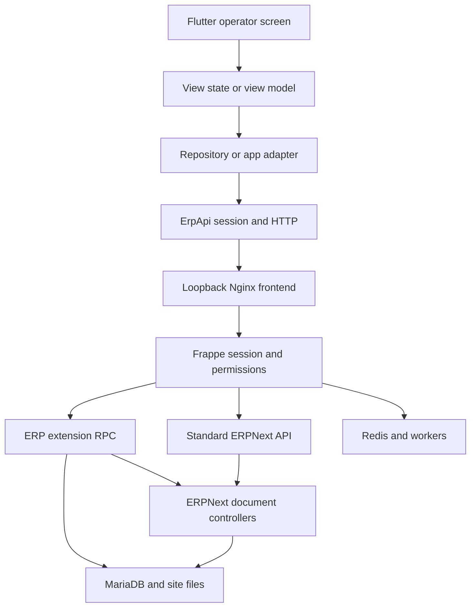
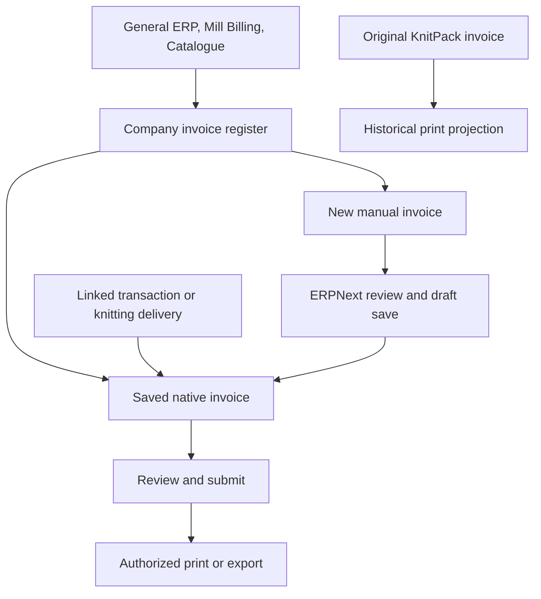
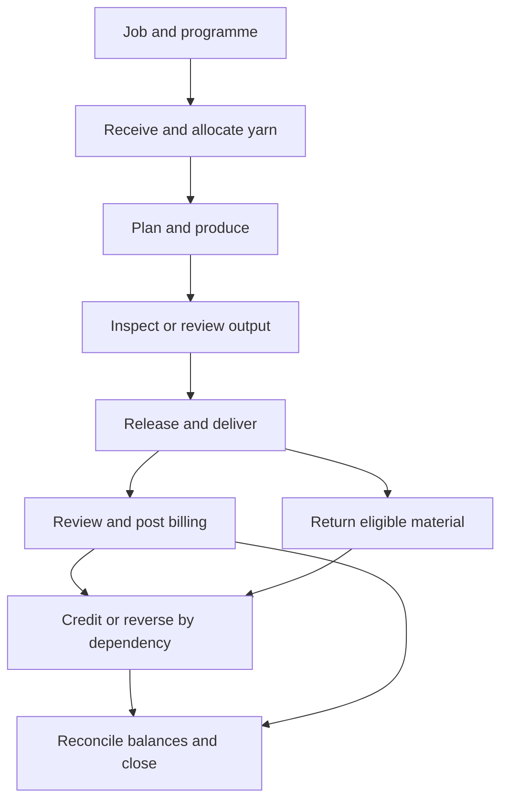
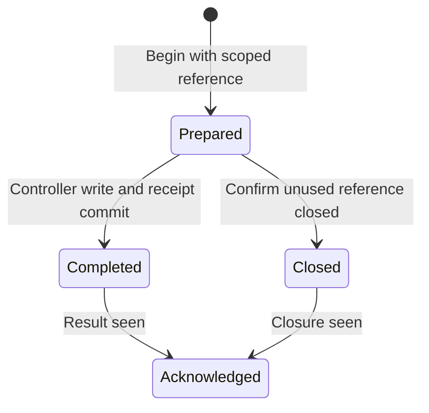

# ERP Workspace technical reference

**Source snapshot** • 18 November 2026, India • `feature/knitting-industry-pack` • base commit `73ae4e4cdb75aedbe0705c0679390aef51ffb4f2` plus the working-tree changes present at review.

ERP Workspace is a Flutter application for operating an ERPNext business from macOS, Windows, iOS and Android targets. It has a General ERP experience, a company-enabled knitting industry pack, and a separate knitting customer build. Frappe authenticates requests and enforces access. ERPNext runs the document controllers that post standard stock and accounting entries. A Python extension adds the native API, invoice tooling, knitting rules and historical import support. These are three layers of one product.

**Delivery position.** This checkout contains working native screens and server paths with prior connected synthetic evidence. The November 18 receipts also record unresolved historical data scope, final connected acceptance and installed-device checks. A preview window, a compiled target, a saved backup and a verified posting are different pieces of evidence. Section 15 gives the result of each.

## Contents

1. [Product scope and editions](#1-product-scope-and-editions)
2. [Technology and repository layout](#2-technology-and-repository-layout)
3. [Runtime and request flow](#3-runtime-and-request-flow)
4. [Flutter architecture and design system](#4-flutter-architecture-and-design-system)
5. [Identity, company access and onboarding](#5-identity-company-access-and-onboarding)
6. [General ERP feature map](#6-general-erp-feature-map)
7. [Metadata-driven screens and native documents](#7-metadata-driven-screens-and-native-documents)
8. [Shared invoice workflow and stationery](#8-shared-invoice-workflow-and-stationery)
9. [Banking, accounting and checkout](#9-banking-accounting-and-checkout)
10. [Knitting operations](#10-knitting-operations)
11. [Historical KnitPack records and migration](#11-historical-knitpack-records-and-migration)
12. [Persistence, operations and failure recovery](#12-persistence-operations-and-failure-recovery)
13. [Local deployment and platform builds](#13-local-deployment-and-platform-builds)
14. [Maintenance, CI and licensing](#14-maintenance-ci-and-licensing)
15. [Verification and open acceptance](#15-verification-and-open-acceptance)
16. [Trace a change through the system](#16-trace-a-change-through-the-system)
17. [Source inventories](#17-source-inventories)

## 1. Product scope and editions

| Surface | What opens | Identity and records |
| --- | --- | --- |
| Original ERPNext Desk | Browser UI on the evaluation origin, port 8080 | Preserved ERPNext/Frappe implementation, original record forms and browser workflows. Evaluation site and credentials are local. |
| ERP Workspace Local | General ERP on macOS from the current named launcher, port 8081 | `erp-workspace.command` builds with local workspace mode and the General-only profile. The current launcher provisions a General company profile. Shared or older development profiles can contain a separate synthetic General and knitting company. |
| ERP Workspace with a knitting-enabled company | Mill overview plus authorized pack pages, with access to General ERP when the company and edition allow it | The same Flutter and Python code checks the returned industry context, pack state and role capabilities. General ERP remains an entry within eligible mixed-mode companies. |
| ERP Workspace Customer | Separate macOS app identity, ordinary password sign-in, knitting navigation, port 8082 | Opens the local customer ERPNext site. The client requires the server to confirm the knitting-only company entitlement. The supporting business masters, eligible accounts workflows, Billing and Original history are available through that company context. |
| Knitting Preview and test harnesses | Offline review build or test shell with explicitly synthetic data | Useful for layout and operator interaction checks. Preview data is supplied by a fixture, with fixture-defined reads and capabilities. |

The user sees **Company** as the selected ERPNext company and access boundary. **Masters** means reusable business records such as Customer, Supplier, Item, Warehouse and Account, or knitting-specific definitions such as machine, yarn or fabric categories. **Records** means instances of those masters or transactions such as invoices, payments and stock movements. **Original history** is the read-only projection of captured KnitPack records. A label in the new app can group related work independently of the source product's menu wording. The route-by-route KnitPack comparison is tracked separately from the local navigation labels.

The product name **ERP Workspace** is provisional. AI functionality is deferred in this increment. The optional industry layer is intended to support future packs through company setup, capability checks and shell integration. The installed implementation covers knitting.

Sources [workspace README](../../README.md), [workspace setup](../../apps/erp_extensions/erp_extensions/workspace.py), [local profile loader](../../apps/erp_client/lib/core/services/local_workspace.dart), [customer launcher](../../scripts/erp-customer.command), [design review](../setup/WORKSPACE_DESIGN_REVIEW_2026-11-18.md).

## 2. Technology and repository layout

| Layer | Technology in this checkout | Responsibility |
| --- | --- | --- |
| App | Flutter 3.47.9, Dart 3.13.7, package `erp_client` version `0.2.0+2` | Native layouts, operator workflows, session coordination, permission-aware UI and output. |
| Client networking and state | Dart `HttpClient`, Flutter widgets, futures, listenables, explicit repositories and constructor injection | Frappe HTTP transport, app composition, scoped state and request lifecycle. |
| Apple host | Swift, Xcode projects and CocoaPods integration | Flutter host, plugin registration, lifecycle and accessibility bridge. Target floors are macOS 12 and iOS 15. |
| Android host | Gradle Kotlin DSL, JVM toolchain, Android runner and manifest | Flutter host, backup/transfer policy and release/debug network policy. Build minimum is API 30, target SDK follows Flutter. |
| Windows host | Generated Flutter Windows runner and CMake | Windows packaging entry point. Build evidence requires a Windows host. |
| Business server | ERPNext v16.54.0 and Frappe source v16.55.2 | Accounting, stock, buying, selling, manufacturing and other standard ERP functions. Frappe supplies DocTypes, sessions, permissions, transactions, reports and background jobs. The runtime image is pinned separately from the preserved source references. |
| Native server extension | `erp_extensions` 0.1.0, Python ≥3.11, setuptools | Native RPC methods, DocType installation, validation, state transitions, permission hooks, protected history and industry logic. |
| Storage and jobs | MariaDB 11.8, Redis 6.2 Alpine, Bench processes | MariaDB holds business documents. Site volumes hold configuration and files. Redis supplies queue and cache services. |
| Local hosting | Docker Compose, Colima, Nginx, ERPNext frontend and backend containers | Local site routing, persistent volumes, workers, scheduler and websocket service. |
| Metadata tooling | Node.js, locked parser dependencies, JavaScript syntax extraction | Converts selected upstream form and report declarations into bounded data for native rendering. |
| Build and tests | Shell/Python launchers, GitHub Actions, Flutter test, Python unit and Frappe tests, Maestro | Reproducible local builds, source and boundary checks, synthetic connected checks, mobile workflow definitions and test receipts. |

### Direct client packages

| Package | Pinned version | Role |
| --- | --- | --- |
| `barcode` | 2.2.9 | Barcode support and rendered identifiers. |
| `xml` | 6.6.1 | XML processing. |
| `html` | 0.15.6 | HTML parsing for bounded formatted-text handling. |
| `file_selector` | 1.1.0 | Native input and save dialogs. |
| `intl` | 0.20.2 | Dates, numbers, currency and localization utilities. |
| `pdf` | 3.12.0 | Locally produced PDF layouts and content. |
| `printing` | 5.14.2 | Print integration and PDF rendering support. |
| `share_plus` | 12.0.1 | Platform share actions. |
| `url_launcher` | 6.3.2 | Open eligible links in platform handlers. |
| `flutter_test` and `flutter_lints` | SDK and constraint ^6.0.0 | Tests and static analysis. |

### Upstream source pins

| Checkout | Tag | Commit |
| --- | --- | --- |
| ERPNext | `v16.54.0` | `495380b59c8701629f25089bd3807e6ddf7f26c6` |
| Frappe | `v16.55.2` | `3d1284c5fdb52207a516a49bbf2fd186cb43b3ab` |
| Frappe Docker | `v4.2.0` | `61d35da827ebc04d01b64c9e78385597ccebc9d8` |

| Path | Ownership |
| --- | --- |
| `apps/erp_client/lib/` | Flutter app entry, app adapters, shared code, migrated features and remaining root-level implementations. |
| `apps/erp_client/{android,ios,macos,windows}/` | Per-platform runner projects, native settings and generated integration surfaces. |
| `apps/erp_client/assets/` | Studio artwork, stationery art, invoice backgrounds, fonts and license material. |
| `apps/erp_client/{test,tool}/` | Unit/widget verification, synthetic pilot drivers, fixture server, profiling and Maestro scenarios. |
| `apps/erp_extensions/erp_extensions/` | Frappe extension, installation hooks, general RPC, knitting and history. |
| `infrastructure/erpnext/` | Compose, security overlays and quality/toolchain configuration. |
| `scripts/` and `tools/native_metadata/` | Launchers, provisioning, migration/preflight, quality and upstream metadata generation. |
| `upstream/` and `upstream.lock.json` | Preserved shallow source trees and exact source/image/notice references. |
| `docs/` and `licenses/` | Architecture, delivery evidence, research and attribution. |
| `.local/` | Ignored test receipts, profiles, logs, build evidence and local inputs. |

Sources [Flutter manifest](../../apps/erp_client/pubspec.yaml), [Python package](../../apps/erp_extensions/pyproject.toml), [upstream lock](../../upstream.lock.json), [Compose](../../infrastructure/erpnext/compose.yaml).

## 3. Runtime and request flow



1. `lib/main.dart` calls `bootstrap()` in `app/workspace_shell.dart`. The shell starts local profile loading or sign-in, loads workspace context and composes the destination for the selected company and edition.
2. Screens fetch through feature repositories and adapters where migrated. Remaining implementations call `ErpApi` more directly. The shell supplies navigation callbacks for cross-feature actions.
3. `ErpApi` validates the service origin, handles cookies and routes native calls to `/api/method/erp_extensions.…`. `_native` and `_industry` encode structured fields for Frappe and read the `message` envelope. Some dashboard and record helpers use standard ERPNext resource/count endpoints. Native RPC and standard APIs share the account session. Normal sign-in uses the Frappe session cookie. The locally provisioned workspace can attach a scoped authorization header. Transport rejects redirects and applies bounded request time-outs to connection, response and decoding.
4. The extension evaluates authenticated identity, company, role, field and record permission. Linked sources and business status can constrain a request further. The server returns the permitted projection.
5. For standard transactions, the extension prepares and saves the actual ERPNext DocType and invokes its controller actions. For mill operations it records the pack event, updates its custody or production state, and posts an ERPNext voucher where the operation requires one.
6. The Flutter side validates response scope and updates the current screen. Printing, file saving and sharing use platform adapters. Financial and stock totals shown by the client come from the server.

| RPC namespace | Typical payload or result |
| --- | --- |
| `erp_extensions.api` | Catalogue, field schema, document snapshots, draft saves, transitions, report definition/result, lookups, activity, attachments and standard print. |
| `erp_extensions.workspace`, `erp_extensions.onboarding` | Company context, capabilities, industry setup, owner registration, team members and invitations. |
| `erp_extensions.invoice_compose`, `erp_extensions.invoices` | Company defaults, recent customers, bill review and draft creation, register pages, print projection and stationery. |
| `erp_extensions.operations` | Prepare operation, lookup status, acknowledge results, close unposted work and list recoverable entries. |
| `erp_extensions.reconciliation`, `erp_extensions.bank_matching`, `erp_extensions.bank_csv`, `erp_extensions.pos_checkout` | Payment allocation, bank movement matching and CSV, and POS shift/review/checkout/refund. |
| `erp_extensions.knitting.api` | Overview, register, job snapshot, roll, lookup, command, command status, reports, exports and billing review. |
| `erp_extensions.migration.api`, `erp_extensions.migration.production_reports`, `erp_extensions.migration.printing` | Permission-scoped original records and print data, historical registers and production summaries. |

Frappe hooks under `hooks.py` install invoice and operation schema on install and refresh relevant schema on migration. Permission hooks combine pack, managed-team, history and financial book rules. Auth and document hooks cover standard framework surfaces as well as native routes. Financial history extensions add book-specific controller behavior to Journal Entry, Sales Invoice, Purchase Invoice and Payment Entry. Synthetic site setup initializes additional project-specific capabilities.

Sources [client transport](../../apps/erp_client/lib/erp_api.dart), [shell](../../apps/erp_client/lib/app/workspace_shell.dart), [hooks](../../apps/erp_extensions/erp_extensions/hooks.py), [native API](../../apps/erp_extensions/erp_extensions/api.py).

## 4. Flutter architecture and design system

The migration uses feature-first MVVM with plain Dart contracts. `presentation/` holds views and view models where the feature has been extracted. `data/` holds repository interfaces, concrete API-backed repositories or platform services as appropriate. Feature `models/` hold read models and values. `app/` constructs navigation and adapters. `core/` holds shared values, access handling, design and platform helpers. Compatibility imports at the library root coexist with substantive root implementations. Directory placement alone establishes very little about runtime behavior.

| Area | Current structure |
| --- | --- |
| Shell and shared seams | `app/workspace_shell.dart`, `app/adapters/`, `core/models/`, `core/ui/`, `core/services/`. |
| Features with recorded architecture acceptance | Tasks, pending operations, team, authentication, workspace, overview/module browser/chart, catalogue/registers/trees/master import and native reports. |
| Extracted feature code with later stages tracked separately | Original history and invoice register, stationery, preview and composer have feature files. Read their stage receipts for what passed and what’s still open. The overall architecture program remains open. |
| Significant root implementations | General document editor and fields, banking and reconciliation, POS, knitting screens/workflow/reporting and the shared API transport. |
| State | Widget-owned focus/controllers/layout state, futures and retained loads, explicit command state and models or listenables where helpful. Constructor injection lets tests swap sessions, repositories or platform I/O. |
| Navigation | Shell callbacks and Flutter navigation open full editors, registers, tools and dialogs. Feature code can use adapters for cross-feature UI composition. |

A read is scoped to a service, account, company and access revision. A view model or widget can also track request generation, filter values and current page. A result that arrives after a relevant change is discarded or prompts a fresh load. Retained data belongs to the originating authorized scope and applied filters. A permission failure has its own UI state. Drafts and pending operations capture their relevant identities before initiating a write.

### UI and accessibility

| Surface | Behavior in source and review |
| --- | --- |
| Visual system | Graphite treatment for module icons, restrained peach active emphasis, Manrope for UI typography and Barlow Condensed where used by display design. Studio and invoice illustrations are packaged assets. |
| Dashboard | General overview prioritizes business totals, sales and recent records. Knitting prioritizes running jobs, factory queues and balances. Some wide compositions use 13:8 columns. Phone widths or larger text can use a single column. |
| Desktop | Wider aligned registers, navigation rail or sidebar, toolbar aligned to the work surface, and full-width data entry where appropriate. Keyboard navigation is available in the workspace picker. |
| Phones | Adaptive navigation, a scoped More menu and short direct entry for common operations. The knitting dock can give direct access to up to three permitted destinations. It clears space for the keyboard. Forms use one visible operation title and keep their primary action reachable with keyboard insets. |
| Guided forms | New long documents can use steps derived from visible tabs and sections. The knitting new job/estimate uses brief, fabric programme and review. Values survive backward navigation. Field errors direct the operator to their section or line. |
| Motion | Opening an invoice can share its record identifier across register and editor. A recent or registered knitting job can expand from its row bounds. Returning to a register can restore scroll position. Reduced Motion shortens or bypasses custom transitions. |
| Translucency | Navigation controls use translucent material where supported. Solid settings apply for Reduce Transparency and high contrast. Apple host code forwards live accessibility changes, and the app observes system animation preferences. |
| Review and exports | Review surfaces align labels, amounts and units and use readable fields. Export adapters recheck access when a preview leaves the protected screen. Institution-specific output and physical device interaction have their own acceptance gates. |

Sources [architecture guide](../../ARCHITECTURE.md), [architecture progress ledger](MIGRATION_PROGRESS.md), [boundary rules](../../scripts/check_flutter_architecture.py), [design review](../setup/WORKSPACE_DESIGN_REVIEW_2026-11-18.md), [mobile verification](../setup/MOBILE_RUN_2026-11-18.md).

## 5. Identity, company access and onboarding

| Stage | Path and guard |
| --- | --- |
| Connect | Normal sign-in connects to the configured origin and uses Frappe password/session handling. Service addresses accept HTTPS or a supported local test address. Dart enforces HTTPS in Android profile and release, alongside native Android network policy. Local evaluation profiles use their dedicated provisioned path. Android debug fixtures can connect through the emulator host route. |
| Authenticate | Frappe issues the session cookie. The app handles ordinary sign-in and supported verification challenges. It tracks session and access state and asks for recovery where appropriate. |
| Choose company | Server returns the readable companies and resolves selection. `select_company` persists an allowed choice for returning users. Switching resets relevant module state and checks company and permissions again. |
| Start a company | Local approved setup supports Create a company, General ERP or Knitting, through the owner provisioning route. Server-side conditions govern where registration is available. General setup uses standard company records. Knitting adds industry readiness and role setup. |
| Invite staff | Account and settings → Team access. Authorized owners issue a company-bound invitation for an eligible role. The backend stores the token digest, expiry and status. Acceptance checks invitation and account identity and provisions the appropriate member access. |
| Revoke or change access | Team management applies server checks. A new context fingerprint can invalidate mounted views and in-flight results. An expired session may request reauthentication before a fresh read or recovery check. |
| Protect user data | Frappe DocType and permlevel rules combine with User Permissions, company links, controller checks, managed-team request restrictions and pack-specific record rules. Row, child-field, linked-source and print permissions can differ. |
| Company readiness | The industry profile moves through Setup, Active, Closing and Inactive. Server checks required configuration and outstanding work. Explicit capabilities determine what is readable, creatable or operable for the current user. |

Owner-issued presets include Sales, Cashier, Purchasing, Accounts, Inventory, Knitting operator, Quality checker and Production planner where the edition permits them. Knitting permissions also define Knitting Manager, Knitting Operator, Knitting Checker, Knitting Planner and Knitting Accountant roles. Owner provisioning and direct administrator use follow different paths. A kitchen-sink role test would miss narrower commercial, warehouse, customer and document restrictions.

Sources [onboarding](../../apps/erp_extensions/erp_extensions/onboarding.py), [workspace context](../../apps/erp_extensions/erp_extensions/workspace.py), [managed team scope](../../apps/erp_extensions/erp_extensions/team_scope.py), [pack permissions](../../apps/erp_extensions/erp_extensions/knitting/permissions.py).

## 6. General ERP feature map

| Work area | What the app exposes | Controllers and workflow boundaries |
| --- | --- | --- |
| Overview | Period-based sales and purchasing indicators, recent records, stock or open-work signals and permitted business shortcuts. | Aggregates scoped resource reads. Chart and data availability can differ by company and role. |
| Sales | Customer and selling records, Quotation, Sales Order, Delivery Note, Sales Invoice, return/credit workflows and related Payment Entry where eligible. | ERPNext calculates quantities outstanding and controls mapping or posting. Shared invoice register is the primary sales invoice entry. |
| Purchasing | Supplier, Material Request, Supplier Quotation, Purchase Order, Purchase Receipt, Purchase Invoice, returns and debit notes. | Native related actions call ERPNext mappers with source state, permission and remaining quantity checks. |
| Inventory | Items, Warehouse and related hierarchies, balances and Stock Entry, reconciliation and batch/serial fields where supported. | ERPNext stock logic posts ledger movements. Physical stock devices and per-install configuration are separate acceptance work. |
| Manufacturing | BOM/Work Order browsing and operation handoffs for transferring materials or recording finished goods. | ERPNext constructs Stock Entry drafts and validates posted quantities and WIP movement. Coverage is strongest for the documented partial-production scenarios. |
| General subcontracting | Purchase Order → Subcontracting Order → supplier material movement → Subcontracting Receipt → Purchase Receipt → bill/debit note. | Native mappers use ordinary ERPNext subcontracting documents. Knitting subcontract execution uses its own pack records and posting service. |
| Accounts and banking | Native accounting records, payment allocation, bank matching and bank CSV import. | Payment allocation and bank clearance are separate operations; both persist via ERPNext. See section 9. |
| POS | Register setup and opening, priced cash checkout, refund and closing. | Scoped ERPNext cash transactions and closing documents. The verified cash paths assume a prepared register and documented modes. |
| Projects and Tasks | Task list/board/calendar, status filters, linked tasks and creation from Project Template where authorized. | ERPNext validates dependencies, scheduling, copied tasks and the underlying documents. |
| Quality | Purchase Receipt line to incoming Quality Inspection and ordinary native inspection forms. | Handoff uses receipt row identity to distinguish identical item codes. Underlying permission, sample quantities and post-submission settings apply. |
| Asset maintenance | Asset → maintenance plan → due maintenance log and next schedule. | ERPNext handles maintenance team, date logic, assigned tasks and validation. |
| Catalogue | Find permitted records, reports and create actions by area, name or operator-oriented search terms. | Returned catalogue and create/read permissions shape results. Tree views expose scoped parent/child actions with stale-record checks. |
| Master import | CSV template, bounded preview and confirmation for Customer, Supplier and Item, and group reassignment for selected records. | Replays of identical input can return prior results. Invalid rows roll back the import. Older connected evidence used limits of 200 rows and 256 KB, and 50 selections for group update. |
| Activity and output | Comments, assignments, private attachments, print options, native file and barcode fields and supported rich text. | Actions are associated with a particular document and checked for read/write/print permissions independently. |

ERPNext exposes hundreds of DocTypes, including settings and child tables. The older inventory counted 835 record types and 198 report definitions. That upstream breadth gives the native client metadata to work with and supplies standard business rules. Native workflow coverage depends on the implemented field adapters, reports, controllers and operator journeys under the current role and company.

Sources [General ERP workflow verification](../coverage/2026-11-14-general-workflow-parity.md), [accounting and maintenance walkthrough](../coverage/2026-11-14-native-accounting-and-maintenance.md), [general documents and mappers](../../apps/erp_extensions/erp_extensions/api.py).

## 7. Metadata-driven screens and native documents

| Phase | Client | Server |
| --- | --- | --- |
| Browse | Catalogue, tree or module register lists permissible targets and retains scope and query. | `catalog`, `records` and `tree_children` return readable metadata and paged records. |
| Open | The editor decodes the schema, document, field values, child tables and permitted actions. | `schema` and `document` resolve DocType/permlevels, document permissions and selected company for relevant records. |
| Edit | Inputs cover ordinary date, text, numeric, link, choice and check fields. Specialized adapters support child tables, select scopes, attachments, written content, location points, signatures and barcodes where implemented. | Schema defines permitted fields. Link lookups use item, warehouse, company and document context. Party/item default requests use ERPNext controller logic. |
| Evaluate conditional rules | Visible tabs, sections and required or read-only state recompute with parent and child context. | Condition inventory stores restricted definitions. Unsupported expressions or specialized actions require an explicit adapter or source workflow evidence. |
| Review | Editable input and derived review data remain distinct. Child columns in review are drawn from readable metadata. Document revision is included where required. | `prepare` runs approved preparation and returns refreshed values. Actual mutations check server conditions again. |
| Save or transition | The editor sends changed values, source identities and current revision. It resolves pending, stale or permission-denied states explicitly. | `save` and `transition` reload and validate the target, apply permitted input and use ERPNext actions with idempotency where supported. |
| Map to another document | Create/copy actions open a full linked editor. Source references and eligible quantities are carried forward. | `new_from` validates source state, obligation, related action and version, then uses the approved mapper. |
| Report | Native filters, results, links and available charts render in scoped views. | `report_definition`, `run_report` and `queue_report` use approved report handling and Frappe prepared reports where supported. |

Lookup and schema permissions matter for child data. Stable row identities distinguish saved children from new rows. The server controls permitted field application and linked identity handling. Generic metadata displays supported controls, while specialized unpaid amounts, tax decisions and custom workflows still require controller-aware code. The native client handles a supported subset of report presentation including scoped single-aggregate report builder output. Dynamic report logic and complex upstream custom scripts carry explicit coverage limits.

The metadata tools parse source syntax into JSON. The generator records conditional expression or report definitions that it can safely represent, flags dynamic cases and retains source lineage. The earlier inventory tracked 1,112 distinct conditional expressions and 2,335 use sites in forms. Report extraction records definitions and diagnostics independently of what a given user can run.

Sources [native API](../../apps/erp_extensions/erp_extensions/api.py), [document editor](../../apps/erp_client/lib/document_editor.dart), [conditions](../../apps/erp_client/lib/core/models/native_conditions.dart), [reports coverage](../coverage/report-extraction.json), [conditions coverage](../coverage/condition-extraction.json), [metadata tooling](../../tools/native_metadata).

## 8. Shared invoice workflow and stationery

The company-scoped Sales Invoice register is shared by General ERP, the Mill Billing destination and the catalogue. Existing native invoices open in the full editor. A draft seeded from a Sales Order, Delivery Note or other supported linked record also opens in that editor, retaining its source and line identity. A fresh manual invoice can use the quick composer. The knitting billing command reviews eligible delivery allocations and then creates and submits a linked Sales Invoice through ERPNext. The saved invoice can be opened in the same full editor with its linkage. Original KnitPack invoices open through a protected historical print projection.



| Step | Operator experience | Technical contract |
| --- | --- | --- |
| Register | Search, page and choose available status views. Phone rows keep amounts on a common right edge. Desktop rows use stable columns. | Scoped Sales Invoice query, permitted columns, decimal-safe payable totals and access-checked print actions. |
| Select customer | Recent active/readable customers can be offered up front. Searching reaches normal eligible customers. | Recent customers derive from recent submitted bills for the company. The server deduplicates and rechecks readability and eligibility. |
| Enter lines | Search for or type an item identifier, select the match, set quantity and optional rate, and add, move or remove lines. Undo keeps the staged line state associated with the line. | Lookup scopes to selling items. Explicit selection or eligible unique submission advances focus. A changed line set invalidates prior review. |
| Add bill details | Posting date, due date and per-bill template. Compact screens keep additional controls under More details where applicable. | Company defaults seed the draft. The template override belongs to this native invoice where action and state permit it. |
| Review | Shows calculated totals, quantities/rates and payable amount. | Server prepares a draft through ERPNext. The client renders returned currency and precision. The review and input identity are bound before saving. |
| Save draft | Confirmation leads to the saved invoice and supports status recovery after an uncertain write. | `invoice_compose.save_draft` checks authorized company, reviewed data and request identity and returns the persisted record. |
| Submit or cancel | Full editor uses the record revision. Submission confirmation can open the saved draft PDF where permitted and return to the same review. | A changed revision requires another review. ERPNext controllers enforce submission and cancellation preconditions and create downstream effects. |
| Print or share | Preview selects A4, reflowed A5, 58 mm or 80 mm. Desktop saves, supported platforms share or use the system print dialog. | Native print data is projected by `invoices.py`. The PDF engine and export adapter check available scope and format. Linked delivery details remain separate by reference. |

### Stationery and payable amounts

Company settings hold logo, default design, accent, printable bank details, UPI, signatory name and footer. The gallery groups 15 templates into Studio, Editorial and Trade and supports a sample preview. The printed signatory is a text field. Eligible submitted INR balances can produce a UPI QR. The QR and outstanding data aid collection; payment allocation still uses the ERP accounting path. A4 and compact rendering use saved readable buyer/seller identifiers, taxes, addresses, totals and shipping details. Linked submitted Delivery Notes can contribute their separate posting date, reference, transporter, vehicle, LR particulars and saved dispatch information. A dispatch posting date describes the movement in the app.

| Gallery group | Designs |
| --- | --- |
| Studio | Violet Canopy, Light Ribbon, Cobalt Fold, Blueprint, Pearl Curve |
| Editorial | Offset Grid, Press Folio, Clay Archive, Olive Grove |
| Trade | Trade Ledger, Rose Stripe, Port Authority, Carbon Copy, Amber Mark, Dispatch Column |

The company accent palette offers Cobalt, Teal, Burgundy, Olive, Violet, Terracotta, Ochre and Graphite, plus resetting to the selected design's original treatment. Unrecognized template IDs use Trade Ledger as the fallback in the client template catalogue.

The quick composer is intentionally narrow in its input contract. The full editor exposes richer fields, tax tables, linked returns, amendments and controller screens where permitted. Tax, totals and actual ledger posting follow ERPNext. External tax filing, jurisdiction-specific acceptance, physical print margins and printer/scanner operation require separate evidence.

### Invoice differences still material to delivery

| Topic | Current behavior and acceptance gap |
| --- | --- |
| Issued print preservation | The print path uses the authorized current invoice, payment state and company stationery settings. The earlier Swift invoicing app stored the issued PDF bytes. An immutable issue-time PDF and byte-identical original retrieval remain open in Flutter. |
| Draft continuity | Durable server recovery starts at preparation/save. Draft text typed before the first save lacks encrypted local persistence across termination. |
| Stationery controls | Company accent, default template, logo/signatory/footer and per-document template exist. Custom paper color, font pairing, visibility toggles, signature artwork and per-bill branding controls have additional parity work. |
| Counter and bulk workflows | POS provides cash checkout. A unified equivalent of Swift recurring rules, bulk draft operations, ZIP/PDF/CSV export, receipt/refund print and editable reminders has not been demonstrated. |
| Delivery controls | Supported saved fields reach print. The arbitrary delivery labels, distinct delivery-date behavior and repeat-bill clearing journey still need defined acceptance. |
| Knitting billing | Billing is integrated into the same register and record editor. The mill command reviews source quantities and explicit tax choice, then posts a linked Sales Invoice through ERPNext. The register opens the resulting invoice normally. Source-specific rounding, rates and adjustments need synthetic cases and source-backed customer examples. |

Sources [invoice app feature](../../apps/erp_client/lib/features/invoices), [invoice app adapter](../../apps/erp_client/lib/app/adapters/invoice_preview.dart), [composer server](../../apps/erp_extensions/erp_extensions/invoice_compose.py), [print projection](../../apps/erp_extensions/erp_extensions/invoices.py), [invoice parity review](../coverage/2026-11-18-invoice-parity.md).

## 9. Banking, accounting and checkout

| Workflow | What an operator does | What changes |
| --- | --- | --- |
| Payment allocation | Choose company and party, find a submitted Payment Entry with unallocated balance and a compatible open customer or supplier invoice, review amount and confirm. | ERPNext allocates against the invoice. The backend compares current payment and invoice balances to the reviewed amounts, checks party/account/company, and records the allocation. Available payment and invoice outstanding both change. |
| Bank matching | Select the company bank account and a bank statement movement, find a compatible posted payment and confirm matching. | The submitted Bank Transaction is reconciled against the payment and the clearance date is recorded. The accounting allocation on an invoice remains its own transaction. |
| Bank CSV import | Choose a UTF-8 file and map date, deposit and/or withdrawal, reference, narration and optional transaction ID. Choose date format and preview. | Confirm creates eligible Bank Transactions. The importer detects duplicates by transaction ID or by account, date, amount, reference and narration. Ambiguous identical rows and changed content for the same ID need review. |
| POS setup and opening | Use a configured register and capture opening cash for the authorized company and user. | ERPNext registers the opening, cashier scope is applied and server identifies valid shift state. |
| Cash sale | Search eligible items, add quantities, price the cart on the server, review tender and complete checkout. | ERPNext records the cash sale and applicable stock and accounting effects. Retries depend on the original checkout identity and response pathway. |
| POS refund and closing | Review a supported receipt for a linked refund and close the active shift against its cash total. | ERPNext posts the supported credit/return and reconciles register movement. Prior verification exercised full refunds and two supported invoice modes. |

Payment allocation and bank matching are designed for the supported submitted documents and the requested company. Previous synthetic evidence checked sales and purchasing sides, one partial allocation and matched deposit/withdrawal. Cash register work has recorded connected evidence for full receipt refund, without full workflow coverage for partial returns, offline/terminal or split payments. The CSV tool is a mapped batch operation, with its own row and file size limit and duplicate review.

The ordinary accounting document editor can expose ERPNext accounting objects where permitted. Imported historical opening and book binding logic works under a separate migration contract. A historical history record or aggregated trend does not create a live payable, receivable or movable unit. Standard ledger movements require explicit native posting or an authorized posting import.

Sources [payment allocation](../../apps/erp_extensions/erp_extensions/reconciliation.py), [statement matching](../../apps/erp_extensions/erp_extensions/bank_matching.py), [CSV import](../../apps/erp_extensions/erp_extensions/bank_csv.py), [cash checkout](../../apps/erp_extensions/erp_extensions/pos_checkout.py), [connected accounting evidence](../coverage/2026-11-14-native-accounting-and-maintenance.md).

## 10. Knitting operations

### 10.1 Shop-floor map

| Area | Operator workflow | Main records and logic |
| --- | --- | --- |
| Mill overview | Open running jobs and permitted queues for yarn, planning, production, quality, delivery and billing. | Scoped overview independent of the current register page, with balances and recent jobs. |
| Estimates and jobs | Record contract customer, separate Bill to where applicable, order or sample, job date, due date, programme lines, kg target, material ownership and pricing. Create/accept an estimate and convert it to a job where eligible. | Quotation linkage, unique conversion, programme identity, job revision, agreed commercial rates and closure prerequisites. |
| Yarn inward | Select allowed party, yarn item, lot and godown, enter weight and recorded units, and record the party challan number/date and source lot where supplied. | Knitting Material Lot, Event and Ledger Entry. ERPNext stock receipt only in modes that require it. Inward report follows the actual movement. |
| Yarn allocation and movement | Allocate between store and job, transfer between eligible jobs or godowns, repack, adjust or return remaining yarn. | Ledger rows identify custodian, lot, job, units and kg. Reversals respect source use, dependencies and available balances. |
| Planning | Select job/programme line, compatible machine and shift, plan quantity and window, review shortages, change or start/finish the plan. | Knitting Plan and machine settings, availability, holiday/shift data, required yarn and produced quantity. |
| Production | Select machine, operator, programme, material inputs, produced output, loss, date/time and shift. Enter supported measured roll, bulk measured rows or aggregate batch records. | Source lots, traceable measured rolls and aggregate production batches have distinct validation. Event results link output, production source and posted voucher when applicable. |
| Quality and release | Inspect eligible measured roll or review an eligible batch using the applicable workflow. | Saved roll quality can be Released, On Hold, Rework or Rejected. Aggregate review records the batch state using aggregate quantities. |
| Delivery and returns | Select eligible released roll/batch, record source quantities and dispatch details, open challan and perform supported returns. | Movement references are retained. Both measured and aggregate deliveries have printable source lines. Physical returns use comparable source reference and remaining-quantity checks. |
| Billing | Open delivered sources, select eligible quantities/charges and tax treatment, review and create the linked invoice. Credit, correct or rebill where allowed. | ERPNext Sales Invoice with event/source links. Historical billing obligations and native quantities need the appropriate source rules. Billing opens the shared invoice register and full editor. |
| Subcontracting | Create supplier job, issue material, receive production, return surplus, bill, complete/short-close or reopen within documented rules. | Knitting Subcontract, custody ledger and linked ERPNext purchasing and stock documents where applicable. |
| Factory masters | Manage allowed yarn/fabric/specification master categories, rates, machines, holidays, component and shift settings. | Knitting Master, Machine, Holiday, Rate and Component; optional links tie the pack to permitted standard ERPNext records. |
| Maintenance and stoppage | Log downtime by machine with optional godown and shift, track components, consumables, breakage and replacement where implemented. | Event chronology drives report duration and component counters. Day-bounded downtime measures interval overlap, including overnight spans. |
| Closure and corrections | Reconcile obligations before completing. Reopen or reverse a supported event in dependency order. | Job, event and linked vouchers retain references. Downstream delivery, billing, returns and stock dependencies constrain the correction order. |

### 10.2 Physical, commercial and posting boundaries

- **Customer material.** The pack tracks custody by lot, party, custodian, job and recorded units/weight. In a service job, customer-owned yarn is a custody balance and the commercial bill can cover conversion service and eligible charges.
- **Owned material.** Permitted stock movements use the standard ERPNext stock controllers. Those records carry their knitting event/job links. A yarn procurement path can link Purchase Order, Purchase Receipt and Purchase Invoice with pack state.
- **Measured output.** Each measured roll has a stable record, weight, programme line, machine/operator/shift and production timestamp when saved. A roll can progress from Awaiting QC through handling states, then delivery, split or cancellation according to the source workflow. Roll splits conserve linked physical weight and associated charges.
- **Aggregate output.** A fabric batch stores a recorded quantity and number of pieces/rolls. Historical totals remain at their recorded granularity. Native batch production and review enforce source selection and custody checks while preserving batch identities. A batch delivery can appear as one printed line with its recorded count and aggregate kg.
- **Commercial source.** Billing chooses qualifying items, delivered allocations and tax treatment. The review uses stock/service and invoice controller rules. Commercial programme changes preserve already committed source quantities and prices according to the event rules.
- **Corrections.** Events and reversal links preserve chronology. Cancel, reverse stock/custody and cancel linked ERPNext vouchers in a valid order. A net-zero balance is insufficient by itself to prove an active dependent voucher no longer matters.
- **Units.** Pack quantities use decimal kg values, generally with three fractional digits. Physical bags, cones, rolls and source units use their own validation and accounting. Money follows the applicable decimal/currency contract.
- **Permissions.** A packing, production, planning or checking role gets only its allowed operations. Commercial fields, financial reports and standard ERPNext vouchers require appropriate record, role, company and source access.



### 10.3 Pack persistence

| DocType | Role and key relationships |
| --- | --- |
| Workspace Industry Setup | One row per company. Stores state, settings and revision. Company readiness and status govern activation and permitted operations. |
| Knitting Job | Company, contract customer, Bill to, optional book, job/programme/revision, ownership choice, standard linked estimate, original reference when imported and reviewed commercial details. |
| Knitting Master / Machine / Rate | Shared pack definitions, machine/workstation and capacity/shift properties, and effective customer/fabric pricing. |
| Knitting Material Lot | Customer/owned stock context, item, party, warehouse, original lot, yarn characteristics and restricted charge data. |
| Knitting Event | Company, source/target job, action, actor, time, scoped request identity, input digest and result, reversal link and optional native voucher. |
| Knitting Ledger Entry | Event → lot and possibly job, owner/custodian, warehouse, signed kg, units and optional native voucher. |
| Knitting Roll / Fabric Batch | Measured roll and separate aggregate batch models; both link to production and programme. Roll additionally identifies parent split, QC/handling state and delivery as applicable. |
| Knitting QC / Plan | Inspection decision, checker and defect information, or scheduled machine/shift and produced/required kg. |
| Knitting Subcontract | Job and supplier, planned quantity, state, warehouse and linked purchase/service records. |
| Knitting Component / Holiday | Machine lifecycle counters, component types and installation, recurring factory capacity constraints such as dated machine holidays. |

### 10.4 Registers, reports and output

The implementation provides 14 register collections, including estimates, jobs, rolls, batches, lots, machines, plans, inspections, events, subcontracts, components, masters, holidays and rates. The November 18 route comparison counts 52 distinct server operations across four command dictionaries and 53 Flutter action IDs. One UI-specific rate edit uses the existing job revision command.

Native reports cover job reconciliation, yarn custody and inward/return movement, fabric in house, roll traceability, production/loss, quality, subcontract, planning, transaction history, component life/breakage, downtime, billing and margin. The same report type can render distinct named/grouped journeys. Historical report screens can display preserved records and production summaries independently. Common report parameters include company, selected job, period or as-of date and permitted group/filter values such as machine, employee, customer, shift, godown and source lot. Roll time sorts by saved production timestamp. Employee/hour buckets use captured identity and hour. Stoppage intervals count the portion within the selected reporting window.

As-of reports reconstruct authorized state through the selected end. Periods attribute activity and corrections by their respective date. Reports can mix closing custody columns with period movement and current outstanding amounts where labelled. The reports and exports share the selected rows and dimensions subject to pagination and export caps. CSV uses safe quoting, BOM/CRLF and formula text handling. Operational PDFs, roll labels and dispatch challans expose authorized fields. GST and Tally outputs are explicitly review formats. E-invoicing, e-way bill, payment gateway and direct hardware/provider integrations lack operational configuration in this deployment.

Sources [pack command handler](../../apps/erp_extensions/erp_extensions/knitting/api.py), [schema](../../apps/erp_extensions/erp_extensions/knitting/install.py), [domain rules](../../apps/erp_extensions/erp_extensions/knitting/domain.py), [ERPNext posting](../../apps/erp_extensions/erp_extensions/knitting/posting.py), [report and export contract](../coverage/knitting-integration-contracts.md), [latest route comparison](../coverage/2026-11-18-knitpack-workflows.md), [connected workflow audit](../coverage/knitting-workflow-audit.md).

## 11. Historical KnitPack records and migration

The migration tooling works from frozen, authorized inputs. Its architecture is capture → identity and content validation → normalized historical records and approved mappings → optional controlled native import → independent reconciliation. Displaying original history and opening a native transaction use different storage and authority. Imported history keeps original dates, references, amounts, units and source identity, including unavailable facts where a capture lacks them.

| Stage | Technical implementation |
| --- | --- |
| Capture integrity | Offline tools inspect frozen archive manifest paths, response sizes and SHA-256 digests. Source snapshots can represent sequential reads over several hours. |
| Normalize and stage | Build stable source identities, normalized business content and schema/version information. Attach JSON pointers, source identity and scope. Verify unique identities, hashes and manifest references before importing. |
| Bind company and access | Authorized mapping chooses destination company and historical scope. Shared rows preserve unowned company scope. Finance books, settlement bindings and source permissions constrain historical accounting visibility. |
| Store original rows | History services persist protected original records with separately indexed fields and computed content hashes. Guarded read-only views expose permitted projections and filters. |
| Map reusable masters | Explicit analysis prepares customer/supplier/item or reference mappings and catalogues missing or ambiguous identities. A source employee or machine master can remain visible without sufficient evidence to assign it to a company or operational capacity. |
| Continue operations | Imported jobs and eligible aggregates may get native continuation bindings after source checks. Source job lookup retains original keys and labels. Imported programme edits are guarded when historical identifiers or quantities make a safe rewrite indeterminate. |
| Establish financial authority | Separate book, opening, voucher, allocation and settlement tooling checks whether evidence can support a posting. Double-entry legs, entity/company/book identities, effective dates and allocation conservation matter individually. |
| Print originals | Original invoice and dispatch projections present preserved source facts and authorized fields. Printable reconstruction is a projection. A source PDF is an original artifact only when its bytes were captured. |
| Read back | Compare source/package and destination by key, business content and indexed fields. Use additional report, voucher, physical or finance proofs according to the question. |

The storage installer declares `Migration Scope`, `Historical Business Record` and `Historical Posting Authority`. The historical record holds a unique source key, scope, company/index columns, family, namespace, native ID, original reference, raw and effective dates, shared flags, JSON record and digest. Posting authority ties a defensible historical effect and proof digest to its native target. `Historical Finance Book Binding` and `Historical Settlement Binding` apply separate book and settlement constraints. The protected record index uses company/family/effective date plus a distinct shared-cash lookup.

### 11.1 Saved evidence on 18 November

| Historical family | Rows matched by source identity and content hash |
| --- | ---: |
| Jobs | 1,657 |
| Production records | 11,601 |
| Yarn receipts | 2,036 |
| Yarn returns | 639 |
| Fabric deliveries | 4,192 |
| Invoices | 1,976 |
| Vouchers | 3,320 |
| Party openings | 51 |
| Shared cash movements | 272 |
| Shared cash openings | 2 |
| Adjustments | 13 |
| Subcontract documents | 3 |
| Master histories | 1,002 |
| **Total** | **26,764** |

All 28,370 frozen responses matched the recorded sizes and SHA-256 checksums. The historical payload comparison against the saved backup matched 26,764 of 26,764 rows. The stricter register comparison found a different company index on 1,272 shared rows: 998 shared masters, 272 shared cash movements and two shared cash openings. The index acquired a default company during Frappe insertion. Shared flags and the underlying original payload remained consistent. The current importer can preserve empty shared company and reconcile an identical authorized replay under the existing scope lock. The saved backup still needs the authorized destination correction and fresh readback. Merely counting imported payloads misses this discrepancy.

Six of the 1,657 jobs lack usable transaction history. A later index or saved header count of 1,656 establishes header evidence only. The capture cannot establish changes after the multi-hour collection window, every deleted record or attachment, or complete individual roll/lot history. Individual weights, historical valuations, original machine/employee owner linkages and settlement evidence remain incomplete in the recorded populations.

The financial review found 52 unresolved company/party/book scopes out of 262. It also recorded 1,591 supported references across 320 balanced components. Those facts describe the evidence examined. Native journal and allocation equivalence requires the remaining original legs, effective dates, mappings and independent replay/readback.

### 11.2 Legacy workflow comparison

| Metric | Result of local comparison |
| --- | ---: |
| Menu entries recorded | 234 |
| Distinct routes mapped in catalogue and scope ledger | 232 |
| Distinct screens directly inspected | 227 |
| Routes observed via menu only | 3 |
| Unresolved links | 2 |
| Shared/independent capabilities or safe substitutes | 179 |
| Shared ERP reuse | 45 |
| External or sample-dependent | 6 |
| Audited correction substitutes | 2 |
| Routes with fully certified source parity | **0** |

A source screenshot, visible button or saved read can establish field names and sample values. Correctness of submit, cancel, GL, return, valuation and report formulas requires a meaningful same-operation comparison. The ledger also records 175 observed configuration and workflow choice values. Their semantics need operator/source acceptance.

Sources [historical data preservation](../coverage/2026-11-18-knitpack-data.md), [workflow coverage](../coverage/2026-11-18-knitpack-workflows.md), [migration tools](../../scripts/migration), [migration implementation](../../apps/erp_extensions/erp_extensions/migration), [financial authority contract](../../scripts/migration/FINANCIAL_AUTHORITY.md).

## 12. Persistence, operations and failure recovery

| Data | Durable owner |
| --- | --- |
| ERPNext documents, stock and GL | MariaDB via Frappe controllers, scoped to the ERPNext site and company. |
| Industry setup, custody and events | Custom DocTypes in the same authorized Frappe site, linked to stock/accounting documents where applicable. |
| Original source/finance history | Protected custom history and binding DocTypes plus external frozen inputs and backups under the project's local storage conventions. |
| Attachments and site config | Frappe site files and config volumes. Document and print permissions apply to read/export. |
| Background work | Redis cache/queue and Frappe workers/scheduler. The authoritative posted result is a business record. |
| Current UI state | Flutter holds active selection, fields, search, filters and access/cache state. Explicit server operation references handle supported writes that could outlive the client session. |
| User output files | PDF, CSV and other local exports reached through appropriate platform actions with access revalidation. |

### Durable write protocol



1. Before a recoverable write, the client creates a request reference and asks `begin_operation` to reserve it. It records the action/record scope necessary to find the result later.
2. The server binds the reference to site, account and company, and validates that it is used for the same operation and record. The operation DocType holds state, action, target identifiers, payload digest and a result receipt where relevant. The journal excludes draft field payloads.
3. A supported mutation takes the relevant lock, checks revision and payload consistency and runs the business transaction. The record commit and durable receipt are coordinated by Frappe for the supported atomic types. Controllers with inherent separate commits and virtual documents have explicit recovery limits.
4. After a time-out or session expiry, the operator can check the original reference through the form or Pending operations. The same reference returns the existing outcome if authorized. A new unreviewed write can cause a second operation, so the client resolves the earlier outcome first.
5. A completed or expressly closed result can be acknowledged. Every status or receipt read rechecks the current account/company/source permissions. Reconciliation, invoice draft, eligible native save or transition, and knitting commands use the common operation types. POS and older compatible writes also have their own workflow-specific receipt contracts.

Knitting commands additionally use a company-scoped event identity, payload fingerprint, input/source version, row/current-state checks and a transactional savepoint. Stale edits, depleted quantities or newly restricted records may require a reload and fresh review. Reviewed preview paths avoid committing operational effects. For shared request lifecycle, the UI checks disposal, dependency replacement, company change and restricted data. Some access failures need reauthentication before the operator can verify a result. Reauthentication re-establishes access and the operator can then check; unknown effects stay unresolved until a receipt or authoritative read proves them.

Sources [durable operation backend](../../apps/erp_extensions/erp_extensions/operations.py), [client document recovery](../../apps/erp_client/lib/document_recovery.dart), [knitting command/receipt](../../apps/erp_extensions/erp_extensions/knitting/api.py), [architecture guide](../../ARCHITECTURE.md).

## 13. Local deployment and platform builds

| Origin | What serves it | Launch path |
| --- | --- | --- |
| `http://localhost:8080` | Original ERPNext evaluation browser frontend and site. | `scripts/erpnext.command` |
| `http://127.0.0.1:8081` | Local synthetic native test frontend for `native-test.localhost`. | `scripts/setup-native-test.command` for server, `scripts/erp-workspace.command` for General app. |
| `http://127.0.0.1:8082` | Separate local customer site frontend. | `scripts/erp-customer.command` with prepared target bindings. |
| `127.0.0.1:8081`, secure candidate variant | Separate synthetic-only service, immutable prepared images and isolated named storage, when explicitly activated. | `scripts/erp-native-secure.command` through its documented plan and execution controls. |

The dedicated Colima profile is `erp`. Docker commands use the `colima-erp` context and baseline Compose project `erp-baseline`. Standard services include ERPNext backend, Nginx frontends, configurator/create-site, MariaDB, Redis queue/cache, short and long workers, websocket and scheduler. Native site processes use their designated named frontends and worker/host routing. Services and assets mount site or configuration volumes as defined by Compose. The standard profiles share some underlying local process and storage infrastructure, with separate site routing and site-level company data. The secure candidate defines its own synthetic storage and service isolation.

The named Mac launchers provision or validate the local server, calculate source fingerprints and build the app only when needed. They verify signatures and stage the bundle before replacement. A marker ties an installed bundle to its owning checkout. The customer launcher requires an existing local bindings file, uses its own origin and customer build flag, assigns bundle ID `org.localerp.mill.customer`, waits for the customer service and launches the separate app. The General launcher builds with `ERP_LOCAL_WORKSPACE=true` and `ERP_GENERAL_LOCAL_PROFILE=true`. `ERP_SERVER` pins an origin. Ordinary hosted-style sign-in is also available when local mode is disabled.

### Build and packaging facts

| Target | Source/configuration | What a complete delivery would demonstrate |
| --- | --- | --- |
| macOS | Swift AppDelegate/window, Xcode, CocoaPods for current plugin integration, minimum macOS 12. | Release build, bundle identity, verified signing and successful attached sign-in/posting on the expected site. Distribution signing/notarization has its own requirements. |
| Android | Native Android host, Gradle Kotlin DSL, min SDK 30. Release policy disables cleartext and backup/transfer. Debug fixture configuration is scoped separately. | Packaged application, correct CPU and runner/plugins, signing, installation and real device workflows. |
| iOS | Swift/Xcode, iOS 15 floor, plugin registration and transparency observer. | Compiled and linked signed app, installation through the intended channel and actual iPhone workflows. |
| Windows | Windows folder, CMake and generated runner. | Windows-host compilation, installer or packaged product, signature and installed use. |

The selector `scripts/flutter_toolchain.py` enforces the pinned Flutter/Dart and checks the identity/mount of the configured external SDK storage. It exits when that configuration is unavailable. Use it from the app directory to run local Flutter commands on the selected SDK. The separate original browser and native services use named start/stop paths. The stop launcher retains database and file volumes.

Representative commands from the repository root for diagnostics and the synthetic test service:

```sh
python3 scripts/flutter_toolchain.py --check
python3 scripts/check_flutter_architecture.py
python3 -m unittest discover -s scripts/migration -p 'test_*.py'
PYTHONPATH="$PWD/apps/erp_extensions" python3 -m unittest discover -s scripts -p 'test_*.py'
python3 apps/erp_client/android/test_security_config.py
(cd apps/erp_client && python3 ../../scripts/flutter_toolchain.py --suppress-analytics analyze --no-pub)
```

To exercise connected business changes, use `scripts/setup-native-test.command` and the approved synthetic-site test modules/pilots. The customer launch path serves authorized local customer records for an operator. Verification uses the isolated test site and synthetic fixtures.

Sources [Compose](../../infrastructure/erpnext/compose.yaml), [synthetic site setup](../../scripts/setup-native-test.command), [General app launcher](../../scripts/erp-workspace.command), [customer app launcher](../../scripts/erp-customer.command), [toolchain guide](../setup/FLUTTER-TOOLCHAIN.md), [native workflows](../setup/NATIVE_WORKFLOWS.md).

## 14. Maintenance, CI and licensing

| Tool or rule | What it covers | Interpretation |
| --- | --- | --- |
| `flutter-architecture.yml` and boundary checker | Static feature import directions, permitted shared seams and cycles. | A guardrail for source ownership and dependency direction. Architecture acceptance has separate feature gates. |
| `flutter-mobile.yml` | Pinned toolchain and lock check, Android and iOS build jobs and Maestro routes for sign-in, company invoice and yarn receipt. | The fixture validates expected reads and rejects writes. Workflow definitions and local checks do not by themselves establish a successful hosted run. |
| Flutter widget/unit tests | Responsive layout, role and navigation constraints, state recovery, race handling, document editing, report filters and file/presentation contracts. | Fixture and renderer evidence applies to the stated source/version. |
| Frappe tests and connected pilots | Real controller effects, document-to-document workflows, permission, company isolation, stock/GL and readback. | Use the synthetic site. Prior connected runs demonstrate the earlier recorded snapshot. |
| Offline migration and top-level script tests | Capture/package identity, filtering, import and correction rules, checksums and isolated tool logic. | These are valuable for data and source-control changes even when the local service is unavailable. |
| Quality tooling and secure runtime | Configured dependency/SBOM/license tools, static analysis, platform configuration, isolated runtime checks and documented candidate build work. | Track raw results, findings, versions and exact build fingerprints. Final combined runtime and some scan results remain open. |
| Local launch and storage | Source hash rebuilds, runtime setup, captured backup evidence and volume-safe stopping. | Archive images/recipes, config and business records according to their distinct lifecycle. |

The root workspace source is GPL-3.0. Original ERPNext is GPL v3 and Frappe and Frappe Docker retain their MIT licenses. Upstream trademark and attribution conditions are documented separately. Assets and fonts preserve their notices. The application carries Flutter/package notices in its Licenses page, and packaged notices are inventoried by exact version and checksum. Manrope and Barlow Condensed are the bundled font families with their OFL notices. Generated design assets and invoice examples have provenance in the design notes. The recorded clean-checkout publication review also verified upstream source and notice pins and the backend wheel's synthetic golden files and metadata.

Customer archives and private analysis inputs are local. The source publication workflow has a different scope from the customer data handoff. The documented branch has a locally prepared candidate bundle and no remote configured at review. A source publication result, app signature or earlier test receipt does not extend its scope to a new build or private dataset.

Sources [architecture CI](../../.github/workflows/flutter-architecture.yml), [mobile CI](../../.github/workflows/flutter-mobile.yml), [quality preparation](../setup/QUALITY_PREPARATION.md), [quality remediation](../setup/QUALITY_REMEDIATION_2026-11-16.md), [publication record](../setup/PUSH_READINESS_2026-11-18.md), [licenses](../setup/LICENSES.md), [notices](../../NOTICE.md).

## 15. Verification and open acceptance

### Evidence by layer

| Claim | Evidence and scope |
| --- | --- |
| App and server source present | Inspected the current Flutter, Python, infrastructure, build, test and coverage files, including current working-tree additions. The base commit alone predates a substantial part of this inventory. |
| Dependency directions | This documentation pass reran the Flutter architecture checker. It reported 231 source files and zero import cycles. |
| Static/offline checks | This documentation pass ran 253 migration, 77 top-level script, 113 quality-tooling and four Android policy tests successfully. The top-level suite requires the extension directory on Python's module search path, as shown in section 13. |
| Prior connected General and knitting work | November 13–14 synthetic-site rehearsals exercised standard purchasing, manufacturing, stock, cashier, accounting and knitting job-to-invoice/return workflows. They verified specific shop-floor operations, posted vouchers, GL and stock/custody readbacks. See the recorded test inputs and dates. |
| Recent Flutter regression receipts | The November 18 delivery report records 839 passing cases across 120 test files, 38 unable to bind loopback HTTP fixtures and one default-build skip with a separate successful variant run. A distinct design-review sweep reports 849 passes across its 122-file discovery. These are different receipts. Both report zero analyzer diagnostics. |
| macOS | November 18 receipts record an ad-hoc-signed Apple Silicon build opening to sign-in, and a separate signed synthetic preview reviewed on screen. The connected customer session remained unverified in those receipts. |
| Android | A prior quality run recorded an unsigned ARM64 release APK on its reviewed snapshot. The November 18 mobile run verified current production Dart AOT for ARM64 and configuration, with current APK/AAB packaging, signing and installed-device interaction still open. |
| iOS | Earlier synthetic simulator debug builds and November 18 ARM64 production-code compilation and host delegate type-check are documented. The later run left plugin linkage, IPA/signing and actual device use open. |
| Windows | Runner source is available. The reviewed evidence contains no Windows host build result. |
| Customer data | Saved backup payloads match in the recorded comparison. Shared company index, delta/current data, historical financial and missing transaction evidence are unresolved. |
| Current connected host readiness | The November 18 receipts record a dedicated Colima profile write/start failure in the verification session. This documentation pass did not run connected customer operations. The SDK selector reported that the external Flutter drive was unmounted. No new Flutter execution or connected posting is claimed here. |
| Source publishing | Candidate clean-checkout, license and standalone test evidence is documented. No remote was configured in this workspace when checked. |

### Release questions grounded in this checkout

1. **Can the final candidate authenticate and post in its own isolated ERPNext environment?** Confirm on a prepared `native-test.localhost` service using synthetic company data. Exercise invoice issue, receipt, credit/return, partial production, role restrictions and readback after interrupted writes.
2. **Does every expected KnitPack workflow preserve the business effect?** Compare selected legacy/source cases against native posting, reversal, valuation, permissions, selectors and report output. Keep route coverage and effect parity separately measurable.
3. **Is the customer dataset current and correctly scoped?** Resolve the 1,272 indexed links in a separately authorized destination, read back a fresh backup, reconcile the cutoff and keep missing histories and 52 finance scopes explicit.
4. **Do final client artifacts work on intended devices?** Install the final signed build and operate the physical phone/desktop paths, keyboard, scanners, printers and accessibility workflows in scope.
5. **Does final issued invoice history meet the team's retention requirement?** Verify reproducible authorized issue-time output, collect/pay/reprint distinction, unsaved draft continuity and any required Swift workflow controls.
6. **Has the exact release runtime passed security and operations acceptance?** Tie final image/build results and restore rehearsal to the actual deployment, supported environment and selected publication artifact.

Sources [18 November delivery](../setup/DELIVERY_2026-11-18.md), [mobile results](../setup/MOBILE_RUN_2026-11-18.md), [design review](../setup/WORKSPACE_DESIGN_REVIEW_2026-11-18.md), [connected staff pilot](../coverage/2026-11-14-connected-pilot.md), [quality receipts](../setup/QUALITY_RUN_2026-11-15.md).

## 16. Trace a change through the system

| Change being analysed | Start here | Follow it through |
| --- | --- | --- |
| Main navigation, company routing or edition | `app/workspace_shell.dart`, workspace context, edition flag and launchers. | Check shell entry selection, account/company switch, customer entitlement, related action callbacks, phone and desktop separately. |
| Unpaid invoices or wrong amount in register | Invoice register, invoice repository and `invoices.register`. | Compare returned amount, rounding, outstanding filters and permission. Then compare editor review and print in the same scenario, including pagination. |
| Invoice entry, due dates or line focus | Invoice composer view and model → composer repository → `invoice_compose`. | Track scoped customer/item defaults, keyboard actions, line identity, review token, idempotent save and full editor handoff. |
| Wrong print fields, delivery or brand | Invoice preview/PDF renderer and print projection. | Confirm the saved invoice revision, print permission, linked Delivery Note ordering/fields, company stationery, format and source/native distinction. |
| An ERP field, linked draft or stock posting | Native schema, document editor and the appropriate server endpoint. | Check field/linked source identity, current saved revision, mapping, controller validation and the resulting standard vouchers/ledger. |
| A knitting production or yarn discrepancy | Knitting screen/entry, command action, pack domain and report. | Check ownership, lot/warehouse/custodian, measured vs aggregate output, event time, captured unit, permissions, voucher, stock/custody and as-of versus period reporting. |
| A missing historical record | Migration source identity, package/backup, mapping and read projection. | Check original presence/capture time, normalized hash, indexed company/visibility flags, allowed company label, filter and original reference. |
| Cross-company stale data | Workspace context and application gates, feature response scope, server permissions. | Test delayed success and delayed failure across account/edition/company/access changes and permission filtering after refresh. |
| A save times out | Pending operations and relevant action-specific receipt, then authoritative target read. | Identify company, actor, operation candidate, reference, committed status and linked record version before treating it as applied or unposted. |
| A local launch breaks | Named launcher, selected Colima context, service profile/site readiness and pinned SDK. | Check existing site/container/volume identity, HTTP readiness, client build fingerprint, bundle ID/signature and edition/env flags. |

The appendix inventories the current product sources and endpoint signatures so the code paths above can be traced without relying on the older architecture baseline. Repository-relative links resolve from this document inside the checkout.

## 17. Source inventories

The following indexes are derived from files currently in the workspace, including relevant untracked work. They cover 231 Flutter implementation files, 55 server Python files, 90 declared extension RPC methods, 52 knitting actions and 93 resolved Flutter packages. Test file names describe the available suite. Section 15 records the checks that ran.

- [A. Flutter implementation files](#a-flutter-implementation-files)
- [B. Python server implementation files](#b-python-server-implementation-files)
- [C. Whitelisted server methods](#c-whitelisted-server-methods)
- [D. Knitting actions, registers and reports](#d-knitting-action-register-and-report-identifiers)
- [E. Knitting custom DocType fields](#e-knitting-custom-doctype-fields)
- [F. Resolved Flutter packages](#f-resolved-flutter-packages)
- [G. Native, infrastructure and developer entry points](#g-native-infrastructure-and-developer-entry-points)
- [H. Test files](#h-test-files)

### A. Flutter implementation files

Paths are relative to `apps/erp_client/lib/`. The source scan lists named public top-level types, extensions and typedefs. Entry functions and private widget state are visible in each linked file. A short export or part file can have a deliberate compatibility or composition role.

**231 Dart files**. 170 implementation, 47 exports or compatibility entry, 5 composes dart parts, 9 dart part.

#### Library root

| File | Lines | Role | Public types |
| --- | --- | --- | --- |
| [bank_statement_import.dart](../../apps/erp_client/lib/bank_statement_import.dart) | 432 | Implementation | `BankStatementImport` |
| [bank_statement_matching.dart](../../apps/erp_client/lib/bank_statement_matching.dart) | 511 | Implementation | `BankStatementMatchingScreen` |
| [design.dart](../../apps/erp_client/lib/design.dart) | 2 | Exports or compatibility entry | — |
| [document_activity.dart](../../apps/erp_client/lib/document_activity.dart) | 497 | Implementation | `DocumentActivityScreen` |
| [document_dialogs.dart](../../apps/erp_client/lib/document_dialogs.dart) | 1 | Exports or compatibility entry | — |
| [document_editor.dart](../../apps/erp_client/lib/document_editor.dart) | 1 | Exports or compatibility entry | — |
| [document_fields.dart](../../apps/erp_client/lib/document_fields.dart) | 1332 | Implementation | `LinkLookup`, `RowDefaults`, `ItemDefaults`, `DocumentFields`, `DocumentFieldsState`, `NativeScalarField`, `DocumentErrorSummary` |
| [document_lookup.dart](../../apps/erp_client/lib/document_lookup.dart) | 190 | Implementation | `DocumentLinkSearch` |
| [document_recovery.dart](../../apps/erp_client/lib/document_recovery.dart) | 131 | Implementation | `DocumentOperation`, `DocumentWriteUncertain`, `DocumentWriteUnverified` |
| [document_review.dart](../../apps/erp_client/lib/document_review.dart) | 1 | Exports or compatibility entry | — |
| [erp_api.dart](../../apps/erp_client/lib/erp_api.dart) | 1594 | Composes Dart parts | `ErpApi` |
| [erp_models.dart](../../apps/erp_client/lib/erp_models.dart) | 1 | Exports or compatibility entry | — |
| [file_actions.dart](../../apps/erp_client/lib/file_actions.dart) | 113 | Implementation | — |
| [formatted_text.dart](../../apps/erp_client/lib/formatted_text.dart) | 1 | Exports or compatibility entry | — |
| [history_filters.dart](../../apps/erp_client/lib/history_filters.dart) | 5 | Exports or compatibility entry | — |
| [imported_history.dart](../../apps/erp_client/lib/imported_history.dart) | 2 | Exports or compatibility entry | — |
| [imported_history_api.dart](../../apps/erp_client/lib/imported_history_api.dart) | 94 | Dart part | — |
| [imported_record_pdf.dart](../../apps/erp_client/lib/imported_record_pdf.dart) | 2 | Exports or compatibility entry | — |
| [imported_record_preview.dart](../../apps/erp_client/lib/imported_record_preview.dart) | 1 | Exports or compatibility entry | — |
| [invoice_api.dart](../../apps/erp_client/lib/invoice_api.dart) | 70 | Dart part | — |
| [invoice_composer.dart](../../apps/erp_client/lib/invoice_composer.dart) | 1 | Exports or compatibility entry | — |
| [invoice_gallery.dart](../../apps/erp_client/lib/invoice_gallery.dart) | 2 | Exports or compatibility entry | — |
| [invoice_hub.dart](../../apps/erp_client/lib/invoice_hub.dart) | 1 | Exports or compatibility entry | — |
| [invoice_pdf.dart](../../apps/erp_client/lib/invoice_pdf.dart) | 4 | Exports or compatibility entry | — |
| [invoice_preview.dart](../../apps/erp_client/lib/invoice_preview.dart) | 1 | Exports or compatibility entry | — |
| [invoice_settings.dart](../../apps/erp_client/lib/invoice_settings.dart) | 1 | Exports or compatibility entry | — |
| [invoice_templates.dart](../../apps/erp_client/lib/invoice_templates.dart) | 1 | Exports or compatibility entry | — |
| [knitting_batch_rows.dart](../../apps/erp_client/lib/knitting_batch_rows.dart) | 332 | Dart part | — |
| [knitting_entry_layout.dart](../../apps/erp_client/lib/knitting_entry_layout.dart) | 680 | Dart part | — |
| [knitting_forms.dart](../../apps/erp_client/lib/knitting_forms.dart) | 3498 | Composes Dart parts | `KnitField`, `KnitAction`, `KnittingCommandForm` |
| [knitting_job_workflow.dart](../../apps/erp_client/lib/knitting_job_workflow.dart) | 587 | Dart part | — |
| [knitting_models.dart](../../apps/erp_client/lib/knitting_models.dart) | 1 | Exports or compatibility entry | — |
| [knitting_register.dart](../../apps/erp_client/lib/knitting_register.dart) | 326 | Implementation | `KnittingRegisterPage`, `KnittingSourcesDialog` |
| [knitting_reports.dart](../../apps/erp_client/lib/knitting_reports.dart) | 1076 | Implementation | `KnittingReports` |
| [knitting_screen.dart](../../apps/erp_client/lib/knitting_screen.dart) | 2077 | Composes Dart parts | `KnittingScreen`, `KnittingWorkbench`, `IndustrySetupScreen` |
| [knitting_workflow_views.dart](../../apps/erp_client/lib/knitting_workflow_views.dart) | 987 | Dart part | — |
| [knitting_workspace_layout.dart](../../apps/erp_client/lib/knitting_workspace_layout.dart) | 517 | Implementation | `KnittingWorkspaceLayout` |
| [local_workspace.dart](../../apps/erp_client/lib/local_workspace.dart) | 1 | Exports or compatibility entry | — |
| [location_field.dart](../../apps/erp_client/lib/location_field.dart) | 209 | Implementation | `LocationField` |
| [main.dart](../../apps/erp_client/lib/main.dart) | 5 | Exports or compatibility entry | — |
| [master_import_screen.dart](../../apps/erp_client/lib/master_import_screen.dart) | 1 | Exports or compatibility entry | — |
| [mill_overview.dart](../../apps/erp_client/lib/mill_overview.dart) | 1021 | Composes Dart parts | `MillJobRowAction`, `MillOverview`, `MillJobRegister` |
| [mill_production.dart](../../apps/erp_client/lib/mill_production.dart) | 455 | Dart part | — |
| [module_browser.dart](../../apps/erp_client/lib/module_browser.dart) | 1 | Exports or compatibility entry | — |
| [native_barcode.dart](../../apps/erp_client/lib/native_barcode.dart) | 1 | Exports or compatibility entry | — |
| [native_catalog.dart](../../apps/erp_client/lib/native_catalog.dart) | 1 | Exports or compatibility entry | — |
| [native_conditions.dart](../../apps/erp_client/lib/native_conditions.dart) | 1 | Exports or compatibility entry | — |
| [native_models.dart](../../apps/erp_client/lib/native_models.dart) | 1 | Exports or compatibility entry | — |
| [native_reports.dart](../../apps/erp_client/lib/native_reports.dart) | 1 | Exports or compatibility entry | — |
| [native_tree.dart](../../apps/erp_client/lib/native_tree.dart) | 1 | Exports or compatibility entry | — |
| [operational_handoffs.dart](../../apps/erp_client/lib/operational_handoffs.dart) | 141 | Implementation | `HandoffTarget` |
| [original_production_report.dart](../../apps/erp_client/lib/original_production_report.dart) | 1 | Exports or compatibility entry | — |
| [overview.dart](../../apps/erp_client/lib/overview.dart) | 1 | Exports or compatibility entry | — |
| [payment_reconciliation.dart](../../apps/erp_client/lib/payment_reconciliation.dart) | 685 | Implementation | `PaymentReconciliationScreen` |
| [pending_operations.dart](../../apps/erp_client/lib/pending_operations.dart) | 1 | Exports or compatibility entry | — |
| [pos_checkout.dart](../../apps/erp_client/lib/pos_checkout.dart) | 936 | Implementation | `PosCheckoutScreen` |
| [report_chart.dart](../../apps/erp_client/lib/report_chart.dart) | 1 | Exports or compatibility entry | — |
| [report_screen.dart](../../apps/erp_client/lib/report_screen.dart) | 3 | Exports or compatibility entry | — |
| [retained_load.dart](../../apps/erp_client/lib/retained_load.dart) | 1 | Exports or compatibility entry | — |
| [sales_chart.dart](../../apps/erp_client/lib/sales_chart.dart) | 1 | Exports or compatibility entry | — |
| [session_recovery.dart](../../apps/erp_client/lib/session_recovery.dart) | 1 | Exports or compatibility entry | — |
| [sign_in.dart](../../apps/erp_client/lib/sign_in.dart) | 1 | Exports or compatibility entry | — |
| [specialized_fields.dart](../../apps/erp_client/lib/specialized_fields.dart) | 400 | Implementation | `OpenFieldFile`, `PrivateFileField`, `SignatureField`, `BarcodePreview` |
| [task_planner.dart](../../apps/erp_client/lib/task_planner.dart) | 1 | Exports or compatibility entry | — |
| [team_access.dart](../../apps/erp_client/lib/team_access.dart) | 1 | Exports or compatibility entry | — |
| [widgets.dart](../../apps/erp_client/lib/widgets.dart) | 1 | Exports or compatibility entry | — |
| [workspace_context.dart](../../apps/erp_client/lib/workspace_context.dart) | 1 | Exports or compatibility entry | — |
| [workspace_picker.dart](../../apps/erp_client/lib/workspace_picker.dart) | 1 | Exports or compatibility entry | — |

#### app

| File | Lines | Role | Public types |
| --- | --- | --- | --- |
| [app/adapters/document_editor.dart](../../apps/erp_client/lib/app/adapters/document_editor.dart) | 1533 | Implementation | `DocumentEditor`, `NativeDocumentForm` |
| [app/adapters/history_filters.dart](../../apps/erp_client/lib/app/adapters/history_filters.dart) | 139 | Implementation | — |
| [app/adapters/imported_history.dart](../../apps/erp_client/lib/app/adapters/imported_history.dart) | 396 | Implementation | `ImportedHistoryScreen`, `ImportedHistoryDetailScreen`, `OriginalProductionReport` |
| [app/adapters/imported_record_preview.dart](../../apps/erp_client/lib/app/adapters/imported_record_preview.dart) | 167 | Implementation | `ImportedRecordPreviewScreen` |
| [app/adapters/invoice_composer.dart](../../apps/erp_client/lib/app/adapters/invoice_composer.dart) | 156 | Implementation | `InvoiceComposer` |
| [app/adapters/invoice_preview.dart](../../apps/erp_client/lib/app/adapters/invoice_preview.dart) | 235 | Implementation | `InvoicePreviewScreen` |
| [app/adapters/invoice_register.dart](../../apps/erp_client/lib/app/adapters/invoice_register.dart) | 275 | Implementation | `InvoiceHub` |
| [app/adapters/invoice_settings.dart](../../apps/erp_client/lib/app/adapters/invoice_settings.dart) | 90 | Implementation | `InvoiceSettingsScreen` |
| [app/adapters/master_import.dart](../../apps/erp_client/lib/app/adapters/master_import.dart) | 111 | Implementation | `MasterImportScreen` |
| [app/adapters/module_browser.dart](../../apps/erp_client/lib/app/adapters/module_browser.dart) | 92 | Implementation | `ModuleBrowser` |
| [app/adapters/native_catalog.dart](../../apps/erp_client/lib/app/adapters/native_catalog.dart) | 450 | Implementation | `NativeCatalogScreen`, `NativeCatalogView`, `NativeRecordScreen` |
| [app/adapters/native_report.dart](../../apps/erp_client/lib/app/adapters/native_report.dart) | 152 | Implementation | `NativeReportScreen` |
| [app/adapters/native_tree.dart](../../apps/erp_client/lib/app/adapters/native_tree.dart) | 153 | Implementation | `NativeTreeScreen` |
| [app/adapters/pending_operations.dart](../../apps/erp_client/lib/app/adapters/pending_operations.dart) | 71 | Implementation | `PendingOperationsScreen` |
| [app/adapters/session_recovery.dart](../../apps/erp_client/lib/app/adapters/session_recovery.dart) | 77 | Implementation | `SessionRecoveryDialog` |
| [app/adapters/sign_in.dart](../../apps/erp_client/lib/app/adapters/sign_in.dart) | 74 | Implementation | `SignInScreen` |
| [app/adapters/task_planner.dart](../../apps/erp_client/lib/app/adapters/task_planner.dart) | 62 | Implementation | `TaskPlanner` |
| [app/adapters/team_access.dart](../../apps/erp_client/lib/app/adapters/team_access.dart) | 63 | Implementation | `TeamAccessScreen` |
| [app/adapters/workspace_picker.dart](../../apps/erp_client/lib/app/adapters/workspace_picker.dart) | 24 | Implementation | — |
| [app/gates/access_gate.dart](../../apps/erp_client/lib/app/gates/access_gate.dart) | 62 | Implementation | `AccessGate` |
| [app/workspace_shell.dart](../../apps/erp_client/lib/app/workspace_shell.dart) | 1633 | Implementation | `ErpWorkspaceApp`, `WorkspaceShell` |

#### core

| File | Lines | Role | Public types |
| --- | --- | --- | --- |
| [core/models/access_source.dart](../../apps/erp_client/lib/core/models/access_source.dart) | 6 | Implementation | `AccessSource` |
| [core/models/email_address.dart](../../apps/erp_client/lib/core/models/email_address.dart) | 2 | Implementation | — |
| [core/models/erp_exception.dart](../../apps/erp_client/lib/core/models/erp_exception.dart) | 23 | Implementation | `ErpException`, `LoginVerification` |
| [core/models/erp_models.dart](../../apps/erp_client/lib/core/models/erp_models.dart) | 228 | Implementation | `DateRange`, `ReportingPeriod`, `ErpModule`, `ErpRecord`, `SalesDay`, `SalesScale`, `ErpSnapshot` |
| [core/models/invoice_number.dart](../../apps/erp_client/lib/core/models/invoice_number.dart) | 34 | Implementation | — |
| [core/models/json_values.dart](../../apps/erp_client/lib/core/models/json_values.dart) | 18 | Implementation | — |
| [core/models/native_barcode.dart](../../apps/erp_client/lib/core/models/native_barcode.dart) | 69 | Implementation | — |
| [core/models/native_conditions.dart](../../apps/erp_client/lib/core/models/native_conditions.dart) | 182 | Implementation | — |
| [core/models/native_models.dart](../../apps/erp_client/lib/core/models/native_models.dart) | 263 | Implementation | `NativeField`, `NativeSchema`, `NativeDocument`, `NativeType`, `NativeCatalog` |
| [core/models/workspace_context.dart](../../apps/erp_client/lib/core/models/workspace_context.dart) | 73 | Implementation | `WorkspaceContext` |
| [core/models/workspace_edition.dart](../../apps/erp_client/lib/core/models/workspace_edition.dart) | 2 | Implementation | — |
| [core/services/local_workspace.dart](../../apps/erp_client/lib/core/services/local_workspace.dart) | 203 | Implementation | `LocalWorkspace` |
| [core/ui/access_scope.dart](../../apps/erp_client/lib/core/ui/access_scope.dart) | 33 | Implementation | `AccessScope` |
| [core/ui/design.dart](../../apps/erp_client/lib/core/ui/design.dart) | 344 | Implementation | `WorkspaceTheme`, `WorkspaceMotionScope`, `WorkspacePhoneTransition`, `WorkspaceRouteTransition` |
| [core/ui/document_dialogs.dart](../../apps/erp_client/lib/core/ui/document_dialogs.dart) | 9 | Implementation | — |
| [core/ui/document_review.dart](../../apps/erp_client/lib/core/ui/document_review.dart) | 171 | Implementation | `DocumentReview` |
| [core/ui/formatted_text.dart](../../apps/erp_client/lib/core/ui/formatted_text.dart) | 330 | Implementation | `FormattedTextPreview`, `FormattedTextField` |
| [core/ui/record_icon.dart](../../apps/erp_client/lib/core/ui/record_icon.dart) | 254 | Implementation | `RecordIcon`, `RecordHeaderMark` |
| [core/ui/record_identity.dart](../../apps/erp_client/lib/core/ui/record_identity.dart) | 112 | Implementation | `RecordIdentityTransition` |
| [core/ui/reduce_transparency.dart](../../apps/erp_client/lib/core/ui/reduce_transparency.dart) | 43 | Implementation | `ReduceTransparencyScope` |
| [core/ui/retained_load.dart](../../apps/erp_client/lib/core/ui/retained_load.dart) | 124 | Implementation | `RetainedFutureBuilder`, `RetainedLoad`, `RetainedLoadNotice` |
| [core/ui/widgets.dart](../../apps/erp_client/lib/core/ui/widgets.dart) | 489 | Implementation | `WorkspaceBackdrop`, `Panel`, `WorkspaceRouteTitle`, `Display`, `CircleControl`, `Pill`, `MetricTile`, `StatusChip`, `MessagePanel` |
| [core/ui/workspace_art.dart](../../apps/erp_client/lib/core/ui/workspace_art.dart) | 177 | Implementation | `ArtObject`, `WorkspaceArt`, `ColumnCaption` |
| [core/ui/workspace_ui.dart](../../apps/erp_client/lib/core/ui/workspace_ui.dart) | 216 | Implementation | `WorkspacePage`, `WorkspaceSelection`, `WorkspaceSteps`, `WorkspaceDestinationTransition` |

#### features/authentication

| File | Lines | Role | Public types |
| --- | --- | --- | --- |
| [features/authentication/data/erp_onboarding_repository.dart](../../apps/erp_client/lib/features/authentication/data/erp_onboarding_repository.dart) | 48 | Implementation | `ErpOnboardingRepository` |
| [features/authentication/data/erp_session_repository.dart](../../apps/erp_client/lib/features/authentication/data/erp_session_repository.dart) | 28 | Implementation | `ErpSessionRepository` |
| [features/authentication/data/onboarding_repository.dart](../../apps/erp_client/lib/features/authentication/data/onboarding_repository.dart) | 7 | Implementation | `OnboardingRepository` |
| [features/authentication/data/session_repository.dart](../../apps/erp_client/lib/features/authentication/data/session_repository.dart) | 12 | Implementation | `SessionRepository` |
| [features/authentication/models/authentication.dart](../../apps/erp_client/lib/features/authentication/models/authentication.dart) | 17 | Implementation | `SignInEntry`, `SignInResult`, `LoginResult`, `SignInValues` |
| [features/authentication/presentation/session_login_view_model.dart](../../apps/erp_client/lib/features/authentication/presentation/session_login_view_model.dart) | 146 | Implementation | `SessionLoginViewModel`, `VerificationViewModel` |
| [features/authentication/presentation/session_recovery_view.dart](../../apps/erp_client/lib/features/authentication/presentation/session_recovery_view.dart) | 103 | Implementation | `SessionRecoveryView` |
| [features/authentication/presentation/sign_in_view.dart](../../apps/erp_client/lib/features/authentication/presentation/sign_in_view.dart) | 447 | Implementation | `SignInView` |
| [features/authentication/presentation/sign_in_view_model.dart](../../apps/erp_client/lib/features/authentication/presentation/sign_in_view_model.dart) | 118 | Implementation | `SignInViewModel` |
| [features/authentication/presentation/verification_dialog.dart](../../apps/erp_client/lib/features/authentication/presentation/verification_dialog.dart) | 82 | Implementation | `VerificationDialogView` |

#### features/catalog

| File | Lines | Role | Public types |
| --- | --- | --- | --- |
| [features/catalog/data/catalog_repository.dart](../../apps/erp_client/lib/features/catalog/data/catalog_repository.dart) | 25 | Implementation | `CatalogSource`, `CatalogRepository` |
| [features/catalog/data/erp_catalog_repository.dart](../../apps/erp_client/lib/features/catalog/data/erp_catalog_repository.dart) | 136 | Implementation | `ErpCatalogRepository` |
| [features/catalog/data/master_import_file_service.dart](../../apps/erp_client/lib/features/catalog/data/master_import_file_service.dart) | 26 | Implementation | `MasterImportFileService` |
| [features/catalog/data/master_import_repository.dart](../../apps/erp_client/lib/features/catalog/data/master_import_repository.dart) | 10 | Implementation | `MasterImportRepository` |
| [features/catalog/data/native_tree_repository.dart](../../apps/erp_client/lib/features/catalog/data/native_tree_repository.dart) | 13 | Implementation | `NativeTreeRepository` |
| [features/catalog/models/catalog_models.dart](../../apps/erp_client/lib/features/catalog/models/catalog_models.dart) | 75 | Implementation | `CatalogSnapshot`, `NativeRecordPage`, `NativeTreeNode`, `NativeTreePage`, `MasterImportPreview`, `ImportFile` |
| [features/catalog/presentation/catalog_browse_view.dart](../../apps/erp_client/lib/features/catalog/presentation/catalog_browse_view.dart) | 369 | Implementation | `CatalogBrowseView` |
| [features/catalog/presentation/catalog_browse_view_model.dart](../../apps/erp_client/lib/features/catalog/presentation/catalog_browse_view_model.dart) | 95 | Implementation | `CatalogBrowseViewModel` |
| [features/catalog/presentation/catalog_screen_view.dart](../../apps/erp_client/lib/features/catalog/presentation/catalog_screen_view.dart) | 147 | Implementation | `CatalogScreenView` |
| [features/catalog/presentation/catalog_view_model.dart](../../apps/erp_client/lib/features/catalog/presentation/catalog_view_model.dart) | 53 | Implementation | `CatalogViewModel` |
| [features/catalog/presentation/master_import_view.dart](../../apps/erp_client/lib/features/catalog/presentation/master_import_view.dart) | 253 | Implementation | `MasterImportView` |
| [features/catalog/presentation/master_import_view_model.dart](../../apps/erp_client/lib/features/catalog/presentation/master_import_view_model.dart) | 249 | Implementation | `MasterImportViewModel` |
| [features/catalog/presentation/native_records_view.dart](../../apps/erp_client/lib/features/catalog/presentation/native_records_view.dart) | 501 | Implementation | `NativeRecordsView` |
| [features/catalog/presentation/native_records_view_model.dart](../../apps/erp_client/lib/features/catalog/presentation/native_records_view_model.dart) | 258 | Implementation | `GroupChangeIntent`, `NativeRecordsViewModel` |
| [features/catalog/presentation/native_tree_view.dart](../../apps/erp_client/lib/features/catalog/presentation/native_tree_view.dart) | 320 | Implementation | `NativeTreeView` |
| [features/catalog/presentation/native_tree_view_model.dart](../../apps/erp_client/lib/features/catalog/presentation/native_tree_view_model.dart) | 149 | Implementation | `TreeChangeIntent`, `NativeTreeViewModel` |

#### features/imported_history

| File | Lines | Role | Public types |
| --- | --- | --- | --- |
| [features/imported_history/data/erp_history_repository.dart](../../apps/erp_client/lib/features/imported_history/data/erp_history_repository.dart) | 147 | Implementation | `ErpImportedHistoryRepository` |
| [features/imported_history/data/history_repository.dart](../../apps/erp_client/lib/features/imported_history/data/history_repository.dart) | 30 | Implementation | `ImportedHistoryRepository` |
| [features/imported_history/data/imported_record_pdf_service.dart](../../apps/erp_client/lib/features/imported_history/data/imported_record_pdf_service.dart) | 171 | Implementation | — |
| [features/imported_history/models/history_filter_intent.dart](../../apps/erp_client/lib/features/imported_history/models/history_filter_intent.dart) | 26 | Implementation | `HistoryFilterIntent` |
| [features/imported_history/models/history_filter_values.dart](../../apps/erp_client/lib/features/imported_history/models/history_filter_values.dart) | 42 | Implementation | — |
| [features/imported_history/models/history_models.dart](../../apps/erp_client/lib/features/imported_history/models/history_models.dart) | 412 | Implementation | `HistorySummary`, `HistoryPage`, `HistoryDetail`, `OriginalProductionPage`, `HistoryChoicesPage`, `OriginalRecordData` |
| [features/imported_history/presentation/history_choices_view.dart](../../apps/erp_client/lib/features/imported_history/presentation/history_choices_view.dart) | 107 | Implementation | `HistoryChoicesView` |
| [features/imported_history/presentation/history_choices_view_model.dart](../../apps/erp_client/lib/features/imported_history/presentation/history_choices_view_model.dart) | 128 | Implementation | `HistoryChoicesViewModel` |
| [features/imported_history/presentation/history_detail_view_model.dart](../../apps/erp_client/lib/features/imported_history/presentation/history_detail_view_model.dart) | 47 | Implementation | `HistoryDetailViewModel` |
| [features/imported_history/presentation/history_filter_text.dart](../../apps/erp_client/lib/features/imported_history/presentation/history_filter_text.dart) | 20 | Implementation | — |
| [features/imported_history/presentation/history_filters_view.dart](../../apps/erp_client/lib/features/imported_history/presentation/history_filters_view.dart) | 170 | Implementation | `HistoryFiltersView` |
| [features/imported_history/presentation/history_filters_view_model.dart](../../apps/erp_client/lib/features/imported_history/presentation/history_filters_view_model.dart) | 166 | Implementation | `HistoryChoiceIntent`, `HistoryFiltersViewModel` |
| [features/imported_history/presentation/history_register_view_model.dart](../../apps/erp_client/lib/features/imported_history/presentation/history_register_view_model.dart) | 251 | Implementation | `HistoryRegisterViewModel` |
| [features/imported_history/presentation/imported_history_detail_view.dart](../../apps/erp_client/lib/features/imported_history/presentation/imported_history_detail_view.dart) | 223 | Implementation | `ImportedHistoryDetailView` |
| [features/imported_history/presentation/imported_history_view.dart](../../apps/erp_client/lib/features/imported_history/presentation/imported_history_view.dart) | 474 | Implementation | `ImportedHistoryView` |
| [features/imported_history/presentation/original_production_view.dart](../../apps/erp_client/lib/features/imported_history/presentation/original_production_view.dart) | 279 | Implementation | `OriginalProductionView` |
| [features/imported_history/presentation/original_production_view_model.dart](../../apps/erp_client/lib/features/imported_history/presentation/original_production_view_model.dart) | 192 | Implementation | `OriginalProductionViewModel` |
| [features/imported_history/presentation/original_record_preview_view.dart](../../apps/erp_client/lib/features/imported_history/presentation/original_record_preview_view.dart) | 110 | Implementation | `OriginalRecordPreviewView` |
| [features/imported_history/presentation/original_record_preview_view_model.dart](../../apps/erp_client/lib/features/imported_history/presentation/original_record_preview_view_model.dart) | 152 | Implementation | `OriginalPdfFile`, `OriginalRecordPreviewViewModel` |

#### features/invoices

| File | Lines | Role | Public types |
| --- | --- | --- | --- |
| [features/invoices/data/erp_invoice_repository.dart](../../apps/erp_client/lib/features/invoices/data/erp_invoice_repository.dart) | 201 | Implementation | `ErpInvoiceRepository` |
| [features/invoices/data/invoice_art_direction_service.dart](../../apps/erp_client/lib/features/invoices/data/invoice_art_direction_service.dart) | 596 | Dart part | — |
| [features/invoices/data/invoice_compact_pdf_service.dart](../../apps/erp_client/lib/features/invoices/data/invoice_compact_pdf_service.dart) | 71 | Dart part | — |
| [features/invoices/data/invoice_composer_repository.dart](../../apps/erp_client/lib/features/invoices/data/invoice_composer_repository.dart) | 20 | Implementation | `InvoiceComposerRepository` |
| [features/invoices/data/invoice_logo_service.dart](../../apps/erp_client/lib/features/invoices/data/invoice_logo_service.dart) | 53 | Implementation | `InvoiceLogoService` |
| [features/invoices/data/invoice_pdf_service.dart](../../apps/erp_client/lib/features/invoices/data/invoice_pdf_service.dart) | 1009 | Composes Dart parts | `InvoicePdfPaper` |
| [features/invoices/data/invoice_repository.dart](../../apps/erp_client/lib/features/invoices/data/invoice_repository.dart) | 32 | Implementation | `InvoiceRegisterRepository`, `InvoiceSettingsRepository`, `InvoicePreviewRepository` |
| [features/invoices/models/invoice_compose.dart](../../apps/erp_client/lib/features/invoices/models/invoice_compose.dart) | 150 | Implementation | `InvoiceDraftLine`, `InvoiceComposeDefaults`, `InvoiceReview`, `InvoiceSaveStatus`, `InvoiceLeaveState` |
| [features/invoices/models/invoice_number.dart](../../apps/erp_client/lib/features/invoices/models/invoice_number.dart) | 1 | Exports or compatibility entry | — |
| [features/invoices/models/invoice_paper.dart](../../apps/erp_client/lib/features/invoices/models/invoice_paper.dart) | 12 | Implementation | `InvoicePaper` |
| [features/invoices/models/invoice_print_data.dart](../../apps/erp_client/lib/features/invoices/models/invoice_print_data.dart) | 61 | Implementation | `InvoiceSourceKind`, `InvoicePreviewSource`, `InvoicePrintData` |
| [features/invoices/models/invoice_profile.dart](../../apps/erp_client/lib/features/invoices/models/invoice_profile.dart) | 44 | Implementation | `InvoiceProfile` |
| [features/invoices/models/invoice_register_page.dart](../../apps/erp_client/lib/features/invoices/models/invoice_register_page.dart) | 46 | Implementation | `InvoiceRegisterPage` |
| [features/invoices/models/invoice_templates.dart](../../apps/erp_client/lib/features/invoices/models/invoice_templates.dart) | 48 | Implementation | `InvoiceTemplate` |
| [features/invoices/models/sample_invoice_data.dart](../../apps/erp_client/lib/features/invoices/models/sample_invoice_data.dart) | 61 | Implementation | — |
| [features/invoices/presentation/invoice_composer_view.dart](../../apps/erp_client/lib/features/invoices/presentation/invoice_composer_view.dart) | 1032 | Implementation | `InvoiceLinkFieldBuilder`, `InvoiceComposerView` |
| [features/invoices/presentation/invoice_composer_view_model.dart](../../apps/erp_client/lib/features/invoices/presentation/invoice_composer_view_model.dart) | 515 | Implementation | `InvoiceDraftReceipt`, `RemovedInvoiceLine`, `InvoiceComposerViewModel` |
| [features/invoices/presentation/invoice_gallery.dart](../../apps/erp_client/lib/features/invoices/presentation/invoice_gallery.dart) | 226 | Implementation | `InvoiceGallery`, `InvoicePaperContinuity` |
| [features/invoices/presentation/invoice_preview_view.dart](../../apps/erp_client/lib/features/invoices/presentation/invoice_preview_view.dart) | 374 | Implementation | `InvoicePreviewView` |
| [features/invoices/presentation/invoice_preview_view_model.dart](../../apps/erp_client/lib/features/invoices/presentation/invoice_preview_view_model.dart) | 327 | Implementation | `InvoicePdfFile`, `InvoicePreviewViewModel` |
| [features/invoices/presentation/invoice_register_row.dart](../../apps/erp_client/lib/features/invoices/presentation/invoice_register_row.dart) | 179 | Implementation | `InvoiceRegisterRow`, `InvoiceRegisterColumns` |
| [features/invoices/presentation/invoice_register_view.dart](../../apps/erp_client/lib/features/invoices/presentation/invoice_register_view.dart) | 878 | Implementation | `InvoiceRegisterView` |
| [features/invoices/presentation/invoice_register_view_model.dart](../../apps/erp_client/lib/features/invoices/presentation/invoice_register_view_model.dart) | 143 | Implementation | `InvoiceRegisterViewModel` |
| [features/invoices/presentation/invoice_settings_view.dart](../../apps/erp_client/lib/features/invoices/presentation/invoice_settings_view.dart) | 509 | Implementation | `InvoiceSettingsView` |
| [features/invoices/presentation/invoice_settings_view_model.dart](../../apps/erp_client/lib/features/invoices/presentation/invoice_settings_view_model.dart) | 358 | Implementation | `InvoiceSettingsViewModel` |

#### features/knitting

| File | Lines | Role | Public types |
| --- | --- | --- | --- |
| [features/knitting/models/knitting_models.dart](../../apps/erp_client/lib/features/knitting/models/knitting_models.dart) | 141 | Implementation | `Kg`, `KnittingSnapshot`, `CommandState`, `KnittingDraft` |

#### features/operations

| File | Lines | Role | Public types |
| --- | --- | --- | --- |
| [features/operations/data/erp_operation_repository.dart](../../apps/erp_client/lib/features/operations/data/erp_operation_repository.dart) | 72 | Implementation | `ErpOperationRepository` |
| [features/operations/data/operation_repository.dart](../../apps/erp_client/lib/features/operations/data/operation_repository.dart) | 10 | Implementation | `OperationRepository` |
| [features/operations/models/operation_reference.dart](../../apps/erp_client/lib/features/operations/models/operation_reference.dart) | 103 | Implementation | `OperationTarget`, `OperationReceipt`, `OperationReference`, `OperationPage` |
| [features/operations/presentation/document_entry_steps.dart](../../apps/erp_client/lib/features/operations/presentation/document_entry_steps.dart) | 130 | Implementation | `DocumentEntryStep`, `DocumentEntryNavigation` |
| [features/operations/presentation/pending_operations_view.dart](../../apps/erp_client/lib/features/operations/presentation/pending_operations_view.dart) | 201 | Implementation | `PendingOperationsView` |
| [features/operations/presentation/pending_operations_view_model.dart](../../apps/erp_client/lib/features/operations/presentation/pending_operations_view_model.dart) | 158 | Implementation | `PendingOperationsViewModel` |

#### features/overview

| File | Lines | Role | Public types |
| --- | --- | --- | --- |
| [features/overview/data/erp_overview_repository.dart](../../apps/erp_client/lib/features/overview/data/erp_overview_repository.dart) | 71 | Implementation | `ErpOverviewRepository` |
| [features/overview/data/module_record_repository.dart](../../apps/erp_client/lib/features/overview/data/module_record_repository.dart) | 19 | Implementation | `RecordLoader`, `ModuleRecordRepository`, `CallbackModuleRecordRepository` |
| [features/overview/data/overview_repository.dart](../../apps/erp_client/lib/features/overview/data/overview_repository.dart) | 13 | Implementation | `OverviewRepository` |
| [features/overview/presentation/module_browser_view.dart](../../apps/erp_client/lib/features/overview/presentation/module_browser_view.dart) | 627 | Implementation | `ModuleBrowserView` |
| [features/overview/presentation/module_browser_view_model.dart](../../apps/erp_client/lib/features/overview/presentation/module_browser_view_model.dart) | 73 | Implementation | `ModuleBrowserViewModel` |
| [features/overview/presentation/overview_view.dart](../../apps/erp_client/lib/features/overview/presentation/overview_view.dart) | 496 | Implementation | `OverviewScreen` |
| [features/overview/presentation/overview_view_model.dart](../../apps/erp_client/lib/features/overview/presentation/overview_view_model.dart) | 47 | Implementation | `OverviewViewModel` |
| [features/overview/presentation/sales_chart.dart](../../apps/erp_client/lib/features/overview/presentation/sales_chart.dart) | 420 | Implementation | `SalesChart` |
| [features/overview/presentation/sales_chart_view_model.dart](../../apps/erp_client/lib/features/overview/presentation/sales_chart_view_model.dart) | 88 | Implementation | `SalesChartViewModel` |

#### features/reports

| File | Lines | Role | Public types |
| --- | --- | --- | --- |
| [features/reports/data/erp_report_repository.dart](../../apps/erp_client/lib/features/reports/data/erp_report_repository.dart) | 58 | Implementation | `ErpReportRepository` |
| [features/reports/data/report_repository.dart](../../apps/erp_client/lib/features/reports/data/report_repository.dart) | 16 | Implementation | `ReportRepository` |
| [features/reports/models/native_reports.dart](../../apps/erp_client/lib/features/reports/models/native_reports.dart) | 186 | Implementation | `NativeReportColumn`, `NativeReportResult`, `ReportChartSeries`, `NativeReportChart` |
| [features/reports/models/report_definition.dart](../../apps/erp_client/lib/features/reports/models/report_definition.dart) | 18 | Implementation | `ReportDefinition` |
| [features/reports/models/report_values.dart](../../apps/erp_client/lib/features/reports/models/report_values.dart) | 7 | Implementation | — |
| [features/reports/presentation/native_report_view.dart](../../apps/erp_client/lib/features/reports/presentation/native_report_view.dart) | 578 | Implementation | `NativeReportView`, `NativeReportTable` |
| [features/reports/presentation/report_chart.dart](../../apps/erp_client/lib/features/reports/presentation/report_chart.dart) | 220 | Implementation | `ReportChart` |
| [features/reports/presentation/report_view_model.dart](../../apps/erp_client/lib/features/reports/presentation/report_view_model.dart) | 262 | Implementation | `AppliedReport`, `ReportViewModel` |

#### features/tasks

| File | Lines | Role | Public types |
| --- | --- | --- | --- |
| [features/tasks/data/erp_task_repository.dart](../../apps/erp_client/lib/features/tasks/data/erp_task_repository.dart) | 40 | Implementation | `ErpTaskRepository` |
| [features/tasks/data/task_repository.dart](../../apps/erp_client/lib/features/tasks/data/task_repository.dart) | 5 | Implementation | `TaskRepository` |
| [features/tasks/models/task_page.dart](../../apps/erp_client/lib/features/tasks/models/task_page.dart) | 71 | Implementation | `TaskRecord`, `TaskPage`, `TaskGroup` |
| [features/tasks/presentation/task_planner_view.dart](../../apps/erp_client/lib/features/tasks/presentation/task_planner_view.dart) | 403 | Implementation | `TaskPlannerView` |
| [features/tasks/presentation/task_planner_view_model.dart](../../apps/erp_client/lib/features/tasks/presentation/task_planner_view_model.dart) | 109 | Implementation | `TaskPlannerViewModel` |

#### features/team

| File | Lines | Role | Public types |
| --- | --- | --- | --- |
| [features/team/data/erp_team_repository.dart](../../apps/erp_client/lib/features/team/data/erp_team_repository.dart) | 60 | Implementation | `ErpTeamRepository` |
| [features/team/data/team_repository.dart](../../apps/erp_client/lib/features/team/data/team_repository.dart) | 12 | Implementation | `TeamRepository` |
| [features/team/models/team_snapshot.dart](../../apps/erp_client/lib/features/team/models/team_snapshot.dart) | 97 | Implementation | `TeamMember`, `TeamInvitation`, `IssuedInvitation`, `TeamSnapshot` |
| [features/team/presentation/team_access_view.dart](../../apps/erp_client/lib/features/team/presentation/team_access_view.dart) | 370 | Implementation | `TeamAccessView` |
| [features/team/presentation/team_access_view_model.dart](../../apps/erp_client/lib/features/team/presentation/team_access_view_model.dart) | 155 | Implementation | `TeamAccessViewModel` |

#### features/workspace

| File | Lines | Role | Public types |
| --- | --- | --- | --- |
| [features/workspace/data/access_repository.dart](../../apps/erp_client/lib/features/workspace/data/access_repository.dart) | 7 | Implementation | `AccessRepository` |
| [features/workspace/data/erp_access_repository.dart](../../apps/erp_client/lib/features/workspace/data/erp_access_repository.dart) | 16 | Implementation | `ErpAccessRepository` |
| [features/workspace/data/erp_workspace_repository.dart](../../apps/erp_client/lib/features/workspace/data/erp_workspace_repository.dart) | 93 | Implementation | `ErpWorkspaceRepository` |
| [features/workspace/data/workspace_repository.dart](../../apps/erp_client/lib/features/workspace/data/workspace_repository.dart) | 9 | Implementation | `WorkspaceRepository` |
| [features/workspace/presentation/access_gate_view.dart](../../apps/erp_client/lib/features/workspace/presentation/access_gate_view.dart) | 70 | Implementation | `AccessGateView` |
| [features/workspace/presentation/access_gate_view_model.dart](../../apps/erp_client/lib/features/workspace/presentation/access_gate_view_model.dart) | 88 | Implementation | `AccessGateViewModel` |
| [features/workspace/presentation/workspace_picker_view.dart](../../apps/erp_client/lib/features/workspace/presentation/workspace_picker_view.dart) | 235 | Implementation | `WorkspacePickerView` |
| [features/workspace/presentation/workspace_picker_view_model.dart](../../apps/erp_client/lib/features/workspace/presentation/workspace_picker_view_model.dart) | 20 | Implementation | `WorkspacePickerViewModel` |
| [features/workspace/presentation/workspace_view_model.dart](../../apps/erp_client/lib/features/workspace/presentation/workspace_view_model.dart) | 120 | Implementation | `WorkspaceViewModel` |

#### ui

| File | Lines | Role | Public types |
| --- | --- | --- | --- |
| [ui/access_gate.dart](../../apps/erp_client/lib/ui/access_gate.dart) | 2 | Exports or compatibility entry | — |
| [ui/date_entry.dart](../../apps/erp_client/lib/ui/date_entry.dart) | 111 | Implementation | `DateEntry` |
| [ui/record_icon.dart](../../apps/erp_client/lib/ui/record_icon.dart) | 1 | Exports or compatibility entry | — |
| [ui/workspace_art.dart](../../apps/erp_client/lib/ui/workspace_art.dart) | 1 | Exports or compatibility entry | — |
| [ui/workspace_ui.dart](../../apps/erp_client/lib/ui/workspace_ui.dart) | 1 | Exports or compatibility entry | — |

### B. Python server implementation files

Public top-level functions and classes are collected from Python syntax. A function can be used by a controller, a hook, a test or a Bench invocation. Explicitly whitelisted RPC methods have their own table.

**55 Python files** in the extension, excluding its test package.

| File | Lines | Public functions and classes |
| --- | --- | --- |
| [__init__.py](../../apps/erp_extensions/erp_extensions/__init__.py) | 1 | — |
| [api.py](../../apps/erp_extensions/erp_extensions/api.py) | 1372 | `catalog`, `reclassify_masters`, `import_masters`, `schema`, `document`, `save`, `prepare`, `new_row`, `task_view`, `records`, `tree_children`, `change_tree_record`, `search_link`, `transition`, `report_definition`, `run_report`, `queue_report`, `activity`, `add_comment`, `assign`, `unassign`, `upload_attachment`, `field_attachment`, `attachment`, `remove_attachment`, `print_options`, `print_pdf`, `party_defaults`, `item_defaults`, `new_from`, `session_status` |
| [bank_csv.py](../../apps/erp_extensions/erp_extensions/bank_csv.py) | 154 | `statement_csv` |
| [bank_matching.py](../../apps/erp_extensions/erp_extensions/bank_matching.py) | 100 | `permitted`, `entries`, `matches`, `match` |
| [hooks.py](../../apps/erp_extensions/erp_extensions/hooks.py) | 28 | — |
| [invoice_compose.py](../../apps/erp_extensions/erp_extensions/invoice_compose.py) | 168 | `install`, `defaults`, `preview`, `save_draft` |
| [invoice_settings.py](../../apps/erp_extensions/erp_extensions/invoice_settings.py) | 173 | `install`, `can_manage`, `default_style`, `read`, `save`, `payment_uri` |
| [invoices.py](../../apps/erp_extensions/erp_extensions/invoices.py) | 352 | `install`, `get_settings`, `save_settings`, `recent_customer_choices`, `payable_total`, `register`, `print_data`, `set_template` |
| [knitting/__init__.py](../../apps/erp_extensions/erp_extensions/knitting/__init__.py) | 1 | — |
| [knitting/api.py](../../apps/erp_extensions/erp_extensions/knitting/api.py) | 344 | `request_key`, `project`, `response`, `command`, `command_status`, `snapshot`, `register`, `overview`, `roll`, `lookup`, `report`, `export`, `invoice_review`, `invoice_signature`, `invoice_preview` |
| [knitting/batches.py](../../apps/erp_extensions/erp_extensions/knitting/batches.py) | 136 | `selected`, `produce`, `produce_rows`, `quantities`, `review`, `deliver`, `return_batch` |
| [knitting/demo.py](../../apps/erp_extensions/erp_extensions/knitting/demo.py) | 47 | `seed` |
| [knitting/domain.py](../../apps/erp_extensions/erp_extensions/knitting/domain.py) | 1341 | `decimal`, `kg`, `money`, `json_value`, `current_rows`, `insert`, `reference`, `warehouse`, `settings`, `job_events`, `lot_balance`, `lot_units`, `movement_units`, `ledger`, `balances`, `register_balances`, `production_lines`, `programme_produced`, `programme`, `physical_specification`, `line_pricing`, `validate_programme`, `create_job`, `receive_yarn`, `return_yarn`, `allocate_yarn`, `transfer_yarn`, `repack_yarn`, `is_imported_job`, `revise_job`, `charge_shares`, `split_roll`, `produce`, `quality`, `deliver`, `delivery_billed`, `invoice`, `close_job`, `reopen_job`, `roll_dependents`, `cancel_event`, `produce_bulk`, `adjust_yarn`, `transfer_fabric`, `credited_allocations`, `allocate_charge_quantity`, `credit_invoice`, `returned_delivery`, `return_fabric` |
| [knitting/exports.py](../../apps/erp_extensions/erp_extensions/knitting/exports.py) | 122 | `safe_cell`, `fiscal_token`, `roll_token`, `gst_review`, `tally_review`, `render` |
| [knitting/factory.py](../../apps/erp_extensions/erp_extensions/knitting/factory.py) | 543 | `create_machine`, `holiday`, `interval`, `plan`, `create_component`, `replace_component`, `component_breakage`, `stoppage`, `create_subcontract`, `subcontract`, `subcontract_issue`, `sc_events`, `subcontract_receive`, `subcontract_return`, `subcontract_bill`, `close_subcontract`, `short_close_subcontract`, `issue_consumable`, `return_consumable`, `create_estimate`, `estimate_source`, `accept_estimate`, `job_from_estimate`, `create_rate`, `save_master`, `move_yarn`, `set_lot_charge`, `close_jobs`, `reopen_subcontract` |
| [knitting/install.py](../../apps/erp_extensions/erp_extensions/knitting/install.py) | 152 | `field`, `upgrade_batch_production_schema`, `install` |
| [knitting/machines.py](../../apps/erp_extensions/erp_extensions/knitting/machines.py) | 150 | `resolve`, `reject_output_fields`, `attribution`, `choices`, `visible` |
| [knitting/operators.py](../../apps/erp_extensions/erp_extensions/knitting/operators.py) | 165 | `resolve`, `reject_output_fields`, `attribution`, `choices`, `visible` |
| [knitting/permissions.py](../../apps/erp_extensions/erp_extensions/knitting/permissions.py) | 398 | `companies`, `capabilities`, `profile`, `company_allowed`, `require`, `service_write`, `is_pack`, `visible_type`, `guard_write`, `has_permission`, `snapshot_link_checks`, `readable_link_names`, `link_visible`, `source_scope`, `SourceReconciliationError`, `require_event_sources`, `require_aggregate_scope`, `require_event_scope`, `query_conditions` |
| [knitting/planning.py](../../apps/erp_extensions/erp_extensions/knitting/planning.py) | 57 | `project` |
| [knitting/posting.py](../../apps/erp_extensions/erp_extensions/knitting/posting.py) | 84 | `common`, `submit`, `stock`, `delivery`, `validate_tax_choice`, `invoice` |
| [knitting/procurement.py](../../apps/erp_extensions/erp_extensions/knitting/procurement.py) | 108 | `clear_flags`, `create_order`, `receive_order`, `billed_receipt_quantities`, `bill`, `clear_manual_receipt_account` |
| [knitting/registers.py](../../apps/erp_extensions/erp_extensions/knitting/registers.py) | 476 | `customer_names`, `literal_search_pattern`, `customer_name_matches`, `original_reference_matches`, `page`, `snapshot`, `overview`, `roll` |
| [knitting/reports.py](../../apps/erp_extensions/erp_extensions/knitting/reports.py) | 540 | `filters`, `event_rows`, `quantity`, `voucher_expense`, `roll_states`, `batch_states`, `yarn_movement_rows`, `require_supported_history`, `run` |
| [knitting/shifts.py](../../apps/erp_extensions/erp_extensions/knitting/shifts.py) | 44 | `validate`, `require_available` |
| [local_workspace.py](../../apps/erp_extensions/erp_extensions/local_workspace.py) | 114 | `provision`, `provision_general` |
| [master_import.py](../../apps/erp_extensions/erp_extensions/master_import.py) | 148 | `install`, `allowed`, `run`, `reclassify` |
| [migration/__init__.py](../../apps/erp_extensions/erp_extensions/migration/__init__.py) | 1 | — |
| [migration/api.py](../../apps/erp_extensions/erp_extensions/migration/api.py) | 325 | `financial_access`, `customer_workspace`, `available`, `summary`, `records`, `filter_options`, `detail`, `shared_cash`, `invoice_print_data` |
| [migration/bootstrap.py](../../apps/erp_extensions/erp_extensions/migration/bootstrap.py) | 177 | `provision`, `local_profile`, `prepare_finance_accounts`, `apply_branding` |
| [migration/cash.py](../../apps/erp_extensions/erp_extensions/migration/cash.py) | 44 | `amount`, `summarize` |
| [migration/contracts.py](../../apps/erp_extensions/erp_extensions/migration/contracts.py) | 276 | `canonical`, `sha`, `text`, `identity`, `iso_date`, `reject_raw_metadata`, `scalar`, `production_fields`, `normalize_scope`, `business_data`, `original_business`, `normalize_print_projection`, `print_projection_ready`, `normalize_record` |
| [migration/dimensions.py](../../apps/erp_extensions/erp_extensions/migration/dimensions.py) | 151 | `Projection`, `programmes`, `specifications`, `report_rows`, `history_tables` |
| [migration/filtering.py](../../apps/erp_extensions/erp_extensions/migration/filtering.py) | 154 | `parse`, `expression`, `search_text`, `predicate`, `available_fields`, `page`, `options` |
| [migration/finance.py](../../apps/erp_extensions/erp_extensions/migration/finance.py) | 415 | `build_journal_spec`, `resolve_book`, `install`, `guard_book_binding`, `has_permission`, `query_conditions`, `configure_books`, `enforce_book`, `FinanceBookMixin`, `verify_journal`, `post_record`, `verify_party_controls` |
| [migration/install.py](../../apps/erp_extensions/erp_extensions/migration/install.py) | 37 | `install` |
| [migration/master_details.py](../../apps/erp_extensions/erp_extensions/migration/master_details.py) | 197 | `india_gstin`, `party_details`, `company_details`, `apply_enrichment` |
| [migration/normalize.py](../../apps/erp_extensions/erp_extensions/migration/normalize.py) | 84 | `private_field`, `clean_business`, `success`, `read_artifact`, `print_line`, `general_invoice_projection` |
| [migration/operations.py](../../apps/erp_extensions/erp_extensions/migration/operations.py) | 250 | `apply_job`, `apply_legacy_billing_refs` |
| [migration/printing.py](../../apps/erp_extensions/erp_extensions/migration/printing.py) | 28 | `can_print`, `record_data` |
| [migration/production_jobs.py](../../apps/erp_extensions/erp_extensions/migration/production_jobs.py) | 119 | `source_job`, `resolved_labels`, `references`, `filter_labels`, `options` |
| [migration/production_reports.py](../../apps/erp_extensions/erp_extensions/migration/production_reports.py) | 151 | `summary` |
| [migration/references.py](../../apps/erp_extensions/erp_extensions/migration/references.py) | 19 | `verified_job_reference` |
| [migration/service.py](../../apps/erp_extensions/erp_extensions/migration/service.py) | 207 | `guard_write`, `has_permission`, `query_conditions`, `create_scope`, `get_scope`, `require_scope_write`, `locked_scope`, `store_record`, `get_record`, `record_from_row`, `get_record_for_effect`, `authority`, `bind_authority` |
| [migration/settlements.py](../../apps/erp_extensions/erp_extensions/migration/settlements.py) | 218 | `validate_component`, `install`, `guard_write`, `apply_component` |
| [migration/tax_templates.py](../../apps/erp_extensions/erp_extensions/migration/tax_templates.py) | 134 | `proof_hash`, `compile_options`, `apply_options` |
| [onboarding.py](../../apps/erp_extensions/erp_extensions/onboarding.py) | 272 | `install`, `membership`, `can_manage_team`, `register_owner`, `team`, `invite_member`, `revoke_invite`, `accept_invite` |
| [operational_handoffs.py](../../apps/erp_extensions/erp_extensions/operational_handoffs.py) | 96 | `related_actions`, `receipt_items`, `inspect_receipt`, `maintenance_logs`, `asset_plan` |
| [operations.py](../../apps/erp_extensions/erp_extensions/operations.py) | 293 | `native_recovery_reason`, `install`, `available`, `begin_operation`, `operation_status`, `close_operation`, `acknowledge_operation`, `pending_operations`, `execute` |
| [pos_checkout.py](../../apps/erp_extensions/erp_extensions/pos_checkout.py) | 367 | `install`, `invoice_type`, `permitted`, `assign_default`, `configure`, `register`, `open_shift`, `quote`, `checkout`, `closing`, `close_shift`, `refund_review`, `refund` |
| [reconciliation.py](../../apps/erp_extensions/erp_extensions/reconciliation.py) | 111 | `permitted`, `candidates`, `allocate` |
| [setup.py](../../apps/erp_extensions/erp_extensions/setup.py) | 37 | `configure_test_site` |
| [task_views.py](../../apps/erp_extensions/erp_extensions/task_views.py) | 39 | `task_view` |
| [team_scope.py](../../apps/erp_extensions/erp_extensions/team_scope.py) | 238 | `native_type_allowed`, `has_permission`, `query_conditions`, `check_links`, `search_link`, `guard_request`, `report_field_allowed`, `report_filters` |
| [workspace.py](../../apps/erp_extensions/erp_extensions/workspace.py) | 185 | `readiness`, `obligations`, `context`, `select_company`, `configure`, `settings` |

### C. Whitelisted server methods

Prepend `/api/method/` to an RPC name. Framework default means that the decorator leaves the method list to Frappe. Nginx allowlists, managed-account routing and handler permissions can further restrict who may call through a particular frontend. Standard Frappe authentication/resource endpoints are provided by upstream.

**90 declared methods** in the workspace extension.

| RPC method | Arguments | Declared HTTP methods | Declared authentication |
| --- | --- | --- | --- |
| [erp_extensions.api.catalog](../../apps/erp_extensions/erp_extensions/api.py#L118) | `company=None` | Framework default | Session |
| [erp_extensions.api.reclassify_masters](../../apps/erp_extensions/erp_extensions/api.py#L149) | `doctype, company, records, group` | POST | Session |
| [erp_extensions.api.import_masters](../../apps/erp_extensions/erp_extensions/api.py#L155) | `doctype, company, content=None, stage='template'` | POST | Session |
| [erp_extensions.api.schema](../../apps/erp_extensions/erp_extensions/api.py#L161) | `doctype` | Framework default | Session |
| [erp_extensions.api.document](../../apps/erp_extensions/erp_extensions/api.py#L203) | `doctype, name=None, company=None, tree_parent=None` | Framework default | Session |
| [erp_extensions.api.save](../../apps/erp_extensions/erp_extensions/api.py#L339) | `document, action='Save', request_id=None, company=None` | POST | Session |
| [erp_extensions.api.prepare](../../apps/erp_extensions/erp_extensions/api.py#L370) | `document` | POST | Session |
| [erp_extensions.api.new_row](../../apps/erp_extensions/erp_extensions/api.py#L380) | `document, field` | Framework default | Session |
| [erp_extensions.api.task_view](../../apps/erp_extensions/erp_extensions/api.py#L396) | `company, month=None, status=None, start=0` | Framework default | Session |
| [erp_extensions.api.records](../../apps/erp_extensions/erp_extensions/api.py#L402) | `doctype, query='', start=0, company=None, limit=50` | Framework default | Session |
| [erp_extensions.api.tree_children](../../apps/erp_extensions/erp_extensions/api.py#L440) | `doctype, parent=None, company=None, start=0, limit=50` | Framework default | Session |
| [erp_extensions.api.change_tree_record](../../apps/erp_extensions/erp_extensions/api.py#L465) | `doctype, name, modified, action, company=None, new_name=None` | POST | Session |
| [erp_extensions.api.search_link](../../apps/erp_extensions/erp_extensions/api.py#L535) | `doctype, query='', parent=None, field=None, context=None` | Framework default | Session |
| [erp_extensions.api.transition](../../apps/erp_extensions/erp_extensions/api.py#L554) | `doctype, name, action, modified=None, request_id=None, company=None` | POST | Session |
| [erp_extensions.api.report_definition](../../apps/erp_extensions/erp_extensions/api.py#L636) | `name, company=None` | Framework default | Session |
| [erp_extensions.api.run_report](../../apps/erp_extensions/erp_extensions/api.py#L813) | `name, filters=None` | Framework default | Session |
| [erp_extensions.api.queue_report](../../apps/erp_extensions/erp_extensions/api.py#L835) | `name, filters=None` | POST | Session |
| [erp_extensions.api.activity](../../apps/erp_extensions/erp_extensions/api.py#L868) | `doctype, name` | Framework default | Session |
| [erp_extensions.api.add_comment](../../apps/erp_extensions/erp_extensions/api.py#L895) | `doctype, name, content` | POST | Session |
| [erp_extensions.api.assign](../../apps/erp_extensions/erp_extensions/api.py#L907) | `doctype, name, user, description=''` | POST | Session |
| [erp_extensions.api.unassign](../../apps/erp_extensions/erp_extensions/api.py#L919) | `doctype, name, user` | POST | Session |
| [erp_extensions.api.upload_attachment](../../apps/erp_extensions/erp_extensions/api.py#L1007) | `doctype, name, filename, content` | POST | Session |
| [erp_extensions.api.field_attachment](../../apps/erp_extensions/erp_extensions/api.py#L1016) | `doctype, name, field, table=None, row=None` | Framework default | Session |
| [erp_extensions.api.attachment](../../apps/erp_extensions/erp_extensions/api.py#L1039) | `doctype, name, file` | Framework default | Session |
| [erp_extensions.api.remove_attachment](../../apps/erp_extensions/erp_extensions/api.py#L1057) | `doctype, name, file` | POST | Session |
| [erp_extensions.api.print_options](../../apps/erp_extensions/erp_extensions/api.py#L1067) | `doctype, name` | Framework default | Session |
| [erp_extensions.api.print_pdf](../../apps/erp_extensions/erp_extensions/api.py#L1074) | `doctype, name, format='Standard'` | Framework default | Session |
| [erp_extensions.api.party_defaults](../../apps/erp_extensions/erp_extensions/api.py#L1093) | `document` | POST | Session |
| [erp_extensions.api.item_defaults](../../apps/erp_extensions/erp_extensions/api.py#L1117) | `document, field, row` | POST | Session |
| [erp_extensions.api.new_from](../../apps/erp_extensions/erp_extensions/api.py#L1360) | `doctype, name, action, modified, quantity=None` | POST | Session |
| [erp_extensions.api.session_status](../../apps/erp_extensions/erp_extensions/api.py#L1371) | `—` | Framework default | Guest-declared; handler checks still apply |
| [erp_extensions.bank_csv.statement_csv](../../apps/erp_extensions/erp_extensions/bank_csv.py#L123) | `company: str, bank_account: str, stage: str, content: str, mapping=None, date_format: str='YMD'` | POST | Session |
| [erp_extensions.bank_matching.entries](../../apps/erp_extensions/erp_extensions/bank_matching.py#L30) | `company: str, bank_account: str, query: str=''` | POST | Session |
| [erp_extensions.bank_matching.matches](../../apps/erp_extensions/erp_extensions/bank_matching.py#L65) | `company: str, bank_account: str, statement: str, from_date: str='', to_date: str=''` | POST | Session |
| [erp_extensions.bank_matching.match](../../apps/erp_extensions/erp_extensions/bank_matching.py#L71) | `company: str, bank_account: str, statement: str, payment: str, expected_statement: str, expected_payment: str, from_date: str='', to_date: str=''` | POST | Session |
| [erp_extensions.invoice_compose.defaults](../../apps/erp_extensions/erp_extensions/invoice_compose.py#L33) | `company: str` | POST | Session |
| [erp_extensions.invoice_compose.preview](../../apps/erp_extensions/erp_extensions/invoice_compose.py#L131) | `company: str, customer: str, posting_date: str, due_date: str, items, template_id: str=''` | POST | Session |
| [erp_extensions.invoice_compose.save_draft](../../apps/erp_extensions/erp_extensions/invoice_compose.py#L136) | `company: str, customer: str, posting_date: str, due_date: str, items, template_id: str, request_id: str, review: str` | POST | Session |
| [erp_extensions.invoices.get_settings](../../apps/erp_extensions/erp_extensions/invoices.py#L43) | `company: str` | POST | Session |
| [erp_extensions.invoices.save_settings](../../apps/erp_extensions/erp_extensions/invoices.py#L49) | `company: str, settings, revision: str` | POST | Session |
| [erp_extensions.invoices.register](../../apps/erp_extensions/erp_extensions/invoices.py#L207) | `company: str, query: str='', status: str='All', start: int=0, limit: int=25` | POST | Session |
| [erp_extensions.invoices.print_data](../../apps/erp_extensions/erp_extensions/invoices.py#L281) | `company: str, name: str` | POST | Session |
| [erp_extensions.invoices.set_template](../../apps/erp_extensions/erp_extensions/invoices.py#L337) | `company: str, name: str, template_id: str` | POST | Session |
| [erp_extensions.knitting.api.command](../../apps/erp_extensions/erp_extensions/knitting/api.py#L55) | `company, action, payload, request_id, modified=None` | POST | Session |
| [erp_extensions.knitting.api.command_status](../../apps/erp_extensions/erp_extensions/knitting/api.py#L137) | `company, request_id` | Framework default | Session |
| [erp_extensions.knitting.api.snapshot](../../apps/erp_extensions/erp_extensions/knitting/api.py#L149) | `company, job=None` | Framework default | Session |
| [erp_extensions.knitting.api.register](../../apps/erp_extensions/erp_extensions/knitting/api.py#L156) | `company, collection, job=None, start=0, query='', state=None, production_date=None, from_date=None, to_date=None, customer=None, category=None` | Framework default | Session |
| [erp_extensions.knitting.api.overview](../../apps/erp_extensions/erp_extensions/knitting/api.py#L163) | `company` | Framework default | Session |
| [erp_extensions.knitting.api.roll](../../apps/erp_extensions/erp_extensions/knitting/api.py#L170) | `company, job, roll` | Framework default | Session |
| [erp_extensions.knitting.api.lookup](../../apps/erp_extensions/erp_extensions/knitting/api.py#L176) | `company, entity, query='', start=0, job=None` | Framework default | Session |
| [erp_extensions.knitting.api.report](../../apps/erp_extensions/erp_extensions/knitting/api.py#L284) | `company, report, filters=None` | Framework default | Session |
| [erp_extensions.knitting.api.export](../../apps/erp_extensions/erp_extensions/knitting/api.py#L290) | `company, format, filters=None` | Framework default | Session |
| [erp_extensions.knitting.api.invoice_preview](../../apps/erp_extensions/erp_extensions/knitting/api.py#L321) | `company, payload, modified=None` | POST | Session |
| [erp_extensions.migration.api.summary](../../apps/erp_extensions/erp_extensions/migration/api.py#L103) | `company` | Framework default | Session |
| [erp_extensions.migration.api.records](../../apps/erp_extensions/erp_extensions/migration/api.py#L112) | `company, family, query='', start=0, page_length=40, filters=None` | Framework default | Session |
| [erp_extensions.migration.api.filter_options](../../apps/erp_extensions/erp_extensions/migration/api.py#L139) | `company, family, field, query='', start=0, filters=None` | Framework default | Session |
| [erp_extensions.migration.api.detail](../../apps/erp_extensions/erp_extensions/migration/api.py#L203) | `company, name` | Framework default | Session |
| [erp_extensions.migration.api.shared_cash](../../apps/erp_extensions/erp_extensions/migration/api.py#L238) | `company, start=0, page_length=40, query='', filters=None` | Framework default | Session |
| [erp_extensions.migration.api.invoice_print_data](../../apps/erp_extensions/erp_extensions/migration/api.py#L299) | `company, name` | Framework default | Session |
| [erp_extensions.migration.printing.record_data](../../apps/erp_extensions/erp_extensions/migration/printing.py#L21) | `company, name` | Framework default | Session |
| [erp_extensions.migration.production_reports.summary](../../apps/erp_extensions/erp_extensions/migration/production_reports.py#L140) | `company, group_by='original_date', filters=None, start=0, page_length=100` | Framework default | Session |
| [erp_extensions.onboarding.register_owner](../../apps/erp_extensions/erp_extensions/onboarding.py#L157) | `full_name: str, email: str, password: str, company: str, industry: str` | POST | Guest-declared; handler checks still apply |
| [erp_extensions.onboarding.team](../../apps/erp_extensions/erp_extensions/onboarding.py#L199) | `company: str` | GET, POST | Session |
| [erp_extensions.onboarding.invite_member](../../apps/erp_extensions/erp_extensions/onboarding.py#L211) | `company: str, email: str, role: str` | POST | Session |
| [erp_extensions.onboarding.revoke_invite](../../apps/erp_extensions/erp_extensions/onboarding.py#L227) | `company: str, name: str` | POST | Session |
| [erp_extensions.onboarding.accept_invite](../../apps/erp_extensions/erp_extensions/onboarding.py#L238) | `token: str, full_name: str='', email: str='', password: str=''` | POST | Guest-declared; handler checks still apply |
| [erp_extensions.operational_handoffs.receipt_items](../../apps/erp_extensions/erp_extensions/operational_handoffs.py#L50) | `receipt: str` | POST | Session |
| [erp_extensions.operational_handoffs.inspect_receipt](../../apps/erp_extensions/erp_extensions/operational_handoffs.py#L56) | `receipt: str, row: str, sample: str, modified: str` | POST | Session |
| [erp_extensions.operational_handoffs.maintenance_logs](../../apps/erp_extensions/erp_extensions/operational_handoffs.py#L78) | `plan: str` | POST | Session |
| [erp_extensions.operational_handoffs.asset_plan](../../apps/erp_extensions/erp_extensions/operational_handoffs.py#L85) | `asset: str` | POST | Session |
| [erp_extensions.operations.begin_operation](../../apps/erp_extensions/erp_extensions/operations.py#L176) | `company, kind, request_id, doctype=None, name=None, action=None` | POST | Session |
| [erp_extensions.operations.operation_status](../../apps/erp_extensions/erp_extensions/operations.py#L211) | `company, request_id` | POST | Session |
| [erp_extensions.operations.close_operation](../../apps/erp_extensions/erp_extensions/operations.py#L216) | `company, request_id` | POST | Session |
| [erp_extensions.operations.acknowledge_operation](../../apps/erp_extensions/erp_extensions/operations.py#L234) | `company, request_id` | POST | Session |
| [erp_extensions.operations.pending_operations](../../apps/erp_extensions/erp_extensions/operations.py#L244) | `company, start=0` | POST | Session |
| [erp_extensions.pos_checkout.configure](../../apps/erp_extensions/erp_extensions/pos_checkout.py#L92) | `company` | POST | Session |
| [erp_extensions.pos_checkout.register](../../apps/erp_extensions/erp_extensions/pos_checkout.py#L139) | `company` | POST | Session |
| [erp_extensions.pos_checkout.open_shift](../../apps/erp_extensions/erp_extensions/pos_checkout.py#L155) | `company, profile, amount` | POST | Session |
| [erp_extensions.pos_checkout.quote](../../apps/erp_extensions/erp_extensions/pos_checkout.py#L227) | `company, opening, customer, items` | POST | Session |
| [erp_extensions.pos_checkout.checkout](../../apps/erp_extensions/erp_extensions/pos_checkout.py#L233) | `company, opening, customer, items, expected, token` | POST | Session |
| [erp_extensions.pos_checkout.closing](../../apps/erp_extensions/erp_extensions/pos_checkout.py#L274) | `company, opening` | POST | Session |
| [erp_extensions.pos_checkout.close_shift](../../apps/erp_extensions/erp_extensions/pos_checkout.py#L280) | `company, opening, amounts, revision` | POST | Session |
| [erp_extensions.pos_checkout.refund_review](../../apps/erp_extensions/erp_extensions/pos_checkout.py#L323) | `company, opening, invoice` | POST | Session |
| [erp_extensions.pos_checkout.refund](../../apps/erp_extensions/erp_extensions/pos_checkout.py#L330) | `company, opening, invoice, expected, token` | POST | Session |
| [erp_extensions.reconciliation.candidates](../../apps/erp_extensions/erp_extensions/reconciliation.py#L52) | `company: str, party_type: str, party: str, payment_query: str='', invoice_query: str=''` | POST | Session |
| [erp_extensions.reconciliation.allocate](../../apps/erp_extensions/erp_extensions/reconciliation.py#L74) | `company: str, party_type: str, party: str, payment: str, invoice: str, amount: str, expected_payment: str, expected_invoice: str, request_id: str &#124; None=None` | POST | Session |
| [erp_extensions.workspace.context](../../apps/erp_extensions/erp_extensions/workspace.py#L45) | `company=None` | Framework default | Session |
| [erp_extensions.workspace.select_company](../../apps/erp_extensions/erp_extensions/workspace.py#L111) | `company` | POST | Session |
| [erp_extensions.workspace.configure](../../apps/erp_extensions/erp_extensions/workspace.py#L120) | `company, settings` | POST | Session |
| [erp_extensions.workspace.settings](../../apps/erp_extensions/erp_extensions/workspace.py#L180) | `company` | Framework default | Session |

### D. Knitting action, register and report identifiers

The command dispatcher checks the declared capability alongside company, job, source and workflow authorization. These action IDs are the server contract.

| Action ID | Capability | Handler |
| --- | --- | --- |
| `accept_estimate` | `billing` | [factory.accept_estimate](../../apps/erp_extensions/erp_extensions/knitting/factory.py#L387) |
| `adjust_yarn` | `lifecycle` | [domain.adjust_yarn](../../apps/erp_extensions/erp_extensions/knitting/domain.py#L1096) |
| `allocate_yarn` | `materials` | [domain.allocate_yarn](../../apps/erp_extensions/erp_extensions/knitting/domain.py#L441) |
| `bill_yarn` | `billing` | [procurement.bill](../../apps/erp_extensions/erp_extensions/knitting/procurement.py#L59) |
| `cancel_event` | `lifecycle` | [domain.cancel_event](../../apps/erp_extensions/erp_extensions/knitting/domain.py#L913) |
| `close_job` | `lifecycle` | [domain.close_job](../../apps/erp_extensions/erp_extensions/knitting/domain.py#L866) |
| `close_jobs` | `lifecycle` | [factory.close_jobs](../../apps/erp_extensions/erp_extensions/knitting/factory.py#L504) |
| `close_subcontract` | `factory` | [factory.close_subcontract](../../apps/erp_extensions/erp_extensions/knitting/factory.py#L276) |
| `component_breakage` | `factory` | [factory.component_breakage](../../apps/erp_extensions/erp_extensions/knitting/factory.py#L131) |
| `create_component` | `factory` | [factory.create_component](../../apps/erp_extensions/erp_extensions/knitting/factory.py#L108) |
| `create_estimate` | `billing` | [factory.create_estimate](../../apps/erp_extensions/erp_extensions/knitting/factory.py#L362) |
| `create_job` | `new_job` | [domain.create_job](../../apps/erp_extensions/erp_extensions/knitting/domain.py#L344) |
| `create_machine` | `factory` | [factory.create_machine](../../apps/erp_extensions/erp_extensions/knitting/factory.py#L11) |
| `create_rate` | `billing` | [factory.create_rate](../../apps/erp_extensions/erp_extensions/knitting/factory.py#L411) |
| `create_subcontract` | `billing` | [factory.create_subcontract](../../apps/erp_extensions/erp_extensions/knitting/factory.py#L163) |
| `create_yarn_order` | `billing` | [procurement.create_order](../../apps/erp_extensions/erp_extensions/knitting/procurement.py#L16) |
| `credit_invoice` | `billing` | [domain.credit_invoice](../../apps/erp_extensions/erp_extensions/knitting/domain.py#L1218) |
| `deliver` | `delivery` | [domain.deliver](../../apps/erp_extensions/erp_extensions/knitting/domain.py#L720) |
| `deliver_batch` | `delivery` | [batches.deliver](../../apps/erp_extensions/erp_extensions/knitting/batches.py#L85) |
| `holiday` | `planning` | [factory.holiday](../../apps/erp_extensions/erp_extensions/knitting/factory.py#L33) |
| `invoice` | `billing` | [domain.invoice](../../apps/erp_extensions/erp_extensions/knitting/domain.py#L769) |
| `issue_consumable` | `factory` | [factory.issue_consumable](../../apps/erp_extensions/erp_extensions/knitting/factory.py#L318) |
| `job_from_estimate` | `new_job` | [factory.job_from_estimate](../../apps/erp_extensions/erp_extensions/knitting/factory.py#L395) |
| `move_yarn` | `materials` | [factory.move_yarn](../../apps/erp_extensions/erp_extensions/knitting/factory.py#L470) |
| `plan` | `planning` | [factory.plan](../../apps/erp_extensions/erp_extensions/knitting/factory.py#L51) |
| `produce` | `production` | [domain.produce](../../apps/erp_extensions/erp_extensions/knitting/domain.py#L571) |
| `produce_batch` | `production` | [batches.produce](../../apps/erp_extensions/erp_extensions/knitting/batches.py#L19) |
| `produce_batches` | `production` | [batches.produce_rows](../../apps/erp_extensions/erp_extensions/knitting/batches.py#L23) |
| `produce_bulk` | `production` | [domain.produce_bulk](../../apps/erp_extensions/erp_extensions/knitting/domain.py#L1076) |
| `quality` | `quality` | [domain.quality](../../apps/erp_extensions/erp_extensions/knitting/domain.py#L699) |
| `receive_yarn` | `materials` | [domain.receive_yarn](../../apps/erp_extensions/erp_extensions/knitting/domain.py#L378) |
| `reopen_job` | `lifecycle` | [domain.reopen_job](../../apps/erp_extensions/erp_extensions/knitting/domain.py#L887) |
| `reopen_subcontract` | `lifecycle` | [factory.reopen_subcontract](../../apps/erp_extensions/erp_extensions/knitting/factory.py#L529) |
| `repack_yarn` | `materials` | [domain.repack_yarn](../../apps/erp_extensions/erp_extensions/knitting/domain.py#L470) |
| `replace_component` | `factory` | [factory.replace_component](../../apps/erp_extensions/erp_extensions/knitting/factory.py#L118) |
| `return_batch` | `delivery` | [batches.return_batch](../../apps/erp_extensions/erp_extensions/knitting/batches.py#L106) |
| `return_consumable` | `factory` | [factory.return_consumable](../../apps/erp_extensions/erp_extensions/knitting/factory.py#L337) |
| `return_fabric` | `delivery` | [domain.return_fabric](../../apps/erp_extensions/erp_extensions/knitting/domain.py#L1288) |
| `return_yarn` | `materials` | [domain.return_yarn](../../apps/erp_extensions/erp_extensions/knitting/domain.py#L429) |
| `review_batch` | `quality` | [batches.review](../../apps/erp_extensions/erp_extensions/knitting/batches.py#L72) |
| `revise_job` | `lifecycle` | [domain.revise_job](../../apps/erp_extensions/erp_extensions/knitting/domain.py#L496) |
| `save_master` | `configure` | [factory.save_master](../../apps/erp_extensions/erp_extensions/knitting/factory.py#L443) |
| `set_lot_charge` | `billing` | [factory.set_lot_charge](../../apps/erp_extensions/erp_extensions/knitting/factory.py#L490) |
| `short_close_subcontract` | `lifecycle` | [factory.short_close_subcontract](../../apps/erp_extensions/erp_extensions/knitting/factory.py#L294) |
| `split_roll` | `production` | [domain.split_roll](../../apps/erp_extensions/erp_extensions/knitting/domain.py#L548) |
| `stoppage` | `factory` | [factory.stoppage](../../apps/erp_extensions/erp_extensions/knitting/factory.py#L146) |
| `subcontract_bill` | `billing` | [factory.subcontract_bill](../../apps/erp_extensions/erp_extensions/knitting/factory.py#L253) |
| `subcontract_issue` | `materials` | [factory.subcontract_issue](../../apps/erp_extensions/erp_extensions/knitting/factory.py#L203) |
| `subcontract_receive` | `factory` | [factory.subcontract_receive](../../apps/erp_extensions/erp_extensions/knitting/factory.py#L223) |
| `subcontract_return` | `materials` | [factory.subcontract_return](../../apps/erp_extensions/erp_extensions/knitting/factory.py#L239) |
| `transfer_fabric` | `lifecycle` | [domain.transfer_fabric](../../apps/erp_extensions/erp_extensions/knitting/domain.py#L1131) |
| `transfer_yarn` | `materials` | [domain.transfer_yarn](../../apps/erp_extensions/erp_extensions/knitting/domain.py#L452) |

| Register ID | DocType or projection |
| --- | --- |
| `estimates` | Quotation |
| `jobs` | Knitting Job |
| `rolls` | Knitting Roll |
| `batches` | Knitting Fabric Batch |
| `lots` | Knitting Material Lot |
| `machines` | Knitting Machine |
| `plans` | Knitting Plan |
| `inspections` | Knitting QC |
| `events` | Knitting Event |
| `subcontracts` | Knitting Subcontract |
| `components` | Knitting Component |
| `masters` | Knitting Master |
| `holidays` | Knitting Holiday |
| `rates` | Knitting Rate |

| Report type ID | Canonical name |
| --- | --- |
| `breakage` | Component breakage |
| `shortages` | 72-hour yarn coverage |
| `changes` | 24-hour job changes |
| `unplanned` | Planning status |
| `jobs` | Job reconciliation |
| `yarn` | Yarn custody |
| `fabric` | Fabric in house |
| `rolls` | Roll traceability |
| `planning` | Machine allocations |
| `production` | Production and loss |
| `quality` | Quality history |
| `subcontract` | Subcontract reconciliation |
| `activity` | Transaction register |
| `components` | Component life |
| `stoppage` | Machine stoppage |
| `billing` | Source billing |
| `margin` | Margin before overhead |
| `yarn_inwards` | Yarn Inward Register |
| `yarn_returns` | Yarn Return Register |

### E. Knitting custom DocType fields

These fields are the current declarations in the pack installer. Frappe supplies common fields such as name, creation, modified, owner and document status separately. Scope and writability are also enforced in the backend. The options column uses arrows for Link targets and commas for Select values.

#### Knitting Master

Source [installer declaration](../../apps/erp_extensions/erp_extensions/knitting/install.py#L14).

| Field | Type | Options or link | Flags and special labels |
| --- | --- | --- | --- |
| `company` | Link | → Company | required |
| `category` | Data | — | required |
| `title` | Data | — | required |
| `enabled` | Check | — | default 1 |
| `specification` | JSON | — | — |

#### Workspace Industry Setup

Source [installer declaration](../../apps/erp_extensions/erp_extensions/knitting/install.py#L15).

| Field | Type | Options or link | Flags and special labels |
| --- | --- | --- | --- |
| `company` | Link | → Company | required, unique |
| `state` | Select | Setup, Active, Closing, Inactive | required |
| `settings` | JSON | — | — |
| `revision` | Int | — | — |

#### Knitting Job

Source [installer declaration](../../apps/erp_extensions/erp_extensions/knitting/install.py#L17).

| Field | Type | Options or link | Flags and special labels |
| --- | --- | --- | --- |
| `company` | Link | → Company | required |
| `customer` | Link | → Customer | required |
| `billing_customer` | Link | → Customer | label Bill to, permlevel 1 |
| `finance_book` | Link | → Finance Book | permlevel 1 |
| `source_record` | Data | — | read-only |
| `source_reference` | Data | — | label Original order, read-only |
| `migration_digest` | Data | — | read-only |
| `migration_cutoff` | Datetime | — | read-only |
| `job_date` | Date | — | label Order date |
| `kind` | Select | Order, Sample | — |
| `material_mode` | Select | Customer, Owned | — |
| `fabric_owner` | Link | → Customer | — |
| `due_date` | Date | — | — |
| `status` | Select | Running, Completed, Cancelled | — |
| `programme` | JSON | — | — |
| `target_kg` | Data | — | — |
| `revision` | Int | — | — |
| `charge_policy` | Select | Included, Separate | permlevel 1 |
| `service_item` | Link | → Item | permlevel 1 |
| `rate` | Currency | — | permlevel 1 |
| `pricing` | JSON | — | permlevel 1 |
| `quotation` | Link | → Quotation | unique |
| `notes` | Small Text | — | — |

#### Knitting Machine

Source [installer declaration](../../apps/erp_extensions/erp_extensions/knitting/install.py#L28).

| Field | Type | Options or link | Flags and special labels |
| --- | --- | --- | --- |
| `company` | Link | → Company | required |
| `title` | Data | — | required |
| `workstation` | Link | → Workstation | — |
| `dia` | Data | — | — |
| `gauge` | Data | — | — |
| `knit_type` | Data | — | — |
| `capacity_kg` | Data | — | — |
| `shifts` | JSON | — | — |
| `enabled` | Check | — | default 1 |

#### Knitting Material Lot

Source [installer declaration](../../apps/erp_extensions/erp_extensions/knitting/install.py#L30).

| Field | Type | Options or link | Flags and special labels |
| --- | --- | --- | --- |
| `company` | Link | → Company | required |
| `item` | Link | → Item | required |
| `party` | Link | → Customer | — |
| `material_owner` | Select | Customer, Owned | — |
| `warehouse` | Link | → Warehouse | — |
| `source_lot` | Data | — | — |
| `specification` | JSON | — | — |
| `charge_item` | Link | → Item | permlevel 1 |
| `charge_rate` | Currency | — | permlevel 1 |

#### Knitting Event

Source [installer declaration](../../apps/erp_extensions/erp_extensions/knitting/install.py#L34).

| Field | Type | Options or link | Flags and special labels |
| --- | --- | --- | --- |
| `company` | Link | → Company | required |
| `job` | Link | → Knitting Job | — |
| `target_job` | Link | → Knitting Job | — |
| `kind` | Data | — | — |
| `request_key` | Data | — | unique |
| `payload_hash` | Data | — | — |
| `actor` | Link | → User | — |
| `occurred_at` | Datetime | — | — |
| `payload` | JSON | — | permlevel 1 |
| `result` | JSON | — | permlevel 1 |
| `reverses` | Link | → Knitting Event | — |
| `cancelled` | Check | — | — |
| `voucher_type` | Data | — | — |
| `voucher_name` | Data | — | — |

#### Knitting Ledger Entry

Source [installer declaration](../../apps/erp_extensions/erp_extensions/knitting/install.py#L38).

| Field | Type | Options or link | Flags and special labels |
| --- | --- | --- | --- |
| `company` | Link | → Company | required |
| `job` | Link | → Knitting Job | — |
| `lot` | Link | → Knitting Material Lot | — |
| `event` | Link | → Knitting Event | required |
| `material_owner` | Select | Customer, Owned | — |
| `party` | Link | → Customer | — |
| `custodian` | Data | — | — |
| `warehouse` | Link | → Warehouse | — |
| `quantity_kg` | Data | — | required |
| `units` | Data | — | — |
| `voucher_type` | Data | — | — |
| `voucher_name` | Data | — | — |

#### Knitting Roll

Source [installer declaration](../../apps/erp_extensions/erp_extensions/knitting/install.py#L42).

| Field | Type | Options or link | Flags and special labels |
| --- | --- | --- | --- |
| `company` | Link | → Company | required |
| `charges` | JSON | — | permlevel 1 |
| `job` | Link | → Knitting Job | required |
| `programme_line` | Data | — | — |
| `job_revision` | Int | — | — |
| `weight_kg` | Data | — | required |
| `fabric_item` | Link | → Item | — |
| `warehouse` | Link | → Warehouse | — |
| `machine` | Link | → Knitting Machine | — |
| `operator` | Link | → User | — |
| `shift` | Data | — | — |
| `produced_at` | Datetime | — | — |
| `state` | Select | Awaiting QC, Released, On Hold, Rework, Rejected, Delivered, Split, Cancelled | — |
| `production` | Link | → Knitting Event | — |
| `delivery` | Link | → Knitting Event | — |
| `parent_roll` | Link | → Knitting Roll | — |
| `specification` | JSON | — | — |

#### Knitting Fabric Batch

Source [installer declaration](../../apps/erp_extensions/erp_extensions/knitting/install.py#L49).

| Field | Type | Options or link | Flags and special labels |
| --- | --- | --- | --- |
| `company` | Link | → Company | required |
| `job` | Link | → Knitting Job | required |
| `programme_line` | Data | — | required |
| `quantity_kg` | Data | — | required |
| `rolls` | Data | — | required |
| `state` | Select | Awaiting review, Released, On Hold, Cancelled | required |
| `production` | Link | → Knitting Event | — |
| `warehouse` | Link | → Warehouse | — |
| `source_reference` | Data | — | — |
| `source_record` | Data | — | read-only |
| `captured_at` | Datetime | — | — |
| `specification` | JSON | — | — |

#### Knitting QC

Source [installer declaration](../../apps/erp_extensions/erp_extensions/knitting/install.py#L55).

| Field | Type | Options or link | Flags and special labels |
| --- | --- | --- | --- |
| `company` | Link | → Company | required |
| `roll` | Link | → Knitting Roll | required |
| `job` | Link | → Knitting Job | — |
| `checker` | Link | → User | — |
| `decision` | Select | Released, On Hold, Rework, Rejected | — |
| `defects` | JSON | — | — |
| `remarks` | Small Text | — | — |
| `event` | Link | → Knitting Event | — |

#### Knitting Plan

Source [installer declaration](../../apps/erp_extensions/erp_extensions/knitting/install.py#L58).

| Field | Type | Options or link | Flags and special labels |
| --- | --- | --- | --- |
| `company` | Link | → Company | required |
| `job` | Link | → Knitting Job | required |
| `machine` | Link | → Knitting Machine | required |
| `programme_line` | Data | — | — |
| `required_yarn_kg` | Data | — | — |
| `produced_kg` | Data | — | default 0.000 |
| `starts_at` | Datetime | — | required |
| `ends_at` | Datetime | — | required |
| `quantity_kg` | Data | — | required |
| `state` | Select | Planned, Started, Completed, Cancelled | — |
| `shift` | Data | — | — |
| `event` | Link | → Knitting Event | — |

#### Knitting Subcontract

Source [installer declaration](../../apps/erp_extensions/erp_extensions/knitting/install.py#L61).

| Field | Type | Options or link | Flags and special labels |
| --- | --- | --- | --- |
| `company` | Link | → Company | required |
| `job` | Link | → Knitting Job | required |
| `supplier` | Link | → Supplier | required |
| `target_kg` | Data | — | — |
| `status` | Select | Open, Completed, Cancelled | — |
| `rate` | Currency | — | permlevel 1 |
| `warehouse` | Link | → Warehouse | — |
| `purchase_order` | Link | → Purchase Order | — |
| `service_item` | Link | → Item | — |

#### Knitting Component

Source [installer declaration](../../apps/erp_extensions/erp_extensions/knitting/install.py#L64).

| Field | Type | Options or link | Flags and special labels |
| --- | --- | --- | --- |
| `company` | Link | → Company | required |
| `machine` | Link | → Knitting Machine | — |
| `component_type` | Select | Needle, Sinker, Cylinder, Dial | — |
| `item` | Link | → Item | — |
| `boundary_kg` | Data | — | — |
| `run_kg` | Data | — | — |
| `installed_at` | Datetime | — | — |

#### Knitting Holiday

Source [installer declaration](../../apps/erp_extensions/erp_extensions/knitting/install.py#L66).

| Field | Type | Options or link | Flags and special labels |
| --- | --- | --- | --- |
| `company` | Link | → Company | required |
| `machine` | Link | → Knitting Machine | — |
| `date` | Date | — | required |
| `description` | Data | — | — |

#### Knitting Rate

Source [installer declaration](../../apps/erp_extensions/erp_extensions/knitting/install.py#L67).

| Field | Type | Options or link | Flags and special labels |
| --- | --- | --- | --- |
| `company` | Link | → Company | required |
| `customer` | Link | → Customer | required |
| `fabric` | Data | — | required |
| `yarn_count` | Data | — | — |
| `gauge` | Data | — | — |
| `rate` | Currency | — | permlevel 1 |
| `effective_from` | Date | — | required |

### F. Resolved Flutter packages

These versions and source classifications come from `apps/erp_client/pubspec.lock`. A transitive package can be required by the engine or a platform plugin.

| Package | Version | Dependency | Source |
| --- | --- | --- | --- |
| `archive` | `4.0.9` | transitive | hosted |
| `args` | `2.7.0` | transitive | hosted |
| `async` | `2.13.1` | transitive | hosted |
| `barcode` | `2.2.9` | direct main | hosted |
| `bidi` | `2.0.13` | transitive | hosted |
| `boolean_selector` | `2.1.2` | transitive | hosted |
| `characters` | `1.4.1` | transitive | hosted |
| `clock` | `1.1.2` | transitive | hosted |
| `code_assets` | `1.2.1` | transitive | hosted |
| `collection` | `1.19.1` | transitive | hosted |
| `cross_file` | `0.3.5+5` | transitive | hosted |
| `crypto` | `3.0.8` | transitive | hosted |
| `csslib` | `1.0.2` | transitive | hosted |
| `fake_async` | `1.3.3` | transitive | hosted |
| `ffi` | `2.2.0` | transitive | hosted |
| `file` | `7.0.1` | transitive | hosted |
| `file_selector` | `1.1.0` | direct main | hosted |
| `file_selector_android` | `0.5.2+6` | transitive | hosted |
| `file_selector_ios` | `0.5.3+6` | transitive | hosted |
| `file_selector_linux` | `0.9.4+1` | transitive | hosted |
| `file_selector_macos` | `0.9.5+1` | transitive | hosted |
| `file_selector_platform_interface` | `2.7.0` | transitive | hosted |
| `file_selector_web` | `0.9.5` | transitive | hosted |
| `file_selector_windows` | `0.9.3+6` | transitive | hosted |
| `fixnum` | `1.1.1` | transitive | hosted |
| `flutter` | `0.0.0` | direct main | sdk |
| `flutter_lints` | `6.0.0` | direct dev | hosted |
| `flutter_test` | `0.0.0` | direct dev | sdk |
| `flutter_web_plugins` | `0.0.0` | transitive | sdk |
| `hooks` | `2.0.2` | transitive | hosted |
| `html` | `0.15.6` | direct main | hosted |
| `http` | `1.6.0` | transitive | hosted |
| `http_parser` | `4.1.2` | transitive | hosted |
| `image` | `4.5.4` | transitive | hosted |
| `intl` | `0.20.2` | direct main | hosted |
| `jni` | `1.1.2` | transitive | hosted |
| `jni_flutter` | `1.0.4+1` | transitive | hosted |
| `jni_util` | `1.0.0` | transitive | hosted |
| `leak_tracker` | `11.0.2` | transitive | hosted |
| `leak_tracker_flutter_testing` | `3.0.10` | transitive | hosted |
| `leak_tracker_testing` | `3.0.2` | transitive | hosted |
| `lints` | `6.1.0` | transitive | hosted |
| `logging` | `1.3.0` | transitive | hosted |
| `matcher` | `0.12.20` | transitive | hosted |
| `material_color_utilities` | `0.13.0` | transitive | hosted |
| `meta` | `1.19.0` | transitive | hosted |
| `mime` | `2.1.0` | transitive | hosted |
| `objective_c` | `9.5.0` | transitive | hosted |
| `package_config` | `2.2.0` | transitive | hosted |
| `path` | `1.9.1` | transitive | hosted |
| `path_parsing` | `1.1.0` | transitive | hosted |
| `path_provider` | `2.1.6` | transitive | hosted |
| `path_provider_android` | `2.3.1` | transitive | hosted |
| `path_provider_foundation` | `2.6.0` | transitive | hosted |
| `path_provider_linux` | `2.2.2` | transitive | hosted |
| `path_provider_platform_interface` | `2.1.3` | transitive | hosted |
| `path_provider_windows` | `2.3.0` | transitive | hosted |
| `pdf` | `3.12.0` | direct main | hosted |
| `pdf_widget_wrapper` | `1.0.4` | transitive | hosted |
| `petitparser` | `7.0.2` | transitive | hosted |
| `platform` | `3.1.6` | transitive | hosted |
| `plugin_platform_interface` | `2.1.8` | transitive | hosted |
| `posix` | `6.5.4` | transitive | hosted |
| `printing` | `5.14.2` | direct main | hosted |
| `pub_semver` | `2.2.1` | transitive | hosted |
| `qr` | `3.0.3` | transitive | hosted |
| `record_use` | `0.6.0` | transitive | hosted |
| `share_plus` | `12.0.1` | direct main | hosted |
| `share_plus_platform_interface` | `6.1.0` | transitive | hosted |
| `sky_engine` | `0.0.0` | transitive | sdk |
| `source_span` | `1.10.2` | transitive | hosted |
| `stack_trace` | `1.12.1` | transitive | hosted |
| `stream_channel` | `2.1.4` | transitive | hosted |
| `string_scanner` | `1.4.1` | transitive | hosted |
| `term_glyph` | `1.2.2` | transitive | hosted |
| `test_api` | `0.7.12` | transitive | hosted |
| `typed_data` | `1.4.0` | transitive | hosted |
| `url_launcher` | `6.3.2` | direct main | hosted |
| `url_launcher_android` | `6.3.30` | transitive | hosted |
| `url_launcher_ios` | `6.4.2` | transitive | hosted |
| `url_launcher_linux` | `3.2.3` | transitive | hosted |
| `url_launcher_macos` | `3.2.6` | transitive | hosted |
| `url_launcher_platform_interface` | `2.3.2` | transitive | hosted |
| `url_launcher_web` | `2.4.3` | transitive | hosted |
| `url_launcher_windows` | `3.1.6` | transitive | hosted |
| `uuid` | `4.6.0` | transitive | hosted |
| `vector_math` | `2.4.4` | transitive | hosted |
| `vm_service` | `15.4.0` | transitive | hosted |
| `web` | `1.1.1` | transitive | hosted |
| `win32` | `5.15.0` | transitive | hosted |
| `xdg_directories` | `1.1.0` | transitive | hosted |
| `xml` | `6.6.1` | direct main | hosted |
| `yaml` | `3.1.4` | transitive | hosted |

### G. Native, infrastructure and developer entry points

This index covers maintained first-party runner, build and ops/quality files. Generated vendor build outputs, private/local storage and upstream checkouts are outside the first-party inventory.

#### .github/workflows

- [.github/workflows/flutter-architecture.yml](../../.github/workflows/flutter-architecture.yml)
- [.github/workflows/flutter-mobile.yml](../../.github/workflows/flutter-mobile.yml)

#### apps/erp_client/android

- [apps/erp_client/android/.gitignore](../../apps/erp_client/android/.gitignore)
- [apps/erp_client/android/app/build.gradle.kts](../../apps/erp_client/android/app/build.gradle.kts)
- [apps/erp_client/android/app/src/debug/AndroidManifest.xml](../../apps/erp_client/android/app/src/debug/AndroidManifest.xml)
- [apps/erp_client/android/app/src/debug/res/xml/network_security_config.xml](../../apps/erp_client/android/app/src/debug/res/xml/network_security_config.xml)
- [apps/erp_client/android/app/src/main/AndroidManifest.xml](../../apps/erp_client/android/app/src/main/AndroidManifest.xml)
- [apps/erp_client/android/app/src/main/kotlin/org/localerp/erp_client/MainActivity.kt](../../apps/erp_client/android/app/src/main/kotlin/org/localerp/erp_client/MainActivity.kt)
- [apps/erp_client/android/app/src/main/res/drawable/launch_background.xml](../../apps/erp_client/android/app/src/main/res/drawable/launch_background.xml)
- [apps/erp_client/android/app/src/main/res/drawable-v21/launch_background.xml](../../apps/erp_client/android/app/src/main/res/drawable-v21/launch_background.xml)
- [apps/erp_client/android/app/src/main/res/values/styles.xml](../../apps/erp_client/android/app/src/main/res/values/styles.xml)
- [apps/erp_client/android/app/src/main/res/values-night/styles.xml](../../apps/erp_client/android/app/src/main/res/values-night/styles.xml)
- [apps/erp_client/android/app/src/main/res/xml/data_extraction_rules.xml](../../apps/erp_client/android/app/src/main/res/xml/data_extraction_rules.xml)
- [apps/erp_client/android/app/src/main/res/xml/network_security_config.xml](../../apps/erp_client/android/app/src/main/res/xml/network_security_config.xml)
- [apps/erp_client/android/app/src/profile/AndroidManifest.xml](../../apps/erp_client/android/app/src/profile/AndroidManifest.xml)
- [apps/erp_client/android/build.gradle.kts](../../apps/erp_client/android/build.gradle.kts)
- [apps/erp_client/android/gradle/wrapper/gradle-wrapper.properties](../../apps/erp_client/android/gradle/wrapper/gradle-wrapper.properties)
- [apps/erp_client/android/gradle.properties](../../apps/erp_client/android/gradle.properties)
- [apps/erp_client/android/settings.gradle.kts](../../apps/erp_client/android/settings.gradle.kts)

#### apps/erp_client/ios

- [apps/erp_client/ios/.gitignore](../../apps/erp_client/ios/.gitignore)
- [apps/erp_client/ios/Flutter/AppFrameworkInfo.plist](../../apps/erp_client/ios/Flutter/AppFrameworkInfo.plist)
- [apps/erp_client/ios/Flutter/Debug.xcconfig](../../apps/erp_client/ios/Flutter/Debug.xcconfig)
- [apps/erp_client/ios/Flutter/Release.xcconfig](../../apps/erp_client/ios/Flutter/Release.xcconfig)
- [apps/erp_client/ios/Podfile](../../apps/erp_client/ios/Podfile)
- [apps/erp_client/ios/Podfile.lock](../../apps/erp_client/ios/Podfile.lock)
- [apps/erp_client/ios/Runner/AppDelegate.swift](../../apps/erp_client/ios/Runner/AppDelegate.swift)
- [apps/erp_client/ios/Runner/Assets.xcassets/AppIcon.appiconset/Contents.json](../../apps/erp_client/ios/Runner/Assets.xcassets/AppIcon.appiconset/Contents.json)
- [apps/erp_client/ios/Runner/Assets.xcassets/LaunchImage.imageset/Contents.json](../../apps/erp_client/ios/Runner/Assets.xcassets/LaunchImage.imageset/Contents.json)
- [apps/erp_client/ios/Runner/Assets.xcassets/LaunchImage.imageset/README.md](../../apps/erp_client/ios/Runner/Assets.xcassets/LaunchImage.imageset/README.md)
- [apps/erp_client/ios/Runner/Base.lproj/LaunchScreen.storyboard](../../apps/erp_client/ios/Runner/Base.lproj/LaunchScreen.storyboard)
- [apps/erp_client/ios/Runner/Base.lproj/Main.storyboard](../../apps/erp_client/ios/Runner/Base.lproj/Main.storyboard)
- [apps/erp_client/ios/Runner/Info.plist](../../apps/erp_client/ios/Runner/Info.plist)
- [apps/erp_client/ios/Runner/Runner-Bridging-Header.h](../../apps/erp_client/ios/Runner/Runner-Bridging-Header.h)
- [apps/erp_client/ios/Runner.xcodeproj/project.pbxproj](../../apps/erp_client/ios/Runner.xcodeproj/project.pbxproj)
- [apps/erp_client/ios/Runner.xcodeproj/project.xcworkspace/contents.xcworkspacedata](../../apps/erp_client/ios/Runner.xcodeproj/project.xcworkspace/contents.xcworkspacedata)
- [apps/erp_client/ios/Runner.xcodeproj/project.xcworkspace/xcshareddata/IDEWorkspaceChecks.plist](../../apps/erp_client/ios/Runner.xcodeproj/project.xcworkspace/xcshareddata/IDEWorkspaceChecks.plist)
- [apps/erp_client/ios/Runner.xcodeproj/project.xcworkspace/xcshareddata/WorkspaceSettings.xcsettings](../../apps/erp_client/ios/Runner.xcodeproj/project.xcworkspace/xcshareddata/WorkspaceSettings.xcsettings)
- [apps/erp_client/ios/Runner.xcodeproj/xcshareddata/xcschemes/Runner.xcscheme](../../apps/erp_client/ios/Runner.xcodeproj/xcshareddata/xcschemes/Runner.xcscheme)
- [apps/erp_client/ios/Runner.xcworkspace/contents.xcworkspacedata](../../apps/erp_client/ios/Runner.xcworkspace/contents.xcworkspacedata)
- [apps/erp_client/ios/Runner.xcworkspace/xcshareddata/IDEWorkspaceChecks.plist](../../apps/erp_client/ios/Runner.xcworkspace/xcshareddata/IDEWorkspaceChecks.plist)
- [apps/erp_client/ios/Runner.xcworkspace/xcshareddata/WorkspaceSettings.xcsettings](../../apps/erp_client/ios/Runner.xcworkspace/xcshareddata/WorkspaceSettings.xcsettings)
- [apps/erp_client/ios/RunnerTests/RunnerTests.swift](../../apps/erp_client/ios/RunnerTests/RunnerTests.swift)

#### apps/erp_client/macos

- [apps/erp_client/macos/.gitignore](../../apps/erp_client/macos/.gitignore)
- [apps/erp_client/macos/Flutter/Flutter-Debug.xcconfig](../../apps/erp_client/macos/Flutter/Flutter-Debug.xcconfig)
- [apps/erp_client/macos/Flutter/Flutter-Release.xcconfig](../../apps/erp_client/macos/Flutter/Flutter-Release.xcconfig)
- [apps/erp_client/macos/Flutter/GeneratedPluginRegistrant.swift](../../apps/erp_client/macos/Flutter/GeneratedPluginRegistrant.swift)
- [apps/erp_client/macos/Podfile](../../apps/erp_client/macos/Podfile)
- [apps/erp_client/macos/Podfile.lock](../../apps/erp_client/macos/Podfile.lock)
- [apps/erp_client/macos/Runner/AppDelegate.swift](../../apps/erp_client/macos/Runner/AppDelegate.swift)
- [apps/erp_client/macos/Runner/Assets.xcassets/AppIcon.appiconset/Contents.json](../../apps/erp_client/macos/Runner/Assets.xcassets/AppIcon.appiconset/Contents.json)
- [apps/erp_client/macos/Runner/Base.lproj/MainMenu.xib](../../apps/erp_client/macos/Runner/Base.lproj/MainMenu.xib)
- [apps/erp_client/macos/Runner/Configs/AppInfo.xcconfig](../../apps/erp_client/macos/Runner/Configs/AppInfo.xcconfig)
- [apps/erp_client/macos/Runner/Configs/Debug.xcconfig](../../apps/erp_client/macos/Runner/Configs/Debug.xcconfig)
- [apps/erp_client/macos/Runner/Configs/Release.xcconfig](../../apps/erp_client/macos/Runner/Configs/Release.xcconfig)
- [apps/erp_client/macos/Runner/Configs/Warnings.xcconfig](../../apps/erp_client/macos/Runner/Configs/Warnings.xcconfig)
- [apps/erp_client/macos/Runner/DebugProfile.entitlements](../../apps/erp_client/macos/Runner/DebugProfile.entitlements)
- [apps/erp_client/macos/Runner/Info.plist](../../apps/erp_client/macos/Runner/Info.plist)
- [apps/erp_client/macos/Runner/MainFlutterWindow.swift](../../apps/erp_client/macos/Runner/MainFlutterWindow.swift)
- [apps/erp_client/macos/Runner/Release.entitlements](../../apps/erp_client/macos/Runner/Release.entitlements)
- [apps/erp_client/macos/Runner.xcodeproj/project.pbxproj](../../apps/erp_client/macos/Runner.xcodeproj/project.pbxproj)
- [apps/erp_client/macos/Runner.xcodeproj/project.xcworkspace/xcshareddata/IDEWorkspaceChecks.plist](../../apps/erp_client/macos/Runner.xcodeproj/project.xcworkspace/xcshareddata/IDEWorkspaceChecks.plist)
- [apps/erp_client/macos/Runner.xcodeproj/xcshareddata/xcschemes/Runner.xcscheme](../../apps/erp_client/macos/Runner.xcodeproj/xcshareddata/xcschemes/Runner.xcscheme)
- [apps/erp_client/macos/Runner.xcworkspace/contents.xcworkspacedata](../../apps/erp_client/macos/Runner.xcworkspace/contents.xcworkspacedata)
- [apps/erp_client/macos/Runner.xcworkspace/xcshareddata/IDEWorkspaceChecks.plist](../../apps/erp_client/macos/Runner.xcworkspace/xcshareddata/IDEWorkspaceChecks.plist)
- [apps/erp_client/macos/RunnerTests/RunnerTests.swift](../../apps/erp_client/macos/RunnerTests/RunnerTests.swift)

#### apps/erp_client/tool

- [apps/erp_client/tool/mobile/company_invoice.yaml](../../apps/erp_client/tool/mobile/company_invoice.yaml)
- [apps/erp_client/tool/mobile/fixture_server.py](../../apps/erp_client/tool/mobile/fixture_server.py)
- [apps/erp_client/tool/mobile/flows/enter_test_mill.yaml](../../apps/erp_client/tool/mobile/flows/enter_test_mill.yaml)
- [apps/erp_client/tool/mobile/sign_in.yaml](../../apps/erp_client/tool/mobile/sign_in.yaml)
- [apps/erp_client/tool/mobile/yarn_receipt.yaml](../../apps/erp_client/tool/mobile/yarn_receipt.yaml)
- [apps/erp_client/tool/pilot_mill_fixture.py](../../apps/erp_client/tool/pilot_mill_fixture.py)
- [apps/erp_client/tool/pilot_trade_fixture.py](../../apps/erp_client/tool/pilot_trade_fixture.py)
- [apps/erp_client/tool/prepare_history_fixture.py](../../apps/erp_client/tool/prepare_history_fixture.py)
- [apps/erp_client/tool/prepare_invoice_composer_fixture.py](../../apps/erp_client/tool/prepare_invoice_composer_fixture.py)
- [apps/erp_client/tool/prepare_invoice_presentation_fixture.py](../../apps/erp_client/tool/prepare_invoice_presentation_fixture.py)
- [apps/erp_client/tool/prepare_invoice_register_fixture.py](../../apps/erp_client/tool/prepare_invoice_register_fixture.py)
- [apps/erp_client/tool/profile_startup.dart](../../apps/erp_client/tool/profile_startup.dart)
- [apps/erp_client/tool/profile_workspace.dart](../../apps/erp_client/tool/profile_workspace.dart)
- [apps/erp_client/tool/verify_connection.dart](../../apps/erp_client/tool/verify_connection.dart)
- [apps/erp_client/tool/verify_knitting.dart](../../apps/erp_client/tool/verify_knitting.dart)
- [apps/erp_client/tool/verify_native.dart](../../apps/erp_client/tool/verify_native.dart)
- [apps/erp_client/tool/verify_operations.dart](../../apps/erp_client/tool/verify_operations.dart)
- [apps/erp_client/tool/verify_overview.dart](../../apps/erp_client/tool/verify_overview.dart)
- [apps/erp_client/tool/verify_pos.dart](../../apps/erp_client/tool/verify_pos.dart)
- [apps/erp_client/tool/verify_reports.dart](../../apps/erp_client/tool/verify_reports.dart)
- [apps/erp_client/tool/verify_tasks.dart](../../apps/erp_client/tool/verify_tasks.dart)

#### apps/erp_client/windows

- [apps/erp_client/windows/.gitignore](../../apps/erp_client/windows/.gitignore)
- [apps/erp_client/windows/CMakeLists.txt](../../apps/erp_client/windows/CMakeLists.txt)
- [apps/erp_client/windows/flutter/CMakeLists.txt](../../apps/erp_client/windows/flutter/CMakeLists.txt)
- [apps/erp_client/windows/flutter/generated_plugin_registrant.cc](../../apps/erp_client/windows/flutter/generated_plugin_registrant.cc)
- [apps/erp_client/windows/flutter/generated_plugin_registrant.h](../../apps/erp_client/windows/flutter/generated_plugin_registrant.h)
- [apps/erp_client/windows/flutter/generated_plugins.cmake](../../apps/erp_client/windows/flutter/generated_plugins.cmake)
- [apps/erp_client/windows/runner/CMakeLists.txt](../../apps/erp_client/windows/runner/CMakeLists.txt)
- [apps/erp_client/windows/runner/Runner.rc](../../apps/erp_client/windows/runner/Runner.rc)
- [apps/erp_client/windows/runner/flutter_window.cpp](../../apps/erp_client/windows/runner/flutter_window.cpp)
- [apps/erp_client/windows/runner/flutter_window.h](../../apps/erp_client/windows/runner/flutter_window.h)
- [apps/erp_client/windows/runner/main.cpp](../../apps/erp_client/windows/runner/main.cpp)
- [apps/erp_client/windows/runner/resource.h](../../apps/erp_client/windows/runner/resource.h)
- [apps/erp_client/windows/runner/runner.exe.manifest](../../apps/erp_client/windows/runner/runner.exe.manifest)
- [apps/erp_client/windows/runner/utils.cpp](../../apps/erp_client/windows/runner/utils.cpp)
- [apps/erp_client/windows/runner/utils.h](../../apps/erp_client/windows/runner/utils.h)
- [apps/erp_client/windows/runner/win32_window.cpp](../../apps/erp_client/windows/runner/win32_window.cpp)
- [apps/erp_client/windows/runner/win32_window.h](../../apps/erp_client/windows/runner/win32_window.h)

#### infrastructure/erpnext

- [infrastructure/erpnext/compose.security-native.yaml](../../infrastructure/erpnext/compose.security-native.yaml)
- [infrastructure/erpnext/compose.yaml](../../infrastructure/erpnext/compose.yaml)
- [infrastructure/erpnext/native-api-methods.conf](../../infrastructure/erpnext/native-api-methods.conf)
- [infrastructure/erpnext/native-security-headers.conf](../../infrastructure/erpnext/native-security-headers.conf)
- [infrastructure/erpnext/quality/api/openapi.json](../../infrastructure/erpnext/quality/api/openapi.json)
- [infrastructure/erpnext/quality/bruno/bruno.json](../../infrastructure/erpnext/quality/bruno/bruno.json)
- [infrastructure/erpnext/quality/bruno/environments/native-test.bru](../../infrastructure/erpnext/quality/bruno/environments/native-test.bru)
- [infrastructure/erpnext/quality/bruno/ping.bru](../../infrastructure/erpnext/quality/bruno/ping.bru)
- [infrastructure/erpnext/quality/compose.tools.yaml](../../infrastructure/erpnext/quality/compose.tools.yaml)
- [infrastructure/erpnext/quality/endpoints.txt](../../infrastructure/erpnext/quality/endpoints.txt)
- [infrastructure/erpnext/quality/flutter-toolchain.json](../../infrastructure/erpnext/quality/flutter-toolchain.json)
- [infrastructure/erpnext/quality/k6.js](../../infrastructure/erpnext/quality/k6.js)
- [infrastructure/erpnext/quality/license-tools.lock.json](../../infrastructure/erpnext/quality/license-tools.lock.json)
- [infrastructure/erpnext/quality/native-tools.lock.json](../../infrastructure/erpnext/quality/native-tools.lock.json)
- [infrastructure/erpnext/quality/package-lock.json](../../infrastructure/erpnext/quality/package-lock.json)
- [infrastructure/erpnext/quality/package.json](../../infrastructure/erpnext/quality/package.json)
- [infrastructure/erpnext/quality/patrol-cli.pubspec.lock](../../infrastructure/erpnext/quality/patrol-cli.pubspec.lock)
- [infrastructure/erpnext/quality/playwright.config.cjs](../../infrastructure/erpnext/quality/playwright.config.cjs)
- [infrastructure/erpnext/quality/release-gates.json](../../infrastructure/erpnext/quality/release-gates.json)
- [infrastructure/erpnext/quality/requirements-checkov.lock.txt](../../infrastructure/erpnext/quality/requirements-checkov.lock.txt)
- [infrastructure/erpnext/quality/requirements-core.lock.txt](../../infrastructure/erpnext/quality/requirements-core.lock.txt)
- [infrastructure/erpnext/quality/requirements-core.txt](../../infrastructure/erpnext/quality/requirements-core.txt)
- [infrastructure/erpnext/quality/requirements-semgrep.lock.txt](../../infrastructure/erpnext/quality/requirements-semgrep.lock.txt)
- [infrastructure/erpnext/quality/runtime-node-legacy-baseline.json](../../infrastructure/erpnext/quality/runtime-node-legacy-baseline.json)
- [infrastructure/erpnext/quality/runtime-node-manifest.json](../../infrastructure/erpnext/quality/runtime-node-manifest.json)
- [infrastructure/erpnext/quality/semgrep.yml](../../infrastructure/erpnext/quality/semgrep.yml)
- [infrastructure/erpnext/quality/tools.json](../../infrastructure/erpnext/quality/tools.json)
- [infrastructure/erpnext/quality/tox.ini](../../infrastructure/erpnext/quality/tox.ini)
- [infrastructure/erpnext/quality/web.spec.cjs](../../infrastructure/erpnext/quality/web.spec.cjs)
- [infrastructure/erpnext/quality/zap.yaml](../../infrastructure/erpnext/quality/zap.yaml)
- [infrastructure/erpnext/security/README.md](../../infrastructure/erpnext/security/README.md)
- [infrastructure/erpnext/security/archive-tar-artifacts.lock.json](../../infrastructure/erpnext/security/archive-tar-artifacts.lock.json)
- [infrastructure/erpnext/security/archive-tar-ordinary-compatibility.pl](../../infrastructure/erpnext/security/archive-tar-ordinary-compatibility.pl)
- [infrastructure/erpnext/security/assemble-runtime.py](../../infrastructure/erpnext/security/assemble-runtime.py)
- [infrastructure/erpnext/security/build-assets.py](../../infrastructure/erpnext/security/build-assets.py)
- [infrastructure/erpnext/security/build-expat.py](../../infrastructure/erpnext/security/build-expat.py)
- [infrastructure/erpnext/security/build-expat.sh](../../infrastructure/erpnext/security/build-expat.sh)
- [infrastructure/erpnext/security/build-libxml2.py](../../infrastructure/erpnext/security/build-libxml2.py)
- [infrastructure/erpnext/security/build-libxml2.sh](../../infrastructure/erpnext/security/build-libxml2.sh)
- [infrastructure/erpnext/security/build-lxml-inside.py](../../infrastructure/erpnext/security/build-lxml-inside.py)
- [infrastructure/erpnext/security/build-lxml.py](../../infrastructure/erpnext/security/build-lxml.py)
- [infrastructure/erpnext/security/build-lxml.sh](../../infrastructure/erpnext/security/build-lxml.sh)
- [infrastructure/erpnext/security/build-os-archive-tar.sh](../../infrastructure/erpnext/security/build-os-archive-tar.sh)
- [infrastructure/erpnext/security/build-os-git-finish.sh](../../infrastructure/erpnext/security/build-os-git-finish.sh)
- [infrastructure/erpnext/security/build-os-git.sh](../../infrastructure/erpnext/security/build-os-git.sh)
- [infrastructure/erpnext/security/build-os-libsndfile.sh](../../infrastructure/erpnext/security/build-os-libsndfile.sh)
- [infrastructure/erpnext/security/build-os-ncurses.sh](../../infrastructure/erpnext/security/build-os-ncurses.sh)
- [infrastructure/erpnext/security/build-os-package.py](../../infrastructure/erpnext/security/build-os-package.py)
- [infrastructure/erpnext/security/build-os-sqlite.sh](../../infrastructure/erpnext/security/build-os-sqlite.sh)
- [infrastructure/erpnext/security/build-os-x11-finish.sh](../../infrastructure/erpnext/security/build-os-x11-finish.sh)
- [infrastructure/erpnext/security/build-os-x11.sh](../../infrastructure/erpnext/security/build-os-x11.sh)
- [infrastructure/erpnext/security/build-os-zlib.sh](../../infrastructure/erpnext/security/build-os-zlib.sh)
- [infrastructure/erpnext/security/build-runtime-image.py](../../infrastructure/erpnext/security/build-runtime-image.py)
- [infrastructure/erpnext/security/build-util-linux-finish.sh](../../infrastructure/erpnext/security/build-util-linux-finish.sh)
- [infrastructure/erpnext/security/build-util-linux.py](../../infrastructure/erpnext/security/build-util-linux.py)
- [infrastructure/erpnext/security/build-util-linux.sh](../../infrastructure/erpnext/security/build-util-linux.sh)
- [infrastructure/erpnext/security/check-runtime-os-closure.py](../../infrastructure/erpnext/security/check-runtime-os-closure.py)
- [infrastructure/erpnext/security/check-runtime-os.py](../../infrastructure/erpnext/security/check-runtime-os.py)
- [infrastructure/erpnext/security/commit-runtime-image.py](../../infrastructure/erpnext/security/commit-runtime-image.py)
- [infrastructure/erpnext/security/erp-runtime.Containerfile](../../infrastructure/erpnext/security/erp-runtime.Containerfile)
- [infrastructure/erpnext/security/expat-artifacts.lock.json](../../infrastructure/erpnext/security/expat-artifacts.lock.json)
- [infrastructure/erpnext/security/install-runtime-debs.py](../../infrastructure/erpnext/security/install-runtime-debs.py)
- [infrastructure/erpnext/security/install-runtime-node.py](../../infrastructure/erpnext/security/install-runtime-node.py)
- [infrastructure/erpnext/security/install-runtime-perl.py](../../infrastructure/erpnext/security/install-runtime-perl.py)
- [infrastructure/erpnext/security/install-runtime-pip.py](../../infrastructure/erpnext/security/install-runtime-pip.py)
- [infrastructure/erpnext/security/install-tested-util-linux.sh](../../infrastructure/erpnext/security/install-tested-util-linux.sh)
- [infrastructure/erpnext/security/lxml-artifacts.lock.json](../../infrastructure/erpnext/security/lxml-artifacts.lock.json)
- [infrastructure/erpnext/security/lxml-offline-setup.py](../../infrastructure/erpnext/security/lxml-offline-setup.py)
- [infrastructure/erpnext/security/lxml-ordinary-compatibility.py](../../infrastructure/erpnext/security/lxml-ordinary-compatibility.py)
- [infrastructure/erpnext/security/lxml-recovery.lock.json](../../infrastructure/erpnext/security/lxml-recovery.lock.json)
- [infrastructure/erpnext/security/lxml_recovery.py](../../infrastructure/erpnext/security/lxml_recovery.py)
- [infrastructure/erpnext/security/mariadb-gosu.Containerfile](../../infrastructure/erpnext/security/mariadb-gosu.Containerfile)
- [infrastructure/erpnext/security/native-storage-vm.py](../../infrastructure/erpnext/security/native-storage-vm.py)
- [infrastructure/erpnext/security/ncurses-CVE-2025-69720.patch](../../infrastructure/erpnext/security/ncurses-CVE-2025-69720.patch)
- [infrastructure/erpnext/security/ncurses-artifacts.lock.json](../../infrastructure/erpnext/security/ncurses-artifacts.lock.json)
- [infrastructure/erpnext/security/ncurses-compatibility.py](../../infrastructure/erpnext/security/ncurses-compatibility.py)
- [infrastructure/erpnext/security/node-runtime-ordinary.cjs](../../infrastructure/erpnext/security/node-runtime-ordinary.cjs)
- [infrastructure/erpnext/security/node-runtime.lock.json](../../infrastructure/erpnext/security/node-runtime.lock.json)
- [infrastructure/erpnext/security/os-artifacts.lock.json](../../infrastructure/erpnext/security/os-artifacts.lock.json)
- [infrastructure/erpnext/security/os-build-guards-test.py](../../infrastructure/erpnext/security/os-build-guards-test.py)
- [infrastructure/erpnext/security/os-builds.md](../../infrastructure/erpnext/security/os-builds.md)
- [infrastructure/erpnext/security/os-node-native-contract-test.py](../../infrastructure/erpnext/security/os-node-native-contract-test.py)
- [infrastructure/erpnext/security/os-node-native-contract.py](../../infrastructure/erpnext/security/os-node-native-contract.py)
- [infrastructure/erpnext/security/os-runtime-compatibility.py](../../infrastructure/erpnext/security/os-runtime-compatibility.py)
- [infrastructure/erpnext/security/os-x11-abi-check-test.py](../../infrastructure/erpnext/security/os-x11-abi-check-test.py)
- [infrastructure/erpnext/security/os-x11-abi-check.py](../../infrastructure/erpnext/security/os-x11-abi-check.py)
- [infrastructure/erpnext/security/os-x11-abi-contract.json](../../infrastructure/erpnext/security/os-x11-abi-contract.json)
- [infrastructure/erpnext/security/os-x11-recovery-test.py](../../infrastructure/erpnext/security/os-x11-recovery-test.py)
- [infrastructure/erpnext/security/os-x11-recovery.py](../../infrastructure/erpnext/security/os-x11-recovery.py)
- [infrastructure/erpnext/security/os-x11-retain-build-test.py](../../infrastructure/erpnext/security/os-x11-retain-build-test.py)
- [infrastructure/erpnext/security/os-x11-retain-build.py](../../infrastructure/erpnext/security/os-x11-retain-build.py)
- [infrastructure/erpnext/security/os-x11-symbol-metadata.py](../../infrastructure/erpnext/security/os-x11-symbol-metadata.py)
- [infrastructure/erpnext/security/package-archive-tar.py](../../infrastructure/erpnext/security/package-archive-tar.py)
- [infrastructure/erpnext/security/package-util-linux.py](../../infrastructure/erpnext/security/package-util-linux.py)
- [infrastructure/erpnext/security/pip-artifacts.lock.json](../../infrastructure/erpnext/security/pip-artifacts.lock.json)
- [infrastructure/erpnext/security/recover-util-linux.py](../../infrastructure/erpnext/security/recover-util-linux.py)
- [infrastructure/erpnext/security/runtime-artifacts.lock.json](../../infrastructure/erpnext/security/runtime-artifacts.lock.json)
- [infrastructure/erpnext/security/runtime-assembly-scratch.py](../../infrastructure/erpnext/security/runtime-assembly-scratch.py)
- [infrastructure/erpnext/security/runtime-component-evidence.py](../../infrastructure/erpnext/security/runtime-component-evidence.py)
- [infrastructure/erpnext/security/runtime-image-controller.py](../../infrastructure/erpnext/security/runtime-image-controller.py)
- [infrastructure/erpnext/security/runtime-node-critical.py](../../infrastructure/erpnext/security/runtime-node-critical.py)
- [infrastructure/erpnext/security/runtime-node-native-contract.lock.json](../../infrastructure/erpnext/security/runtime-node-native-contract.lock.json)
- [infrastructure/erpnext/security/runtime-os-closure.lock.json](../../infrastructure/erpnext/security/runtime-os-closure.lock.json)
- [infrastructure/erpnext/security/runtime-python-pins.py](../../infrastructure/erpnext/security/runtime-python-pins.py)
- [infrastructure/erpnext/security/runtime-python-postgres.lock.json](../../infrastructure/erpnext/security/runtime-python-postgres.lock.json)
- [infrastructure/erpnext/security/source_builder_mounts.py](../../infrastructure/erpnext/security/source_builder_mounts.py)
- [infrastructure/erpnext/security/sqlite-abi-check-test.py](../../infrastructure/erpnext/security/sqlite-abi-check-test.py)
- [infrastructure/erpnext/security/sqlite-abi-check.py](../../infrastructure/erpnext/security/sqlite-abi-check.py)
- [infrastructure/erpnext/security/sqlite-abi-contract.json](../../infrastructure/erpnext/security/sqlite-abi-contract.json)
- [infrastructure/erpnext/security/test-libxml2-xinclude.c](../../infrastructure/erpnext/security/test-libxml2-xinclude.c)
- [infrastructure/erpnext/security/tool-os-build-curl.py](../../infrastructure/erpnext/security/tool-os-build-curl.py)
- [infrastructure/erpnext/security/tool-os-build-curl.sh](../../infrastructure/erpnext/security/tool-os-build-curl.sh)
- [infrastructure/erpnext/security/tool-os-build-krb5.py](../../infrastructure/erpnext/security/tool-os-build-krb5.py)
- [infrastructure/erpnext/security/tool-os-build-krb5.sh](../../infrastructure/erpnext/security/tool-os-build-krb5.sh)
- [infrastructure/erpnext/security/tool-os-build-pyexpat-inside.py](../../infrastructure/erpnext/security/tool-os-build-pyexpat-inside.py)
- [infrastructure/erpnext/security/tool-os-build-pyexpat.py](../../infrastructure/erpnext/security/tool-os-build-pyexpat.py)
- [infrastructure/erpnext/security/tool-os-build-pyexpat.sh](../../infrastructure/erpnext/security/tool-os-build-pyexpat.sh)
- [infrastructure/erpnext/security/tool-os-check-curl.py](../../infrastructure/erpnext/security/tool-os-check-curl.py)
- [infrastructure/erpnext/security/tool-os-check-libsndfile.py](../../infrastructure/erpnext/security/tool-os-check-libsndfile.py)
- [infrastructure/erpnext/security/tool-os-curl-https-mtls-dependency.patch](../../infrastructure/erpnext/security/tool-os-curl-https-mtls-dependency.patch)
- [infrastructure/erpnext/security/tool-os-curl-install-test.py](../../infrastructure/erpnext/security/tool-os-curl-install-test.py)
- [infrastructure/erpnext/security/tool-os-curl-install.py](../../infrastructure/erpnext/security/tool-os-curl-install.py)
- [infrastructure/erpnext/security/tool-os-curl-postbuild.lock.json](../../infrastructure/erpnext/security/tool-os-curl-postbuild.lock.json)
- [infrastructure/erpnext/security/tool-os-curl-scratch-test.py](../../infrastructure/erpnext/security/tool-os-curl-scratch-test.py)
- [infrastructure/erpnext/security/tool-os-curl-scratch.py](../../infrastructure/erpnext/security/tool-os-curl-scratch.py)
- [infrastructure/erpnext/security/tool-os-curl-test.py](../../infrastructure/erpnext/security/tool-os-curl-test.py)
- [infrastructure/erpnext/security/tool-os-curl.lock.json](../../infrastructure/erpnext/security/tool-os-curl.lock.json)
- [infrastructure/erpnext/security/tool-os-finish-curl.py](../../infrastructure/erpnext/security/tool-os-finish-curl.py)
- [infrastructure/erpnext/security/tool-os-finish-krb5-test.py](../../infrastructure/erpnext/security/tool-os-finish-krb5-test.py)
- [infrastructure/erpnext/security/tool-os-finish-krb5.py](../../infrastructure/erpnext/security/tool-os-finish-krb5.py)
- [infrastructure/erpnext/security/tool-os-krb5-0003-debian-osconf.hin-path-changes.patch](../../infrastructure/erpnext/security/tool-os-krb5-0003-debian-osconf.hin-path-changes.patch)
- [infrastructure/erpnext/security/tool-os-krb5-0005-gssapi-never-unload-mechanisms.patch](../../infrastructure/erpnext/security/tool-os-krb5-0005-gssapi-never-unload-mechanisms.patch)
- [infrastructure/erpnext/security/tool-os-krb5-0011-Allow-kpropd-to-bind-even-if-only-loopback-is-config.patch](../../infrastructure/erpnext/security/tool-os-krb5-0011-Allow-kpropd-to-bind-even-if-only-loopback-is-config.patch)
- [infrastructure/erpnext/security/tool-os-krb5-0012-Skip-keyring-tests-if-keyring-blocked-by-seccomp.patch](../../infrastructure/erpnext/security/tool-os-krb5-0012-Skip-keyring-tests-if-keyring-blocked-by-seccomp.patch)
- [infrastructure/erpnext/security/tool-os-krb5-0013-Report-keyctl-error-as-text.patch](../../infrastructure/erpnext/security/tool-os-krb5-0013-Report-keyctl-error-as-text.patch)
- [infrastructure/erpnext/security/tool-os-krb5-abi-exception.json](../../infrastructure/erpnext/security/tool-os-krb5-abi-exception.json)
- [infrastructure/erpnext/security/tool-os-krb5-consumers.py](../../infrastructure/erpnext/security/tool-os-krb5-consumers.py)
- [infrastructure/erpnext/security/tool-os-krb5-environment-test.py](../../infrastructure/erpnext/security/tool-os-krb5-environment-test.py)
- [infrastructure/erpnext/security/tool-os-krb5-postbuild.lock.json](../../infrastructure/erpnext/security/tool-os-krb5-postbuild.lock.json)
- [infrastructure/erpnext/security/tool-os-krb5-seccomp-default.json](../../infrastructure/erpnext/security/tool-os-krb5-seccomp-default.json)
- [infrastructure/erpnext/security/tool-os-krb5-seccomp.LICENSE](../../infrastructure/erpnext/security/tool-os-krb5-seccomp.LICENSE)
- [infrastructure/erpnext/security/tool-os-krb5-seccomp.NOTICE](../../infrastructure/erpnext/security/tool-os-krb5-seccomp.NOTICE)
- [infrastructure/erpnext/security/tool-os-krb5-seccomp.json](../../infrastructure/erpnext/security/tool-os-krb5-seccomp.json)
- [infrastructure/erpnext/security/tool-os-krb5-test-environment.lock.json](../../infrastructure/erpnext/security/tool-os-krb5-test-environment.lock.json)
- [infrastructure/erpnext/security/tool-os-krb5-test-environment.py](../../infrastructure/erpnext/security/tool-os-krb5-test-environment.py)
- [infrastructure/erpnext/security/tool-os-krb5-test.py](../../infrastructure/erpnext/security/tool-os-krb5-test.py)
- [infrastructure/erpnext/security/tool-os-krb5.lock.json](../../infrastructure/erpnext/security/tool-os-krb5.lock.json)
- [infrastructure/erpnext/security/tool-os-libsndfile-CVE-2026-37555.patch](../../infrastructure/erpnext/security/tool-os-libsndfile-CVE-2026-37555.patch)
- [infrastructure/erpnext/security/tool-os-libsndfile-test.py](../../infrastructure/erpnext/security/tool-os-libsndfile-test.py)
- [infrastructure/erpnext/security/tool-os-libsndfile.lock.json](../../infrastructure/erpnext/security/tool-os-libsndfile.lock.json)
- [infrastructure/erpnext/security/tool-os-package-krb5.py](../../infrastructure/erpnext/security/tool-os-package-krb5.py)
- [infrastructure/erpnext/security/tool-os-pyexpat-test.py](../../infrastructure/erpnext/security/tool-os-pyexpat-test.py)
- [infrastructure/erpnext/security/tool-os-pyexpat.lock.json](../../infrastructure/erpnext/security/tool-os-pyexpat.lock.json)
- [infrastructure/erpnext/security/tool-os-pyexpat.py](../../infrastructure/erpnext/security/tool-os-pyexpat.py)
- [infrastructure/erpnext/security/util-linux-artifacts.lock.json](../../infrastructure/erpnext/security/util-linux-artifacts.lock.json)
- [infrastructure/erpnext/security/util-linux-idmap-config.patch](../../infrastructure/erpnext/security/util-linux-idmap-config.patch)
- [infrastructure/erpnext/security/util-linux-idmap-include.patch](../../infrastructure/erpnext/security/util-linux-idmap-include.patch)
- [infrastructure/erpnext/security/util-linux-ordinary-compatibility.py](../../infrastructure/erpnext/security/util-linux-ordinary-compatibility.py)
- [infrastructure/erpnext/security/util-linux-packages.lock.json](../../infrastructure/erpnext/security/util-linux-packages.lock.json)
- [infrastructure/erpnext/security/util-linux-recovery.lock.json](../../infrastructure/erpnext/security/util-linux-recovery.lock.json)
- [infrastructure/erpnext/security/validate-node-runtime.py](../../infrastructure/erpnext/security/validate-node-runtime.py)
- [infrastructure/erpnext/security/validate-runtime.py](../../infrastructure/erpnext/security/validate-runtime.py)

#### scripts

- [scripts/app-fingerprint.py](../../scripts/app-fingerprint.py)
- [scripts/check_flutter_architecture.py](../../scripts/check_flutter_architecture.py)
- [scripts/erp-customer.command](../../scripts/erp-customer.command)
- [scripts/erp-native-secure.command](../../scripts/erp-native-secure.command)
- [scripts/erp-vm-storage.command](../../scripts/erp-vm-storage.command)
- [scripts/erp-workspace.command](../../scripts/erp-workspace.command)
- [scripts/erp_vm_storage.py](../../scripts/erp_vm_storage.py)
- [scripts/erpnext.command](../../scripts/erpnext.command)
- [scripts/flutter_toolchain.py](../../scripts/flutter_toolchain.py)
- [scripts/local_launch_profiles.py](../../scripts/local_launch_profiles.py)
- [scripts/profile-startup.py](../../scripts/profile-startup.py)
- [scripts/provision-customer-profile.py](../../scripts/provision-customer-profile.py)
- [scripts/provision-customer-site.py](../../scripts/provision-customer-site.py)
- [scripts/provision-local-workspace.py](../../scripts/provision-local-workspace.py)
- [scripts/quality-mobsf.command](../../scripts/quality-mobsf.command)
- [scripts/quality-storage.command](../../scripts/quality-storage.command)
- [scripts/quality.command](../../scripts/quality.command)
- [scripts/reload-native-proxy.command](../../scripts/reload-native-proxy.command)
- [scripts/setup-customer-workspace.command](../../scripts/setup-customer-workspace.command)
- [scripts/setup-native-test.command](../../scripts/setup-native-test.command)
- [scripts/stop-erpnext.command](../../scripts/stop-erpnext.command)
- [scripts/verify-native-ux.command](../../scripts/verify-native-ux.command)

#### scripts/migration

- [scripts/migration/FINANCIAL_AUTHORITY.md](../../scripts/migration/FINANCIAL_AUTHORITY.md)
- [scripts/migration/README.md](../../scripts/migration/README.md)
- [scripts/migration/audit_knitpack_current_settlements.py](../../scripts/migration/audit_knitpack_current_settlements.py)
- [scripts/migration/audit_knitpack_financial_reports.py](../../scripts/migration/audit_knitpack_financial_reports.py)
- [scripts/migration/audit_knitpack_ledgers.py](../../scripts/migration/audit_knitpack_ledgers.py)
- [scripts/migration/audit_knitpack_native_deliveries.py](../../scripts/migration/audit_knitpack_native_deliveries.py)
- [scripts/migration/audit_knitpack_native_invoices.py](../../scripts/migration/audit_knitpack_native_invoices.py)
- [scripts/migration/audit_knitpack_native_returns.py](../../scripts/migration/audit_knitpack_native_returns.py)
- [scripts/migration/audit_knitpack_native_stock.py](../../scripts/migration/audit_knitpack_native_stock.py)
- [scripts/migration/audit_knitpack_physical.py](../../scripts/migration/audit_knitpack_physical.py)
- [scripts/migration/audit_knitpack_reports.py](../../scripts/migration/audit_knitpack_reports.py)
- [scripts/migration/audit_knitpack_tally.py](../../scripts/migration/audit_knitpack_tally.py)
- [scripts/migration/audit_knitpack_voucher_children.py](../../scripts/migration/audit_knitpack_voucher_children.py)
- [scripts/migration/check_knitpack_snapshot.py](../../scripts/migration/check_knitpack_snapshot.py)
- [scripts/migration/history_correction.py](../../scripts/migration/history_correction.py)
- [scripts/migration/import_knitpack_history.py](../../scripts/migration/import_knitpack_history.py)
- [scripts/migration/inventory_knitpack_reports.py](../../scripts/migration/inventory_knitpack_reports.py)
- [scripts/migration/preflight_knitpack_books.py](../../scripts/migration/preflight_knitpack_books.py)
- [scripts/migration/prepare_financial_authority.py](../../scripts/migration/prepare_financial_authority.py)
- [scripts/migration/prepare_knitpack_masters.py](../../scripts/migration/prepare_knitpack_masters.py)
- [scripts/migration/prepare_knitpack_operations.py](../../scripts/migration/prepare_knitpack_operations.py)
- [scripts/migration/prepare_master_details.py](../../scripts/migration/prepare_master_details.py)
- [scripts/migration/prepare_service_tax_options.py](../../scripts/migration/prepare_service_tax_options.py)
- [scripts/migration/reconcile_knitpack_balances.py](../../scripts/migration/reconcile_knitpack_balances.py)
- [scripts/migration/trace_knitpack_physical_movements.py](../../scripts/migration/trace_knitpack_physical_movements.py)
- [scripts/migration/verify_knitpack_preservation.py](../../scripts/migration/verify_knitpack_preservation.py)

#### scripts/quality

- [scripts/quality/check_checkov_patch.py](../../scripts/quality/check_checkov_patch.py)
- [scripts/quality/check_node_security.cjs](../../scripts/quality/check_node_security.cjs)
- [scripts/quality/check_runtime_decoder.cjs](../../scripts/quality/check_runtime_decoder.cjs)
- [scripts/quality/check_runtime_node.cjs](../../scripts/quality/check_runtime_node.cjs)
- [scripts/quality/check_runtime_node_legacy.cjs](../../scripts/quality/check_runtime_node_legacy.cjs)
- [scripts/quality/check_runtime_postcss.cjs](../../scripts/quality/check_runtime_postcss.cjs)
- [scripts/quality/check_runtime_vite.mjs](../../scripts/quality/check_runtime_vite.mjs)
- [scripts/quality/check_runtime_vue.cjs](../../scripts/quality/check_runtime_vue.cjs)
- [scripts/quality/dependency_scan.py](../../scripts/quality/dependency_scan.py)
- [scripts/quality/install_containers.py](../../scripts/quality/install_containers.py)
- [scripts/quality/install_license_tools.py](../../scripts/quality/install_license_tools.py)
- [scripts/quality/install_mobsf.py](../../scripts/quality/install_mobsf.py)
- [scripts/quality/install_native.py](../../scripts/quality/install_native.py)
- [scripts/quality/install_node.py](../../scripts/quality/install_node.py)
- [scripts/quality/install_runtime_node.py](../../scripts/quality/install_runtime_node.py)
- [scripts/quality/install_zap.py](../../scripts/quality/install_zap.py)
- [scripts/quality/mobsf_service.py](../../scripts/quality/mobsf_service.py)
- [scripts/quality/native_target.py](../../scripts/quality/native_target.py)
- [scripts/quality/patch_checkov.py](../../scripts/quality/patch_checkov.py)
- [scripts/quality/patch_runtime_decoder.py](../../scripts/quality/patch_runtime_decoder.py)
- [scripts/quality/prepare_databases.py](../../scripts/quality/prepare_databases.py)
- [scripts/quality/quality.py](../../scripts/quality/quality.py)

#### tools/native_metadata

- [tools/native_metadata/.gitignore](../../tools/native_metadata/.gitignore)
- [tools/native_metadata/conditions.mjs](../../tools/native_metadata/conditions.mjs)
- [tools/native_metadata/extract.mjs](../../tools/native_metadata/extract.mjs)
- [tools/native_metadata/generate.mjs](../../tools/native_metadata/generate.mjs)
- [tools/native_metadata/generate_conditions.mjs](../../tools/native_metadata/generate_conditions.mjs)
- [tools/native_metadata/package-lock.json](../../tools/native_metadata/package-lock.json)
- [tools/native_metadata/package.json](../../tools/native_metadata/package.json)

### H. Test files

One file can define several cases. These paths support targeted review of behavior. Connected pilot drivers and native workflows can require the isolated synthetic site, emulator/simulator, or selected workstation tooling.

#### Flutter unit and widget (123 files)

- [apps/erp_client/test/access_gate_architecture_test.dart](../../apps/erp_client/test/access_gate_architecture_test.dart)
- [apps/erp_client/test/access_refresh_test.dart](../../apps/erp_client/test/access_refresh_test.dart)
- [apps/erp_client/test/authentication_architecture_test.dart](../../apps/erp_client/test/authentication_architecture_test.dart)
- [apps/erp_client/test/authentication_characterization_test.dart](../../apps/erp_client/test/authentication_characterization_test.dart)
- [apps/erp_client/test/bank_statement_import_test.dart](../../apps/erp_client/test/bank_statement_import_test.dart)
- [apps/erp_client/test/bank_statement_matching_test.dart](../../apps/erp_client/test/bank_statement_matching_test.dart)
- [apps/erp_client/test/catalog_architecture_test.dart](../../apps/erp_client/test/catalog_architecture_test.dart)
- [apps/erp_client/test/catalog_characterization_test.dart](../../apps/erp_client/test/catalog_characterization_test.dart)
- [apps/erp_client/test/compact_report_rows_test.dart](../../apps/erp_client/test/compact_report_rows_test.dart)
- [apps/erp_client/test/document_activity_test.dart](../../apps/erp_client/test/document_activity_test.dart)
- [apps/erp_client/test/document_editor_test.dart](../../apps/erp_client/test/document_editor_test.dart)
- [apps/erp_client/test/document_guided_entry_test.dart](../../apps/erp_client/test/document_guided_entry_test.dart)
- [apps/erp_client/test/document_interaction_test.dart](../../apps/erp_client/test/document_interaction_test.dart)
- [apps/erp_client/test/document_recovery_test.dart](../../apps/erp_client/test/document_recovery_test.dart)
- [apps/erp_client/test/document_review_test.dart](../../apps/erp_client/test/document_review_test.dart)
- [apps/erp_client/test/editor_access_test.dart](../../apps/erp_client/test/editor_access_test.dart)
- [apps/erp_client/test/erp_api_test.dart](../../apps/erp_client/test/erp_api_test.dart)
- [apps/erp_client/test/erp_models_test.dart](../../apps/erp_client/test/erp_models_test.dart)
- [apps/erp_client/test/form_geometry_test.dart](../../apps/erp_client/test/form_geometry_test.dart)
- [apps/erp_client/test/formatted_text_test.dart](../../apps/erp_client/test/formatted_text_test.dart)
- [apps/erp_client/test/history_architecture_test.dart](../../apps/erp_client/test/history_architecture_test.dart)
- [apps/erp_client/test/history_characterization_test.dart](../../apps/erp_client/test/history_characterization_test.dart)
- [apps/erp_client/test/history_filters_architecture_test.dart](../../apps/erp_client/test/history_filters_architecture_test.dart)
- [apps/erp_client/test/history_preview_architecture_test.dart](../../apps/erp_client/test/history_preview_architecture_test.dart)
- [apps/erp_client/test/history_preview_characterization_test.dart](../../apps/erp_client/test/history_preview_characterization_test.dart)
- [apps/erp_client/test/imported_history_test.dart](../../apps/erp_client/test/imported_history_test.dart)
- [apps/erp_client/test/imported_invoice_preview_test.dart](../../apps/erp_client/test/imported_invoice_preview_test.dart)
- [apps/erp_client/test/imported_record_api_test.dart](../../apps/erp_client/test/imported_record_api_test.dart)
- [apps/erp_client/test/imported_record_pdf_test.dart](../../apps/erp_client/test/imported_record_pdf_test.dart)
- [apps/erp_client/test/imported_record_preview_test.dart](../../apps/erp_client/test/imported_record_preview_test.dart)
- [apps/erp_client/test/industry_home_test.dart](../../apps/erp_client/test/industry_home_test.dart)
- [apps/erp_client/test/invoice_composer_architecture_test.dart](../../apps/erp_client/test/invoice_composer_architecture_test.dart)
- [apps/erp_client/test/invoice_composer_characterization_test.dart](../../apps/erp_client/test/invoice_composer_characterization_test.dart)
- [apps/erp_client/test/invoice_composer_test.dart](../../apps/erp_client/test/invoice_composer_test.dart)
- [apps/erp_client/test/invoice_hub_test.dart](../../apps/erp_client/test/invoice_hub_test.dart)
- [apps/erp_client/test/invoice_pdf_test.dart](../../apps/erp_client/test/invoice_pdf_test.dart)
- [apps/erp_client/test/invoice_preview_architecture_test.dart](../../apps/erp_client/test/invoice_preview_architecture_test.dart)
- [apps/erp_client/test/invoice_preview_characterization_test.dart](../../apps/erp_client/test/invoice_preview_characterization_test.dart)
- [apps/erp_client/test/invoice_preview_export_scope_test.dart](../../apps/erp_client/test/invoice_preview_export_scope_test.dart)
- [apps/erp_client/test/invoice_record_transition_test.dart](../../apps/erp_client/test/invoice_record_transition_test.dart)
- [apps/erp_client/test/invoice_register_architecture_test.dart](../../apps/erp_client/test/invoice_register_architecture_test.dart)
- [apps/erp_client/test/invoice_register_characterization_test.dart](../../apps/erp_client/test/invoice_register_characterization_test.dart)
- [apps/erp_client/test/invoice_register_view_architecture_test.dart](../../apps/erp_client/test/invoice_register_view_architecture_test.dart)
- [apps/erp_client/test/invoice_settings_architecture_test.dart](../../apps/erp_client/test/invoice_settings_architecture_test.dart)
- [apps/erp_client/test/invoice_settings_test.dart](../../apps/erp_client/test/invoice_settings_test.dart)
- [apps/erp_client/test/invoice_ux_test.dart](../../apps/erp_client/test/invoice_ux_test.dart)
- [apps/erp_client/test/knitting_batch_production_test.dart](../../apps/erp_client/test/knitting_batch_production_test.dart)
- [apps/erp_client/test/knitting_batches_test.dart](../../apps/erp_client/test/knitting_batches_test.dart)
- [apps/erp_client/test/knitting_commercial_revision_test.dart](../../apps/erp_client/test/knitting_commercial_revision_test.dart)
- [apps/erp_client/test/knitting_confirmation_test.dart](../../apps/erp_client/test/knitting_confirmation_test.dart)
- [apps/erp_client/test/knitting_customer_build_test.dart](../../apps/erp_client/test/knitting_customer_build_test.dart)
- [apps/erp_client/test/knitting_customer_labels_test.dart](../../apps/erp_client/test/knitting_customer_labels_test.dart)
- [apps/erp_client/test/knitting_diameter_display_test.dart](../../apps/erp_client/test/knitting_diameter_display_test.dart)
- [apps/erp_client/test/knitting_factory_masters_api_test.dart](../../apps/erp_client/test/knitting_factory_masters_api_test.dart)
- [apps/erp_client/test/knitting_factory_masters_test.dart](../../apps/erp_client/test/knitting_factory_masters_test.dart)
- [apps/erp_client/test/knitting_form_entry_test.dart](../../apps/erp_client/test/knitting_form_entry_test.dart)
- [apps/erp_client/test/knitting_imported_programme_guard_test.dart](../../apps/erp_client/test/knitting_imported_programme_guard_test.dart)
- [apps/erp_client/test/knitting_job_filters_api_test.dart](../../apps/erp_client/test/knitting_job_filters_api_test.dart)
- [apps/erp_client/test/knitting_job_filters_test.dart](../../apps/erp_client/test/knitting_job_filters_test.dart)
- [apps/erp_client/test/knitting_models_test.dart](../../apps/erp_client/test/knitting_models_test.dart)
- [apps/erp_client/test/knitting_pagination_test.dart](../../apps/erp_client/test/knitting_pagination_test.dart)
- [apps/erp_client/test/knitting_presentation_test.dart](../../apps/erp_client/test/knitting_presentation_test.dart)
- [apps/erp_client/test/knitting_production_machine_test.dart](../../apps/erp_client/test/knitting_production_machine_test.dart)
- [apps/erp_client/test/knitting_production_operator_report_test.dart](../../apps/erp_client/test/knitting_production_operator_report_test.dart)
- [apps/erp_client/test/knitting_production_rows_test.dart](../../apps/erp_client/test/knitting_production_rows_test.dart)
- [apps/erp_client/test/knitting_recovery_test.dart](../../apps/erp_client/test/knitting_recovery_test.dart)
- [apps/erp_client/test/knitting_reports_test.dart](../../apps/erp_client/test/knitting_reports_test.dart)
- [apps/erp_client/test/knitting_roll_operator_test.dart](../../apps/erp_client/test/knitting_roll_operator_test.dart)
- [apps/erp_client/test/knitting_running_yarn_overview_test.dart](../../apps/erp_client/test/knitting_running_yarn_overview_test.dart)
- [apps/erp_client/test/knitting_screen_test.dart](../../apps/erp_client/test/knitting_screen_test.dart)
- [apps/erp_client/test/knitting_workflow_destinations_test.dart](../../apps/erp_client/test/knitting_workflow_destinations_test.dart)
- [apps/erp_client/test/layout_test.dart](../../apps/erp_client/test/layout_test.dart)
- [apps/erp_client/test/local_workspace_test.dart](../../apps/erp_client/test/local_workspace_test.dart)
- [apps/erp_client/test/location_field_test.dart](../../apps/erp_client/test/location_field_test.dart)
- [apps/erp_client/test/master_import_architecture_test.dart](../../apps/erp_client/test/master_import_architecture_test.dart)
- [apps/erp_client/test/master_import_test.dart](../../apps/erp_client/test/master_import_test.dart)
- [apps/erp_client/test/mill_batch_sources_test.dart](../../apps/erp_client/test/mill_batch_sources_test.dart)
- [apps/erp_client/test/mill_navigation_pilot_test.dart](../../apps/erp_client/test/mill_navigation_pilot_test.dart)
- [apps/erp_client/test/mill_register_scroll_test.dart](../../apps/erp_client/test/mill_register_scroll_test.dart)
- [apps/erp_client/test/module_browser_test.dart](../../apps/erp_client/test/module_browser_test.dart)
- [apps/erp_client/test/native_api_test.dart](../../apps/erp_client/test/native_api_test.dart)
- [apps/erp_client/test/native_catalog_test.dart](../../apps/erp_client/test/native_catalog_test.dart)
- [apps/erp_client/test/native_conditions_test.dart](../../apps/erp_client/test/native_conditions_test.dart)
- [apps/erp_client/test/native_models_test.dart](../../apps/erp_client/test/native_models_test.dart)
- [apps/erp_client/test/native_multiselect_test.dart](../../apps/erp_client/test/native_multiselect_test.dart)
- [apps/erp_client/test/native_readonly_type_test.dart](../../apps/erp_client/test/native_readonly_type_test.dart)
- [apps/erp_client/test/native_reports_test.dart](../../apps/erp_client/test/native_reports_test.dart)
- [apps/erp_client/test/native_row_safety_test.dart](../../apps/erp_client/test/native_row_safety_test.dart)
- [apps/erp_client/test/native_session_test.dart](../../apps/erp_client/test/native_session_test.dart)
- [apps/erp_client/test/native_tree_test.dart](../../apps/erp_client/test/native_tree_test.dart)
- [apps/erp_client/test/navigation_retention_test.dart](../../apps/erp_client/test/navigation_retention_test.dart)
- [apps/erp_client/test/onboarding_test.dart](../../apps/erp_client/test/onboarding_test.dart)
- [apps/erp_client/test/operation_api_test.dart](../../apps/erp_client/test/operation_api_test.dart)
- [apps/erp_client/test/operation_architecture_test.dart](../../apps/erp_client/test/operation_architecture_test.dart)
- [apps/erp_client/test/operational_handoffs_test.dart](../../apps/erp_client/test/operational_handoffs_test.dart)
- [apps/erp_client/test/original_production_job_filter_test.dart](../../apps/erp_client/test/original_production_job_filter_test.dart)
- [apps/erp_client/test/original_production_report_api_test.dart](../../apps/erp_client/test/original_production_report_api_test.dart)
- [apps/erp_client/test/original_production_report_test.dart](../../apps/erp_client/test/original_production_report_test.dart)
- [apps/erp_client/test/overview_architecture_test.dart](../../apps/erp_client/test/overview_architecture_test.dart)
- [apps/erp_client/test/overview_chart_test.dart](../../apps/erp_client/test/overview_chart_test.dart)
- [apps/erp_client/test/payment_reconciliation_test.dart](../../apps/erp_client/test/payment_reconciliation_test.dart)
- [apps/erp_client/test/pending_operations_characterization_test.dart](../../apps/erp_client/test/pending_operations_characterization_test.dart)
- [apps/erp_client/test/pending_operations_test.dart](../../apps/erp_client/test/pending_operations_test.dart)
- [apps/erp_client/test/pos_checkout_test.dart](../../apps/erp_client/test/pos_checkout_test.dart)
- [apps/erp_client/test/reduce_transparency_test.dart](../../apps/erp_client/test/reduce_transparency_test.dart)
- [apps/erp_client/test/report_architecture_test.dart](../../apps/erp_client/test/report_architecture_test.dart)
- [apps/erp_client/test/report_characterization_test.dart](../../apps/erp_client/test/report_characterization_test.dart)
- [apps/erp_client/test/report_export_scope_test.dart](../../apps/erp_client/test/report_export_scope_test.dart)
- [apps/erp_client/test/report_screen_test.dart](../../apps/erp_client/test/report_screen_test.dart)
- [apps/erp_client/test/sdk_migration_test.dart](../../apps/erp_client/test/sdk_migration_test.dart)
- [apps/erp_client/test/session_recovery_test.dart](../../apps/erp_client/test/session_recovery_test.dart)
- [apps/erp_client/test/specialized_fields_test.dart](../../apps/erp_client/test/specialized_fields_test.dart)
- [apps/erp_client/test/task_architecture_test.dart](../../apps/erp_client/test/task_architecture_test.dart)
- [apps/erp_client/test/task_planner_characterization_test.dart](../../apps/erp_client/test/task_planner_characterization_test.dart)
- [apps/erp_client/test/task_planner_test.dart](../../apps/erp_client/test/task_planner_test.dart)
- [apps/erp_client/test/team_access_characterization_test.dart](../../apps/erp_client/test/team_access_characterization_test.dart)
- [apps/erp_client/test/team_architecture_test.dart](../../apps/erp_client/test/team_architecture_test.dart)
- [apps/erp_client/test/ux_accessibility_test.dart](../../apps/erp_client/test/ux_accessibility_test.dart)
- [apps/erp_client/test/workspace_architecture_test.dart](../../apps/erp_client/test/workspace_architecture_test.dart)
- [apps/erp_client/test/workspace_characterization_test.dart](../../apps/erp_client/test/workspace_characterization_test.dart)
- [apps/erp_client/test/workspace_context_test.dart](../../apps/erp_client/test/workspace_context_test.dart)
- [apps/erp_client/test/workspace_picker_test.dart](../../apps/erp_client/test/workspace_picker_test.dart)
- [apps/erp_client/test/workspace_ui_test.dart](../../apps/erp_client/test/workspace_ui_test.dart)

#### Frappe extension (50 files)

- [apps/erp_extensions/erp_extensions/tests/test_invoice_hub.py](../../apps/erp_extensions/erp_extensions/tests/test_invoice_hub.py)
- [apps/erp_extensions/erp_extensions/tests/test_knitting.py](../../apps/erp_extensions/erp_extensions/tests/test_knitting.py)
- [apps/erp_extensions/erp_extensions/tests/test_knitting_aggregate_review.py](../../apps/erp_extensions/erp_extensions/tests/test_knitting_aggregate_review.py)
- [apps/erp_extensions/erp_extensions/tests/test_knitting_batch_production.py](../../apps/erp_extensions/erp_extensions/tests/test_knitting_batch_production.py)
- [apps/erp_extensions/erp_extensions/tests/test_knitting_batches.py](../../apps/erp_extensions/erp_extensions/tests/test_knitting_batches.py)
- [apps/erp_extensions/erp_extensions/tests/test_knitting_commercial_revision.py](../../apps/erp_extensions/erp_extensions/tests/test_knitting_commercial_revision.py)
- [apps/erp_extensions/erp_extensions/tests/test_knitting_concurrency.py](../../apps/erp_extensions/erp_extensions/tests/test_knitting_concurrency.py)
- [apps/erp_extensions/erp_extensions/tests/test_knitting_estimate_registers.py](../../apps/erp_extensions/erp_extensions/tests/test_knitting_estimate_registers.py)
- [apps/erp_extensions/erp_extensions/tests/test_knitting_imported_compatibility.py](../../apps/erp_extensions/erp_extensions/tests/test_knitting_imported_compatibility.py)
- [apps/erp_extensions/erp_extensions/tests/test_knitting_imported_programme_guard.py](../../apps/erp_extensions/erp_extensions/tests/test_knitting_imported_programme_guard.py)
- [apps/erp_extensions/erp_extensions/tests/test_knitting_job_dates.py](../../apps/erp_extensions/erp_extensions/tests/test_knitting_job_dates.py)
- [apps/erp_extensions/erp_extensions/tests/test_knitting_job_filters.py](../../apps/erp_extensions/erp_extensions/tests/test_knitting_job_filters.py)
- [apps/erp_extensions/erp_extensions/tests/test_knitting_master_register.py](../../apps/erp_extensions/erp_extensions/tests/test_knitting_master_register.py)
- [apps/erp_extensions/erp_extensions/tests/test_knitting_overview_stock.py](../../apps/erp_extensions/erp_extensions/tests/test_knitting_overview_stock.py)
- [apps/erp_extensions/erp_extensions/tests/test_knitting_planning.py](../../apps/erp_extensions/erp_extensions/tests/test_knitting_planning.py)
- [apps/erp_extensions/erp_extensions/tests/test_knitting_production_machine_reports.py](../../apps/erp_extensions/erp_extensions/tests/test_knitting_production_machine_reports.py)
- [apps/erp_extensions/erp_extensions/tests/test_knitting_production_machines.py](../../apps/erp_extensions/erp_extensions/tests/test_knitting_production_machines.py)
- [apps/erp_extensions/erp_extensions/tests/test_knitting_production_operator_reports.py](../../apps/erp_extensions/erp_extensions/tests/test_knitting_production_operator_reports.py)
- [apps/erp_extensions/erp_extensions/tests/test_knitting_production_operators.py](../../apps/erp_extensions/erp_extensions/tests/test_knitting_production_operators.py)
- [apps/erp_extensions/erp_extensions/tests/test_knitting_production_roll_operators.py](../../apps/erp_extensions/erp_extensions/tests/test_knitting_production_roll_operators.py)
- [apps/erp_extensions/erp_extensions/tests/test_knitting_production_rows.py](../../apps/erp_extensions/erp_extensions/tests/test_knitting_production_rows.py)
- [apps/erp_extensions/erp_extensions/tests/test_knitting_recovery.py](../../apps/erp_extensions/erp_extensions/tests/test_knitting_recovery.py)
- [apps/erp_extensions/erp_extensions/tests/test_knitting_registers.py](../../apps/erp_extensions/erp_extensions/tests/test_knitting_registers.py)
- [apps/erp_extensions/erp_extensions/tests/test_knitting_reports.py](../../apps/erp_extensions/erp_extensions/tests/test_knitting_reports.py)
- [apps/erp_extensions/erp_extensions/tests/test_knitting_workflows.py](../../apps/erp_extensions/erp_extensions/tests/test_knitting_workflows.py)
- [apps/erp_extensions/erp_extensions/tests/test_local_workspace.py](../../apps/erp_extensions/erp_extensions/tests/test_local_workspace.py)
- [apps/erp_extensions/erp_extensions/tests/test_manufacturing_handoff.py](../../apps/erp_extensions/erp_extensions/tests/test_manufacturing_handoff.py)
- [apps/erp_extensions/erp_extensions/tests/test_master_import.py](../../apps/erp_extensions/erp_extensions/tests/test_master_import.py)
- [apps/erp_extensions/erp_extensions/tests/test_migration_cash.py](../../apps/erp_extensions/erp_extensions/tests/test_migration_cash.py)
- [apps/erp_extensions/erp_extensions/tests/test_migration_contracts.py](../../apps/erp_extensions/erp_extensions/tests/test_migration_contracts.py)
- [apps/erp_extensions/erp_extensions/tests/test_migration_dimensions.py](../../apps/erp_extensions/erp_extensions/tests/test_migration_dimensions.py)
- [apps/erp_extensions/erp_extensions/tests/test_migration_event_visibility.py](../../apps/erp_extensions/erp_extensions/tests/test_migration_event_visibility.py)
- [apps/erp_extensions/erp_extensions/tests/test_migration_filters.py](../../apps/erp_extensions/erp_extensions/tests/test_migration_filters.py)
- [apps/erp_extensions/erp_extensions/tests/test_migration_finance.py](../../apps/erp_extensions/erp_extensions/tests/test_migration_finance.py)
- [apps/erp_extensions/erp_extensions/tests/test_migration_master_details.py](../../apps/erp_extensions/erp_extensions/tests/test_migration_master_details.py)
- [apps/erp_extensions/erp_extensions/tests/test_migration_normalize.py](../../apps/erp_extensions/erp_extensions/tests/test_migration_normalize.py)
- [apps/erp_extensions/erp_extensions/tests/test_migration_operations.py](../../apps/erp_extensions/erp_extensions/tests/test_migration_operations.py)
- [apps/erp_extensions/erp_extensions/tests/test_migration_printing.py](../../apps/erp_extensions/erp_extensions/tests/test_migration_printing.py)
- [apps/erp_extensions/erp_extensions/tests/test_migration_production_reports.py](../../apps/erp_extensions/erp_extensions/tests/test_migration_production_reports.py)
- [apps/erp_extensions/erp_extensions/tests/test_migration_production_view.py](../../apps/erp_extensions/erp_extensions/tests/test_migration_production_view.py)
- [apps/erp_extensions/erp_extensions/tests/test_migration_source_job_filter.py](../../apps/erp_extensions/erp_extensions/tests/test_migration_source_job_filter.py)
- [apps/erp_extensions/erp_extensions/tests/test_migration_store.py](../../apps/erp_extensions/erp_extensions/tests/test_migration_store.py)
- [apps/erp_extensions/erp_extensions/tests/test_native_api.py](../../apps/erp_extensions/erp_extensions/tests/test_native_api.py)
- [apps/erp_extensions/erp_extensions/tests/test_onboarding.py](../../apps/erp_extensions/erp_extensions/tests/test_onboarding.py)
- [apps/erp_extensions/erp_extensions/tests/test_operational_handoffs.py](../../apps/erp_extensions/erp_extensions/tests/test_operational_handoffs.py)
- [apps/erp_extensions/erp_extensions/tests/test_operations.py](../../apps/erp_extensions/erp_extensions/tests/test_operations.py)
- [apps/erp_extensions/erp_extensions/tests/test_payment_reconciliation.py](../../apps/erp_extensions/erp_extensions/tests/test_payment_reconciliation.py)
- [apps/erp_extensions/erp_extensions/tests/test_pos_checkout.py](../../apps/erp_extensions/erp_extensions/tests/test_pos_checkout.py)
- [apps/erp_extensions/erp_extensions/tests/test_task_views.py](../../apps/erp_extensions/erp_extensions/tests/test_task_views.py)
- [apps/erp_extensions/erp_extensions/tests/test_workspace_selection.py](../../apps/erp_extensions/erp_extensions/tests/test_workspace_selection.py)

#### Scripts and migration (63 files)

- [scripts/migration/test_audit_knitpack_current_settlements.py](../../scripts/migration/test_audit_knitpack_current_settlements.py)
- [scripts/migration/test_audit_knitpack_financial_reports.py](../../scripts/migration/test_audit_knitpack_financial_reports.py)
- [scripts/migration/test_audit_knitpack_ledgers.py](../../scripts/migration/test_audit_knitpack_ledgers.py)
- [scripts/migration/test_audit_knitpack_native_deliveries.py](../../scripts/migration/test_audit_knitpack_native_deliveries.py)
- [scripts/migration/test_audit_knitpack_native_invoices.py](../../scripts/migration/test_audit_knitpack_native_invoices.py)
- [scripts/migration/test_audit_knitpack_native_returns.py](../../scripts/migration/test_audit_knitpack_native_returns.py)
- [scripts/migration/test_audit_knitpack_native_stock.py](../../scripts/migration/test_audit_knitpack_native_stock.py)
- [scripts/migration/test_audit_knitpack_physical.py](../../scripts/migration/test_audit_knitpack_physical.py)
- [scripts/migration/test_audit_knitpack_reports.py](../../scripts/migration/test_audit_knitpack_reports.py)
- [scripts/migration/test_audit_knitpack_tally.py](../../scripts/migration/test_audit_knitpack_tally.py)
- [scripts/migration/test_audit_knitpack_voucher_children.py](../../scripts/migration/test_audit_knitpack_voucher_children.py)
- [scripts/migration/test_check_knitpack_snapshot.py](../../scripts/migration/test_check_knitpack_snapshot.py)
- [scripts/migration/test_finance_bridge.py](../../scripts/migration/test_finance_bridge.py)
- [scripts/migration/test_history_correction.py](../../scripts/migration/test_history_correction.py)
- [scripts/migration/test_history_filter_contract.py](../../scripts/migration/test_history_filter_contract.py)
- [scripts/migration/test_import_knitpack_history.py](../../scripts/migration/test_import_knitpack_history.py)
- [scripts/migration/test_inventory_knitpack_reports.py](../../scripts/migration/test_inventory_knitpack_reports.py)
- [scripts/migration/test_job_reference.py](../../scripts/migration/test_job_reference.py)
- [scripts/migration/test_master_details.py](../../scripts/migration/test_master_details.py)
- [scripts/migration/test_native_settlements.py](../../scripts/migration/test_native_settlements.py)
- [scripts/migration/test_preflight_knitpack_books.py](../../scripts/migration/test_preflight_knitpack_books.py)
- [scripts/migration/test_prepare_financial_authority.py](../../scripts/migration/test_prepare_financial_authority.py)
- [scripts/migration/test_prepare_knitpack_masters.py](../../scripts/migration/test_prepare_knitpack_masters.py)
- [scripts/migration/test_prepare_knitpack_operations.py](../../scripts/migration/test_prepare_knitpack_operations.py)
- [scripts/migration/test_production_filter_contract.py](../../scripts/migration/test_production_filter_contract.py)
- [scripts/migration/test_production_list_contract.py](../../scripts/migration/test_production_list_contract.py)
- [scripts/migration/test_production_report_contract.py](../../scripts/migration/test_production_report_contract.py)
- [scripts/migration/test_reconcile_knitpack_balances.py](../../scripts/migration/test_reconcile_knitpack_balances.py)
- [scripts/migration/test_source_job_filter_contract.py](../../scripts/migration/test_source_job_filter_contract.py)
- [scripts/migration/test_tax_templates.py](../../scripts/migration/test_tax_templates.py)
- [scripts/migration/test_trace_knitpack_physical_movements.py](../../scripts/migration/test_trace_knitpack_physical_movements.py)
- [scripts/migration/test_verify_knitpack_preservation.py](../../scripts/migration/test_verify_knitpack_preservation.py)
- [scripts/quality/test_dependency_scan.py](../../scripts/quality/test_dependency_scan.py)
- [scripts/quality/test_install_node.py](../../scripts/quality/test_install_node.py)
- [scripts/quality/test_install_runtime_node.py](../../scripts/quality/test_install_runtime_node.py)
- [scripts/quality/test_lxml_recovery.py](../../scripts/quality/test_lxml_recovery.py)
- [scripts/quality/test_mobsf_environment.py](../../scripts/quality/test_mobsf_environment.py)
- [scripts/quality/test_native_persistent_storage.py](../../scripts/quality/test_native_persistent_storage.py)
- [scripts/quality/test_native_security_deployment.py](../../scripts/quality/test_native_security_deployment.py)
- [scripts/quality/test_native_target.py](../../scripts/quality/test_native_target.py)
- [scripts/quality/test_node_runtime_installer.py](../../scripts/quality/test_node_runtime_installer.py)
- [scripts/quality/test_node_runtime_validation.py](../../scripts/quality/test_node_runtime_validation.py)
- [scripts/quality/test_portable_security_sources.py](../../scripts/quality/test_portable_security_sources.py)
- [scripts/quality/test_quality.py](../../scripts/quality/test_quality.py)
- [scripts/quality/test_runtime_deb_install.py](../../scripts/quality/test_runtime_deb_install.py)
- [scripts/quality/test_runtime_image_controller.py](../../scripts/quality/test_runtime_image_controller.py)
- [scripts/quality/test_runtime_image_preparation.py](../../scripts/quality/test_runtime_image_preparation.py)
- [scripts/quality/test_runtime_native_candidate.py](../../scripts/quality/test_runtime_native_candidate.py)
- [scripts/quality/test_runtime_ncurses_evidence.py](../../scripts/quality/test_runtime_ncurses_evidence.py)
- [scripts/quality/test_runtime_os_closure.py](../../scripts/quality/test_runtime_os_closure.py)
- [scripts/quality/test_runtime_perl_installer.py](../../scripts/quality/test_runtime_perl_installer.py)
- [scripts/quality/test_runtime_xml_gate.py](../../scripts/quality/test_runtime_xml_gate.py)
- [scripts/quality/test_source_builder_mounts.py](../../scripts/quality/test_source_builder_mounts.py)
- [scripts/test_customer_workspace_scope.py](../../scripts/test_customer_workspace_scope.py)
- [scripts/test_erp_vm_storage.py](../../scripts/test_erp_vm_storage.py)
- [scripts/test_flutter_architecture.py](../../scripts/test_flutter_architecture.py)
- [scripts/test_flutter_toolchain.py](../../scripts/test_flutter_toolchain.py)
- [scripts/test_history_capabilities.py](../../scripts/test_history_capabilities.py)
- [scripts/test_invoice_delivery_notes.py](../../scripts/test_invoice_delivery_notes.py)
- [scripts/test_knitting_permission_batches.py](../../scripts/test_knitting_permission_batches.py)
- [scripts/test_knitting_roll_reports.py](../../scripts/test_knitting_roll_reports.py)
- [scripts/test_local_launch_profiles.py](../../scripts/test_local_launch_profiles.py)
- [scripts/test_original_invoice_print.py](../../scripts/test_original_invoice_print.py)

#### Build and infrastructure (8 files)

- [infrastructure/erpnext/quality/api/test_schema.py](../../infrastructure/erpnext/quality/api/test_schema.py)
- [infrastructure/erpnext/security/test_runtime_pip.py](../../infrastructure/erpnext/security/test_runtime_pip.py)
- [infrastructure/erpnext/security/test_runtime_python_pins.py](../../infrastructure/erpnext/security/test_runtime_python_pins.py)
- [infrastructure/erpnext/security/test_util_linux_build.py](../../infrastructure/erpnext/security/test_util_linux_build.py)
- [infrastructure/erpnext/security/test_util_linux_package.py](../../infrastructure/erpnext/security/test_util_linux_package.py)
- [apps/erp_client/android/test_security_config.py](../../apps/erp_client/android/test_security_config.py)
- [tools/native_metadata/conditions.test.mjs](../../tools/native_metadata/conditions.test.mjs)
- [tools/native_metadata/extract.test.mjs](../../tools/native_metadata/extract.test.mjs)

#### Flutter pilot tests (16 files)

- [apps/erp_client/tool/pilot_company_invoice_settings_test.dart](../../apps/erp_client/tool/pilot_company_invoice_settings_test.dart)
- [apps/erp_client/tool/pilot_customer_migration_test.dart](../../apps/erp_client/tool/pilot_customer_migration_test.dart)
- [apps/erp_client/tool/pilot_invoice_gallery_test.dart](../../apps/erp_client/tool/pilot_invoice_gallery_test.dart)
- [apps/erp_client/tool/pilot_local_launch_test.dart](../../apps/erp_client/tool/pilot_local_launch_test.dart)
- [apps/erp_client/tool/pilot_master_import_test.dart](../../apps/erp_client/tool/pilot_master_import_test.dart)
- [apps/erp_client/tool/pilot_mill_test.dart](../../apps/erp_client/tool/pilot_mill_test.dart)
- [apps/erp_client/tool/pilot_onboarding_test.dart](../../apps/erp_client/tool/pilot_onboarding_test.dart)
- [apps/erp_client/tool/pilot_specialized_fields_test.dart](../../apps/erp_client/tool/pilot_specialized_fields_test.dart)
- [apps/erp_client/tool/pilot_trade_test.dart](../../apps/erp_client/tool/pilot_trade_test.dart)
- [apps/erp_client/tool/pilot_ux_test.dart](../../apps/erp_client/tool/pilot_ux_test.dart)
- [apps/erp_client/tool/verify_catalog_test.dart](../../apps/erp_client/tool/verify_catalog_test.dart)
- [apps/erp_client/tool/verify_history_test.dart](../../apps/erp_client/tool/verify_history_test.dart)
- [apps/erp_client/tool/verify_invoice_composer_test.dart](../../apps/erp_client/tool/verify_invoice_composer_test.dart)
- [apps/erp_client/tool/verify_invoice_presentation_test.dart](../../apps/erp_client/tool/verify_invoice_presentation_test.dart)
- [apps/erp_client/tool/verify_invoice_register_test.dart](../../apps/erp_client/tool/verify_invoice_register_test.dart)
- [apps/erp_client/tool/verify_workspace_test.dart](../../apps/erp_client/tool/verify_workspace_test.dart)
