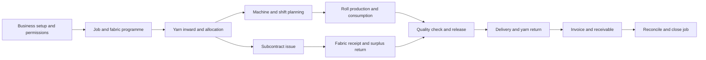

# Industry packs and knitting version one

## Product decision

ERP Workspace remains one general ERP product with a native Flutter interface and the preserved ERPNext and Frappe business backend. Knitting is its first optional industry pack. A knitting business receives the shared accounting, buying, selling, stock and collaboration features plus knitting workspaces. A business without the pack keeps its general ERP experience. Future hospital and publishing packs will follow the same enablement contract, with their own domain models and safety requirements; they are not implemented in this version.

The customer asked for a familiar business workflow, not a copy of Fashion Suite's interface or an ERP replacement inside our ERP. Preserve useful terms such as job, yarn inward, roll, dia, shift and DC. Design task-oriented screens in our charcoal, off-white and peach visual language. Improve the shared screens as well as knitting screens so quality does not stop at the overview.

This is a proposed design for review. Product implementation has not started. The user has requested the feature set and accepted a visual preview; neither the preview nor this document is evidence of implemented knitting behavior. AI remains deferred.

## Evidence and limits

- Baseline: root commit `5b686a9`, `apps/erp_client/`, `apps/erp_extensions/`, and `docs/setup/NATIVE_WORKFLOWS.md`.
- Audit: `docs/research/fashionsuite/2026-11-13/knitpack-functional-specification-and-erp-gap-analysis.docx` and its safe `knitpack-screen-catalogue.json` companion. The audit catalogued 232 menu routes, inspected 227 initial screens, found two unresolved links and deliberately left three action screens unopened.
- Existing evidence records 71 Flutter tests, 38 backend tests and four metadata checks. These prove selected general ERP foundation scenarios, not knitting parity. No tests or builds were rerun merely to write this design.
- Existing general ERP gaps remain tracked. Adding a pack must not relabel POS, reconciliation, specialised fields, custom reports or production packaging as complete.
- The audit does not establish vendor formulas, editable transaction details, backend schemas, API contracts, integration providers or licensing. Implement independently from observed requirements and our licensed source. Preserve notices and keep `upstream/` unchanged.
- Use synthetic fixtures on `native-test.localhost` only. Do not revisit, import from, connect an adapter to, or mutate the customer's live Fashion Suite account. Customer migration requires a separate authorised export or test copy later.

## Architecture choices

Three approaches were considered. Adding knitting fields and screens throughout every ERP flow would entangle future industries. A separate knitting application would duplicate authentication, accounts and stock and give the customer two products to reconcile. Use an optional pack inside this product, sharing the existing server and design system while keeping knitting rules and navigation in bounded modules.

Do not build a generic plugin marketplace or a configurable workflow language. Version one needs a small trusted registry with one implemented pack, `knitting`. Do not create inactive Hospital or Books buttons, fake dashboards or empty scaffolds for unbuilt industries.

### Business setup and login

1. A permitted administrator creates or selects an existing business company.
2. The setup screen shows General ERP as the foundation and offers Knitting as an additional pack. It explains the added workspaces and prerequisites before enabling anything.
3. Setup records company, godowns, fiscal year, units and precision, shifts, machine profiles, operator/checker links, numbering, ownership modes, rates and the selected policies. Settings belong to a company, not one global site switch.
4. The administrator assigns users existing Frappe roles plus knitting action permissions and allowed company/godown scope. Enablement does not grant access automatically.
5. After sign-in, the server returns the permitted companies, enabled packs, effective capabilities, scope, setup state and a configuration revision. The Flutter client shows shared ERP and the allowed industry workspaces.
6. A user with several companies switches context explicitly. Each route and draft remains bound to its originating company. Dirty navigation must be resolved before switching. Clear company-specific lists, selections, metrics and linked-search caches; never silently relabel a draft under another company.
7. Setup that is incomplete opens a checklist with real missing prerequisites. Only valid capabilities become available. Every state is derived from the server.

The server site remains the tenant boundary. Company is a business context within that site, enforced using Frappe document permissions and allowed-company/godown rules. Do not describe company filters alone as tenant isolation. Hosted deployments should use separate Frappe sites for separate customer tenants.

### Access contract

An action is available only when the pack is installed, enabled for the selected company, setup prerequisites are satisfied, the user has the action permission, and every referenced record is in permitted scope. Compute this on the server; the client only presents the result.

Guard pack DocTypes at controller and Frappe permission/query hooks, as well as in dedicated APIs. Apply the same rules to native metadata/catalogue, direct document/list/search, report, attachment, print and lifecycle paths. A deep link, generic native editor or direct Frappe resource call must not bypass pack scope. Core Sales Invoice, Item or Warehouse permissions remain normal for unrelated ERP use; pack-originating documents receive additional validated source/company links rather than globally restricting core documents.

Company setup and roles must be checked again at each mutation, including long-running sessions. Scope caches are keyed by site, account, company and configuration revision. Session recovery refetches context and never automatically retries a write. Quantities or financial values are not optimistically posted.

Industry-specific response models must apply field permissions too. An operator without financial read permission must not receive hidden rates, invoice values or restricted cost/margin fields merely because a knitting endpoint uses a custom DTO. Core field restrictions and masking carry through list summaries, dashboard metrics, reports and exports as well as editors.

Pack states are Setup, Active, Closing and Inactive. Closing blocks new jobs but permits authorised settlement of existing work. Inactive is allowed only after all open obligations are settled; it preserves history, reports and linked invoices for permitted readers. Nothing is deleted by disabling a pack. Reactivation is explicit and audited.

### Organised code boundaries

Build inside the current app and extension:

| Area | Proposed location | Responsibility |
| --- | --- | --- |
| Shared experience | `apps/erp_client/lib/ui/` | Page shell, tokens, controls, data views, states and motion |
| Business context | `apps/erp_client/lib/workspace/` | Company context, pack registry, setup and capability-driven navigation |
| Knitting client | `apps/erp_client/lib/industries/knitting/` | Typed domain models, repository and task screens |
| Server context | `apps/erp_extensions/erp_extensions/workspace/` | Setup/context service and access policy |
| Knitting server | `apps/erp_extensions/erp_extensions/knitting/` | DocTypes, controllers, services, reports and posting adapters |
| Scenario evidence | `docs/coverage/` | Requirement coverage, synthetic fixtures and actual results |

These are proposed boundaries, not directories to populate with unused framework code. Move shared widgets gradually when a real caller uses them. Split the existing large `api.py` only where the new boundaries require it; do not rewrite working core logic during the pack work.

## End to end customer workflow

Payment/collection is an optional next step after invoice posting, not a prerequisite for closing every operational job. Operational completion and financial settlement have separate statuses.

### Job and specification

A job has company, customer/party roles, order reference/date, coordinator, due date, Order or Sample kind, material ownership mode and programme lines. Each line retains a stable identity with fabric variety, colour, GSM values, LL values, gauge, dia/size, knit type, target kg and physical roll/piece count where enabled. LL units remain configurable until confirmed. Keep machine dia, fabric dia and finish dia separate.

Order kind, operational state and billing state are independent. Running/Completed is not a synonym for customer-owned/own-stock. A job supports specification revisions with actor, reason and version. Existing movements keep the revision and source line they were posted against. Rate changes are effective-dated and must not rewrite submitted invoices.

The job detail becomes the main hub: programme, material balances, plan, rolls/QC, subcontract, deliveries, invoices and activity. A visible next action reflects actual eligibility. Do not make users search the entire ERP catalogue for the next step.

Estimation is a knitting-specific view over a draft ERPNext Quotation: specification lines, estimated kg, service/material charge components, rates and totals. It has no stock or GL effects. A permitted user can accept a submitted quotation and create a job from its trusted, version-checked source lines; later changes require a new quotation/job revision. Test quotation-to-job conversion and rejected stale/cross-company sources.

The audited Private Jobs label does not establish special confidentiality behavior. Our version one offers an Order/Sample filtered job view with the same server permissions as other jobs. Any genuinely restricted job uses explicit Frappe document access rules and is tested through every read/report path. Do not invent a separate hidden account system from a menu name.

### Yarn and lycra

Receive yarn with count, variety, colour, mill, lot/source receipt, owner, bags/cones/pieces and kg. Preserve supplier versus customer versus subcontractor and delivery-destination roles through linked existing ERP party/address records. General stock, job allocation and subcontract custody are distinct dimensions. Own and customer lycra have separate inputs and policy limits.

Use standard ERPNext stock and valuation controllers for owned material. Customer-owned material is a non-valued custody balance and must not create a purchase, revenue, expense or asset value simply because it enters our godown. A technical compatibility exercise must verify pinned ERPNext customer-provided-item behavior before choosing its exact receipt/manufacture adapter. If it cannot preserve the required ownership dimensions, the knitting custody ledger is the canonical quantity record for that material; do not force a valued stock receipt to make a generic form convenient.

Each confirmed movement has immutable source references, company, material owner, item/specification, lot, job/programme line, godown/custodian, quantity, physical units, date/time, actor and correction links. Owned-stock movements reference their standard stock vouchers. Do not manually maintain a second editable on-hand total alongside those vouchers.

Support general receipt, job receipt/allocation, transfer in/out, production consumption, return, approved adjustment and subcontract issue/return. Adjustments require reason and permission. Never overwrite a lot or original receipt to implement a transfer.

Yarn Processing is an explicit transformation/repacking event, not a free-form balance edit. It records input lots/cones/kg, output yarn lots/cones/kg, declared process loss and source job; owner and custodian remain explicit. Version one includes repacking and cone changes with the same yarn specification. An optional fabric output must be a linked production event that enters roll identity and QC, not an unexplained reduction of yarn. Input kg equals output yarn kg plus linked fabric kg plus declared loss kg. Owned material uses a verified Stock Entry Repack adapter; customer material uses non-valued custody events. Processing that changes material specification needs a configured conversion rule and separate test before enablement. This is our proposed functional substitute for S021, not a recovered vendor formula.

### Mixed inputs and ownership

Each job/programme has one explicit finished-fabric owner. A customer-material job may consume that customer's yarn/lycra plus company-owned auxiliary material such as lycra. All input allocations preserve their owner and kg; customer input from a different party is blocked. An owned-fabric job cannot consume somebody else's material without an explicit, separately authorised ownership-transfer document.

For customer-owned output, company-owned lycra is consumed through a standard owned-stock issue to the configured cost-of-service account, once. The commercial policy is either included in the knitting rate or billed as a separate material charge. A separate charge uses a non-stock billing item with the consumed source quantity; it must not issue the same physical lycra a second time. The output remains in customer custody, not our valued finished inventory. Policy and output ownership are fixed on the posted production event and cannot be changed retrospectively. Verify GL/stock/custody consequences for both charging policies before enabling mixed input production.

### Machine planning

Machine profiles link to existing Workstations and add dia, gauge, fabric/knit capabilities, feeders, shift availability and a deliberate kg-capacity model. Planner has two views of the same allocations: jobs needing capacity and machine queues. Provide day/shift schedule, planned/unplanned status, 72-hour shortage and 24-hour job-change views.

Use an explicit company/machine working calendar with dated holidays, shutdowns and shifts. Reuse ERPNext Holiday List where its semantics fit, with a tested machine-availability adapter. A holiday blocks capacity rather than merely decorating a calendar.

A planner can split a programme across compatible machines. Queue changes remain local until Review and Apply. The server checks concurrent edits, capability, overlap, remaining quantities and stoppages atomically. Provide keyboard/list alternatives to drag interaction. The first scheduler uses explicit capacity and shifts; no AI or unexplained auto-optimisation.

### Roll production

An operator selects permitted godown, machine, shift and job/programme; compatible context is defaulted from setup. Entry shows remaining programme, yarn allocation and permitted excess before confirmation. Capture timestamp, operator, roll/piece count, actual weight, yarn/lycra consumption, setup fabric or loss where applicable and a reason for exceptions.

Each physical roll receives an immutable identity, programme revision, machine/operator/shift/time links and actual kg. Bulk and multi-size entry create the same records as single-roll entry. Prevent duplicate identities and consumption of unavailable material. Source ownership is explicit; customer and own material cannot be silently merged.

Confirmation posts the production event, stock/custody consequences and roll identities in one transaction. A partial failure creates none of them. Repeated confirmation with the same request identity returns the existing result; the same identity with different payload fails. The client displays a durable receipt/status after an uncertain connection outcome instead of blindly repeating the write.

### Quality

Standard QC and Touch QC use the same inspection model. Touch QC offers large machine/queue cards and roll scan or code lookup, defect choices, weight, remarks and checker. Version one guarantees typed roll-code entry; camera/barcode hardware requires a separate verified device adapter before being advertised.

Roll states are Awaiting QC, Released, On Hold, Rework and Rejected with a recorded inspection history. Rework produces a linked event rather than erasing an earlier failure. Delivery of uninspected/held/rejected rolls is blocked by the proposed default policy. A permitted exception, if configured, requires explicit review and reason. This policy is our proposed rule, not a claim about Fashion Suite.

### Delivery returns and billing

Delivery selects released rolls or a permitted programme-based quantity and retains job, programme line, owner, fabric, dia/size and original roll/lot references. A full-roll delivery is the default. Splitting a physical roll requires an explicit child-roll split event and conserved kg; silently editing its original weight is prohibited.

Yarn return, dia transfer and job/party transfer are separate traced events with from/to dimensions and conservation checks. Fabric Delivery Against Stock versus Program is a company policy. Programme-based exceptions still need explicit quantity and ownership controls; they cannot create fictitious available rolls.

Billing has at least two tested modes: knitting service on customer material, and sale of owned fabric. Bill only eligible unbilled source quantities. A service invoice charges the configured service item/rate without selling the customer's yarn or posting fabric stock a second time. Owned-fabric sale uses standard delivery/invoice stock semantics. Every invoice line maps to source delivery/programme references and preserves partial billing and credit-note behavior.

Preview totals through existing ERPNext calculators and post through their controllers. Money, tax, receivable and valuation logic stays on the server. Knitting rates support Fabric Only and Fabric plus Yarn Count plus Gauge. Preserve configured sales/service numbering, company sequences and fiscal-year boundaries. Tax/provider rules require separate verification; a synthetic zero-tax test is not a tax configuration recommendation.

### Subcontracting

Support SC order, yarn issue/DC, fabric receipt, surplus yarn return, adjustment, bill and closure. Keep original customer job, subcontract job, owner, lot and custodian links throughout. Fabric received enters the applicable roll/QC flow. Quantities at the subcontractor reconcile independently of our godown. Standard subcontract/purchase documents remain the financial and owned-stock starting points, with explicit knitting adapters rather than duplicated payable logic.

### Maintenance inventory and margin

Record machine stoppage by type, date/time, godown and shift. Needle, sinker, cylinder and dial components carry boundary/run/remaining kg, issue and replacement events. Their measured life is kilograms unless a later confirmed machine rule introduces another unit. Reset/replacement never silently erases history.

Track consumable issue and return by department/employee/machine/job. Margin views identify configured cost inputs and allocation basis, with source drilldown. Do not publish a profit number from invented allocation assumptions. Needle breakage reports support overall, employee, dia, job, machine, gauge, party and fabric-variety grouping.

### Reconciliation and closure

Before operational closure show programme balance, remaining yarn, physical rolls, subcontract custody, pending deliveries, unbilled quantities and unresolved exceptions. Completion and billing thresholds are distinct company policies. Auto-complete starts disabled until its rule is selected and tested. Reopening requires permission, reason and stale-version protection.

Cancelling a downstream invoice, delivery or movement respects the dependency chain, reverses its posted effects exactly once and recomputes eligibility. Never delete submitted history. A job may be operationally complete while a legitimate receivable remains outstanding.

## Data and posting boundaries

The exact number of DocTypes is a builder decision. Retain these records and invariants without creating a new table for every visible screen:

| Record family | Required persistent information | Shared ERP relationship |
| --- | --- | --- |
| Business industry setup | Company, pack state, setup revision, policies and effective versions | Company, roles and user permissions |
| Knitting job and lines | Identity, party roles, specification revisions, target quantities and rates | Sales/order references where applicable |
| Machine and plan | Capabilities, shifts, queue/allocation revisions | Workstation and employee links |
| Material movement | Ownership/custody/lot/job quantities and canonical source vouchers | Stock Entry/receipt/return adapters for owned stock |
| Production and rolls | Immutable roll identity, kg, consumption and machine context | Manufacturing/stock adapters where applicable |
| QC and defects | Checker, inspection history, defects and release state | Quality Inspection where semantics agree |
| Delivery and billing source | Roll/programme quantities, ownership and unbilled references | Delivery Note and Sales Invoice with tested mode adapters |
| Subcontract chain | SC/order/job, original ownership and custody references | Subcontract/purchase controllers |
| Stoppage and component use | Duration, reason, usage kg, issue/replacement | Stock issue and maintenance references |
| Integration and migration mapping | Source IDs, jobs, provider request identity and reconciled status | Existing ERP integration hooks and import services |

Use database precision appropriate to kg and money, explicit Decimal arithmetic for domain checks, and one rounding boundary at configured display/posting precision. JSON quantities cross the new knitting API as canonical decimal strings; Flutter must not calculate authoritative totals with binary doubles. Physical counts are integers except explicitly configured split units. Preserve original source precision in history.

All mutating operations check request identity, expected source versions, pack state, permission and company/owner/godown compatibility inside the transaction. Lock the affected balance/source rows in a consistent order before consuming or delivering. Unique database constraints back up roll identities and request identities. No manual commit in a partially complete domain action and no external provider call inside a transaction assumed to be reversible.

Use a fixed action registry under the extension, not arbitrary method paths from Dart. Generic pack document saves cannot invoke posting consequences implicitly; explicit confirmed submit/cancel commands and controllers own those effects. Submitted core invoices with knitting source references validate those references even when edited through another client.

## Reports prints and integrations

All report families in the audit remain in scope. `docs/coverage/knitting-scope.json` maps every observed menu route to a work package, without pretending 232 routes need 232 new screens. Duplicate/alias menu entries may lead to one shared report with named variants.

Required views include job ledger with/without SC, transaction history, yarn/cloth statement, programme balance, job/general/SC/total yarn, roll/fabric stock, planning and shortage, production by date/shift/machine/operator/hour, QC, needle/sinker, stoppage, margin, invoice registers, collections and outstanding. Distinguish as-of stock from period movement. Every total drills down to its source or identifies why the account cannot read it; exports obey export permission.

Provide original print layouts for job ledger, receipt/programme, fabric DC, yarn return, invoice, SC movements and roll labels. Match business information, units, totals and customer-approved sample arrangements; use our own brand and assets. Preserve fiscal and roll-label token meanings through a tested mapping, without executing arbitrary template code from a user.

GST report/download, Tally export, E-Invoice, E-Way Bill and payment gateway are integration requirements, not working connections discovered by seeing a menu. Implement only known provider contracts and verified active customer formats. Provider calls are isolated and idempotent with pending/succeeded/failed/reconcile states. Use provider test environments or local contract fixtures; never submit real tax documents, send email, charge an account or manufacture a successful status. An integration without a configured provider is labelled Not configured and blocks only the operation that requires it.

No customer migration is performed in this increment. Design and test migration with synthetic data: companies, godowns, parties, users, machines, specs, lots, active programmes, custody, rolls/QC, SC balances, open invoices, usage counters, numbering and policies. A later authorised migration needs an immutable source crosswalk, trial import, report reconciliation, backup/restore and cutover approval.

### Release scope for unknown source behavior

The source catalogue is an audit inventory, not an instruction to clone every vendor action. Every route has an explicit disposition in `knitting-scope.json`: independent functional requirement, reuse shared ERP, safe correction instead of destructive action, independent substitute for an unresolved screen, or optional external requirement.

S223 Masters Config is satisfied by our reviewed company/master setup and scoped configuration, not a guessed vendor screen. S227 Holiday is satisfied by the working-calendar behavior above. S018 Job Delete and S048 Roll Edit and Delete are replaced by reviewed cancellation/correction with history. These substitutes must pass their own acceptance cases.

S044 Automation test is an optional hardware requirement: no device/protocol was observed or supplied, so version one does not expose a fake hardware control. Device-specific automation is outside the initial release gate until hardware and a protocol are provided. This explicit proposal requires product approval as part of this design.

GST reports/downloads and Tally export remain version-one deliverables with a documented target schema and golden-file tests. Exact customer export parity requires approved samples; it is a customer-pilot gate. Live E-Invoice, E-Way Bill and payment gateway connections are conditional on a configured verified provider contract. Release may keep them Not configured with no success claim; a customer who requires them cannot enter a replacement pilot until those specific paths pass provider tests. Core knitting completion must not depend on obtaining arbitrary unknown vendor integrations, and it must not silently call them implemented.

## Whole application UI and UX

The detailed screen, component and motion contract is `docs/design/WORKSPACE_EXPERIENCE.md`. It applies to General ERP and the knitting pack. Reusing colours alone is not UI consistency.

The design preview contains synthetic examples and local presentation interactions only. It must display Design preview and Sample data plainly. It does not sign in, save records, call an ERP API, send requests to Fashion Suite or stand in for the Flutter product.

The durable preview source is `docs/design/previews/knitting-concept.html`; local fonts and illustrations resolve from the existing Flutter assets. It contains no backend requests. A browser session can present it for review, and the job-detail image records the current screen direction. Preview interaction/layout evidence is kept separately from product verification.

Build the shared design components first, then retrofit sign-in, overview, module picker, catalogue/list, native form/child rows, reports, hierarchy, activity/files, settings and session/error dialogs. Knitting gets task-specific layouts made from the same controls. Avoid forcing a machine planner and a dense accounting register into identical card grids.

## Delivery order and exit gates

| Stage | Concrete result | Exit evidence |
| --- | --- | --- |
| 0 Design and coverage | This design, connected visual preview, all 232 source routes mapped and synthetic acceptance fixtures | Builder review and product-design approval |
| 1 Shared experience and context | App-wide components and motion, company/pack setup and role-aware navigation | General ERP still works with no pack; server denial tests across all access paths; UI matrix |
| 2 Stock and accounting compatibility | Tested customer-custody and owned-manufacturing adapters with canonical ledgers | Balanced own-stock/GL and non-valued custody fixtures; no double posting |
| 3 Complete first job cycle | Job, inward, production, QC, delivery, return, service/owned invoice and closure | Repeatable real-database cycle, native Mac walkthrough and source-linked reports |
| 4 Factory completeness | Planning, SC, maintenance, bulk/multi-size variants and exceptions | Queues/custody/counters reconcile; cancellation, concurrency and partial-flow tests |
| 5 Reports and integrations | Required register/print variants, configured export/provider paths | Deterministic reports/PDF/exports and safe provider contract tests |
| 6 Release and pilot | Target-platform builds, installer/backend handling, backup/restore and synthetic migration rehearsal | Reconciled pilot dataset, no known blocking defects and explicit remaining external checks |

This sequence does not postpone factory requirements indefinitely. Version one is complete only when required rows in the coverage ledger and acceptance matrix are verified. The first job cycle is a milestone, not a claim that the entire industry pack is done.

## Verification contract

Use `docs/coverage/knitting-acceptance.md` for exact fixture arithmetic and the acceptance matrix. Prove the normal cycle and rejection/recovery behavior, not only that screens render. Keep requirements marked Planned, Implemented, Automated verified and Native verified separately. Record actual test run, site, app revision, fixture, assertions, screenshot/build reference and known limits.

Run existing tests as regression gates after shared changes, plus new server, Dart contract and meaningful widget tests. Use real Frappe/MariaDB for stock, GL, transactional rollback, uniqueness and concurrent consumption. Use native Mac UI for the connected operator cycle. Verify empty/loading/error/permission states and narrow layouts, not only successful populated screenshots.

The current local verification site is `native-test.localhost`, gateway `http://localhost:8081`, using explicit Docker context `colima-erp`. Existing evaluation site `frontend` at port 8080 and all database volumes are preserved. Test setup must refuse a different site. Live customer URLs and credentials never enter runtime configuration, fixtures, logs or source.

Windows needs a Windows host; iOS/Android device behavior and distribution signing need actual devices/accounts. Simulator/APK builds are compilation evidence only. No blanket error-free promise: release requires no known blocking defects in the defined scope, recorded test results and clear external checks.

## Builder decisions and review

Builder proposals in this document include company-level enablement, capability/action checks, the first scheduler, roll split policy, QC default hold, decimal-string transport, the proposed screen arrangement and the delivery order. They are not recorded as customer-confirmed Fashion Suite rules.

Customer-specific formulas, active integration providers and exact migration balances remain unverified. Build selectable, versioned policies and synthetic acceptance cases; do not infer these values from the production account. The mixed-input charging model, estimation, processing and unknown-route dispositions above are explicit builder proposals for product approval. A real customer pilot cannot be certified until the required policies and formats are confirmed against an authorised test copy or signed examples.

Independent builder check completed on 13 November 2026. The review raised unknown-route release scope, mixed-material ownership/billing, and estimation/processing/private-job semantics. These were resolved as explicit proposals in this design and acceptance cases A25 to A28; the follow-up review reported nothing important left. Product design approval: pending.
